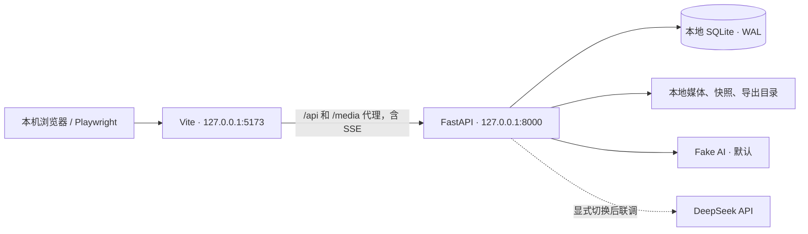

# 英语师范生 AI 协作教学资源制作系统
## 项目开发文档 v1.1 · 本地开发与测试版

> 更新日期：2026-09-22。本文档根据《9.21 数据采集设计文档.md》整理，当前用于单台 Windows 电脑上的开发、联调和验收。源设计定义的功能、事件及研究边界保持为产品依据；局域网部署和课堂容量验证安排在后续独立阶段。本文件中的目录、脚本和命令是待实现的开发契约，并不代表项目代码已经完成。

## 1. 项目目标与边界

### 1.1 产品目标

系统最终服务于线下英语师范生课堂任务。当前先在一台开发电脑上，通过本机浏览器完成“阅读任务要求 → 与 AI 协作 → 编写并运行单文件 HTML 游戏 → 反复检查和修改 → 提交作品”的全过程，本机 FastAPI 保存操作事件、对话、代码版本、计划文本、预览运行结果和提交快照。

当前交付目标是：功能在本机跑通，单元测试和集成测试可重复执行，并能从本地 SQLite 和快照目录核对每个模拟会话的事件及作品版本。系统不计算元认知得分、不推荐策略、不弹出干预提示。本地验收通过后再进入部署优化，不以当前结果推断真实课堂性能。

### 1.2 本期范围

- 任务页：任务目标、硬约束、示例视频、服务端校准时间、只读座位号。
- 工作区：AI 对话、文件附件、HTML 编辑器、手动运行预览、运行控制台、计划侧栏、提交作品。
- 过程保活：任务页和工作区往返时不销毁工作台状态，不意外重载 iframe。
- 数据采集：设计文档中定义的学生行为事件和系统结果事件，包含通用字段及专属字段。
- 作品归档：编辑器自动落库、代码不可变快照、计划版本、每次成功提交的独立快照。
- 本地运行：一台电脑运行前端、后端和数据库，以 1 个会话完成主流程，以 2–3 个隔离浏览器上下文验证数据隔离。
- 本地导出：按任务、会话、参与者和提交批次导出 JSONL/CSV/HTML 快照包，供开发者核对采集结果。

### 1.3 明确不做

- 不做实时元认知识别、评分、干预或学生画像。
- 不做多文件项目编辑；本期作品为一个可离线运行的 HTML 文件，CSS、JavaScript 和可用资源内嵌其中。
- 不让 AI 回复自动替换编辑器代码；学生必须自行复制、粘贴和修改。
- 不把鼠标移动、触摸移动、播放器暂停/拖动/全屏等高频原生事件写入行为库。
- 默认使用可控 fake AI，不要求配置真实 API 密钥；真实 DeepSeek 联调通过本机后端调用，密钥不下发浏览器。
- 不把失败的上传、AI 回复、预览和提交结果冒充学生行为计数。
- 当前不实施局域网 IP/防火墙配置、教师主控部署、20 台设备容量压测、希沃真机验收和课堂运维；后续事项见第 14 节。

### 1.4 工程实现约定

源设计没有规定身份入口、任务内容管理后台和导出界面。本项目采用以下默认决策，若后续研究方案改变，应先修改本文件和接口契约，再改代码：

1. **身份入口**：本地 seed 脚本生成 01–03 三个模拟座位及随机测试令牌，输出 `http://127.0.0.1:5173/enter?seat=01&token=...`。继续走真实 bootstrap/JWT/会话鉴权，不硬编码一个共享学生身份。教师发放令牌的界面后置。
2. **任务配置**：本期不做教师后台；配置中提供 `task-test`、一段本地示例视频和固定任务版本，每轮测试开始时锁定 `task_content_version`。
3. **事件传输**：浏览器优先批量发送事件；网络短暂中断时进入本地 outbox，恢复后按原 `occurred_at` 和客户端顺序补写。服务器以 `event_id` 幂等去重。
4. **代码持久化**：编辑器变更进入内存和本地草稿；800ms 防抖写入 IndexedDB，后台每 5 秒保存一次有变化的恢复检查点。运行、提交、离开工作台和结束会话强制 flush。检查点保存不生成 `code_edited`，不刷新预览；合并编辑事件仍按源设计边界产生。异常退出最多只能保证恢复已持久化内容，不能承诺恢复尚在内存的按键。
5. **时钟**：服务器返回 `server_now`，前端计算 `clock_offset_ms` 作为显示和 `occurred_at` 校准依据；服务器 `recorded_at` 永远由服务器生成。
6. **本地基线**：单个 FastAPI worker、单个 SQLite 文件、1 个主流程会话，2–3 个独立上下文验证隔离；AI 全局并发默认 2、每会话最多 1 个在途请求。20 台课堂目标留待部署阶段实测。
7. **环境隔离**：手工调试写 `data/local/`，自动测试每次创建独立临时目录；不得连接手工库或未来正式库。fake 模式在依赖安装完成后可完全离线运行。

### 1.5 本轮交付物

- 可以按第 13 节启动的本地应用、种子数据和环境配置样例。
- 可重复执行的单元测试、集成测试、Playwright E2E，以及本地人工评测记录。
- 本地导出样例和数据质量报告，能追溯到测试用例、会话和代码版本。
- 未勾选的开发清单；每项仅在对应本地实现与验收均通过后勾选。部署清单独立维护。

## 2. 需求解读与关键验收原则

### 2.1 数据采集原则

- 事件是可观测事实，不是研究结论。同一事件能否支持 Planning、Monitoring 或 Evaluating，需要课后结合上下文分析。
- 行为事件和系统结果事件必须分开。学生点击“运行”记录 `preview_run`，系统发现报错记录 `preview_error_detected`，不能合并成一个“运行失败行为”。
- 连续输入采用“暂存 + 边界合并”。`planner_edited`、`ai_request_edited`、`code_edited` 不逐字上报；必须在收起、运行、发送、提交、离开或结束等边界形成一条带差分的事件。
- 每条事件既有客户端发生时间，也有服务器接收时间和会话内序号，支持处理延迟、重试和同一毫秒内的操作。
- 所有成功提交都留档。学生继续修改不会改变已经提交的快照；没有点击提交时，结束会话仍保存最后一次自动落库内容。

### 2.2 用户可感知的关键行为

1. 首次打开进入任务页，点击示例卡片在同页弹层播放，关闭时保留播放位置。
2. 点击“去工作区”后进入三区工作台；从工作台返回任务页时工作台保活。
3. 点击“运行”才应用代码到预览；编辑、粘贴、收到 AI 回复均不会自动刷新预览。
4. 预览报错只显示原始控制台信息，不自动解释或一键修复。
5. 计划侧栏覆盖预览但不卸载 iframe，展开和收起不触发重新运行。
6. 提交需要二次确认，提交中不锁定编辑工作，成功或失败后都可以继续制作并再次提交。

### 2.3 必须保持的关系

- `task_started` 是每个会话的第一条业务事件，`task_ended` 至少出现一次；异常关闭时由服务端超时收尾任务补写。
- 首次任务页用 `task_viewed`，从工作台返回用 `task_revisited`；每次离开任务页都产生 `workbench_entered`。
- `example_opened` 与 `example_closed` 按 `example_id` 配对；关闭时记录播放位置和实际观看秒数。
- `preview_run`、`preview_ready`、`preview_error_detected` 通过 `run_id` 关联。
- `submit_confirmed`、`submit_succeeded`、`submit_failed` 通过 `submission_id` 关联；成功提交必须有 `snapshot_id`。
- `code_pasted` 与 `code_edited` 不能混为同一事件；粘贴可以随后触发一次合并的人工编辑事件。

## 3. 推荐总体架构

### 3.1 本地运行拓扑



### 3.2 分层设计

#### 前端层（Vue 3 + TypeScript）

- `router`：任务页、工作区和错误页；使用 `KeepAlive` 或单一壳组件切换，保证工作台不销毁。
- `stores/session`：JWT、座位号、参与者、会话、服务端时钟偏移、连接状态。
- `stores/task`：任务内容版本、示例列表、播放器状态、任务页计时。
- `stores/workbench`：当前页面、AI 请求状态、附件、代码、计划、预览和提交状态。
- `services/api`：REST、SSE、上传、重试和统一错误模型。
- `services/event-collector`：动作识别、合并窗口、事件 outbox、批量发送和幂等重试。
- `components`：任务页、视频弹层、AI 对话、附件列表、代码编辑器、预览 iframe、控制台、计划侧栏、提交弹窗。

#### 后端层（FastAPI）

- `api`：鉴权、任务、会话、上传、对话、代码、计划、预览、提交、事件和导出路由。
- `domain`：会话、附件、请求、代码 revision、运行、计划 revision、提交状态机。
- `services`：事件写入、AI 适配器、文件校验、快照、时间校准、导出和恢复。
- `repositories`：SQLite 事务和查询；禁止路由函数直接拼 SQL。
- `workers`：AI 流式响应、附件处理、会话超时收尾；本期使用进程内受控任务，不引入 Redis/Celery。
- `config`：环境变量、任务配置、文件类型/大小、AI provider、测试故障场景和超时参数。

#### 持久化层

- SQLite：结构化业务数据和事件元数据。
- 文件系统：原始附件、任务视频、代码快照、提交清单和导出包。
- 事件表只追加不更新；修正通过补偿事件或数据清洗脚本完成，保留原记录。

### 3.3 建议项目目录

```text
project/
├─ backend/
│  ├─ app/
│  │  ├─ main.py
│  │  ├─ api/                 # 路由与依赖注入
│  │  ├─ domain/              # Pydantic DTO、状态机、枚举
│  │  ├─ services/            # 业务服务
│  │  ├─ repositories/        # SQLite 读写
│  │  ├─ workers/             # 流式 AI、收尾任务
│  │  └─ settings.py
│  ├─ migrations/
│  ├─ tests/unit/
│  └─ tests/integration/
├─ frontend/
│  ├─ src/
│  │  ├─ views/               # TaskView、WorkbenchView
│  │  ├─ components/
│  │  ├─ stores/
│  │  ├─ services/
│  │  ├─ composables/
│  │  └─ types/
│  └─ tests/
├─ config/
│  ├─ tasks/task-test.json
│  └─ examples/
├─ data/local/                # 手工调试数据，不提交源码仓库
│  ├─ app.db
│  ├─ attachments/
│  ├─ code-snapshots/
│  ├─ submissions/
│  ├─ exports/
│  └─ backups/
├─ tests/fixtures/            # 本地视频、附件、HTML、AI 固定回复
├─ scripts/                   # local_init、seed_local、export_session、validate_export、backup_local、restore_local
├─ artifacts/                 # 测试报告、trace、日志，不提交源码仓库
├─ docs/acceptance/            # 已完成验收的记录
├─ .env.local.example
└─ README.md
```

### 3.4 核心工程原则

- 所有写操作采用显式事务，事件和对应业务状态变更尽量在同一事务中提交。
- 事件接收接口采用客户端 `event_id` 幂等；重复请求返回 `accepted_duplicate`，不重复插入。
- 代码、计划和提交使用 revision/snapshot，不以“当前字段覆盖历史”替代版本。
- 浏览器只能拿到短期 JWT 和必要的匿名标识；AI key、数据库路径、文件系统路径不下发。
- 后端返回统一错误结构：`code`、`message`、`retryable`、`request_id`。
- 所有时间统一存 UTC ISO-8601，展示时转课堂时区 `Asia/Shanghai`。
- 服务器启动、关闭、磁盘不足、AI 不可用、数据库异常必须写结构化日志，但日志中不重复打印完整学生作品和 API 密钥。

### 3.5 本地开发选型和接口保留

- 保留 Vue 3、TypeScript、Vuetify、Pinia、FastAPI、Pydantic、httpx、SQLite；本地优先选择 CodeMirror 6 实现单文件编辑。最终版本写入锁文件。
- 先以 `AIProvider` 接口实现 fake 和 DeepSeek adapter；LangChain/LangGraph 的智能体编排不作为本地采集闭环的前置依赖。
- 前端接口全部使用相对地址 `/api/v1` 和 `/media`。通过 Vite 代理转发，统一使用 `127.0.0.1`，避免混用 `localhost` 造成 JWT/IndexedDB 存储与来源差异。
- Vite 和 FastAPI 均仅绑定回环地址。当前不用 Docker、反向代理、公网域名或外部数据库；未来部署通过配置替换入口地址和数据根目录。
- 任务视频、字体、编辑器和脚本来自本地资源；fake 模式下浏览器不需要访问 CDN。

## 4. 领域模型与状态机

### 4.1 会话状态

```text
CREATED -> ACTIVE -> ENDING -> ENDED
                 \-> EXPIRED -> ENDED
```

- `CREATED`：座位令牌校验通过但尚未完成页面初始化。
- `ACTIVE`：允许事件、上传、对话、运行和提交。
- `ENDING`：收到结束请求或页面关闭收尾，先 flush 草稿再封存。
- `ENDED`：拒绝新的业务操作，允许查询、导出和经过身份/结束时间校验的历史事件补传；补传不得重新激活会话。
- `EXPIRED`：超过可配置空闲时长（默认 30 分钟）且无心跳，服务端补写 `task_ended(end_reason=timeout)`。

### 4.2 附件状态

```text
SELECTED -> UPLOADING -> PROCESSING -> READY
                         \-> FAILED -> RETRYING -> ...
SELECTED/READY/FAILED -> REMOVED
```

只有 `READY` 附件能出现在 `ai_request_sent.attachment_ids`。选择、移除不产生独立行为事件；处理完成产生 `file_attached`，失败产生 `attachment_failed`。

### 4.3 AI 请求状态

```text
DRAFT -> SENT -> STREAMING -> SUCCEEDED
                         \-> FAILED -> RETRYING -> SENT
```

同一会话同时最多一个 `SENT/STREAMING` 请求。失败重试创建新的 `request_id`，并在 `retry_of_request_id` 记录原请求。

### 4.4 代码、运行和提交状态

- 编辑器有单调递增 `code_revision`；每次编辑器快照写入 `code_revisions`。
- 点击运行时先分配 `run_id` 并冻结编辑器当前内容，再保存快照；保存失败也能关联本次尝试，但不加载新 iframe。失败时 `code_snapshot_ref` 可空，`save_status=failed`，错误只记录真实的保存结果。
- 每次运行都重建 iframe，运行编号独立；展开计划、返回任务页不重建 iframe。
- 提交确认时冻结编辑器和计划的当前内容，同时分配 `submission_id`、`snapshot_id`；成功或失败都沿用这两个编号，不能到成功时才生成提交编号。

## 5. 数据库与文件存储设计

### 5.1 通用字段与约束

所有业务表使用 `id`（UUID 字符串）作为主键，`created_at`、`updated_at` 使用 UTC。外键开启 `PRAGMA foreign_keys=ON`，数据库启用 WAL、忙等待和定期 checkpoint。

事件表额外约束：

- `UNIQUE(event_id)`；客户端重试不得重复插入。
- `UNIQUE(session_id, sequence_no)`；序号由服务器事务分配，表示持久化顺序。另存客户端 `client_sequence_no` 为传输元数据，用于识别补传前的动作顺序；不得把接收顺序直接当成发生顺序。
- `CHECK(actor IN ('student','system'))`。
- `event_payload` 使用 JSON 文本，写入前用 Pydantic 按事件类型校验。

### 5.2 核心表

| 表 | 关键字段 | 作用 |
|---|---|---|
| `task_configs` | `task_id`、`version`、`content_json`、`status` | 锁定任务说明、硬约束和示例引用 |
| `sessions` | `session_id`、`participant_id`、`seat_no`、`task_id`、`status`、`started_at`、`ended_at`、`last_seen_at` | 会话和匿名身份 |
| `events` | 通用字段、`payload_json`、`client_event_id` | 全量不可变事件流 |
| `attachments` | `attachment_id`、`session_id`、`file_name`、`mime`、`size`、`sha256`、`status`、`storage_ref` | 上传文件和处理状态 |
| `ai_requests` | `request_id`、`session_id`、`draft_id`、`message_text`、`status`、`retry_of` | AI 请求生命周期 |
| `ai_responses` | `response_id`、`request_id`、`model_name`、`response_text`、`status` | 完整 AI 回复 |
| `code_revisions` | `revision_id`、`session_id`、`revision_no`、`content_ref`、`content_sha256`、`source` | 代码历史和当前指针 |
| `planner_revisions` | `revision_id`、`session_id`、`revision_no`、`content`、`content_sha256` | 计划历史 |
| `preview_runs` | `run_id`、`session_id`、`revision_id`、`status`、`started_at`、`ready_at` | 运行尝试及结果索引 |
| `submissions` | `submission_id`、`session_id`、`code_revision_id`、`plan_revision_id`、`snapshot_id`、`status` | 每次提交的状态 |
| `snapshots` | `snapshot_id`、`session_id`、`code_ref`、`plan_ref`、`manifest_ref`、`sha256` | 可复现作品包 |
| 浏览器 `outbox_events` | `client_event_id`、`payload_json`、`status`、`retry_count` | IndexedDB 对象存储，不是 SQLite 表；保存尚未确认的客户端事件 |

事件 `payload_json` 必须严格遵守源设计文档 4.3 中的事件专属字段。敏感和体积较大的正文可以放在对应表/文件中，事件只保存稳定引用（例如 `response_id`、`code_snapshot_ref`），但导出时必须能完整展开。

### 5.3 文件目录与不可变快照

```text
data/local/
├─ attachments/{session_id}/{attachment_id}_{safe_name}
├─ code-snapshots/{session_id}/{revision_id}.html
├─ planner-snapshots/{session_id}/{revision_id}.txt
├─ submissions/{session_id}/{submission_id}/
│  ├─ index.html
│  ├─ plan.txt
│  ├─ manifest.json
│  └─ checksums.sha256
└─ exports/{export_id}.zip
```

写入采用临时文件 + `fsync` + 原子重命名；数据库只在文件落盘成功后写 `content_ref`。磁盘空间不足时保留编辑器内存、返回可重试错误，并记录 `submit_failed` 或相应系统错误，不得写入半个快照。

### 5.4 事件契约注册表

以下表是前后端共同使用的事件注册表。事件名、actor、触发边界和专属字段均为稳定契约；新增事件必须先更新源设计和本表。除专属字段外，每条事件都必须包含 `event_id`、`event_name`、`actor`、`participant_id`、`session_id`、`task_id`、`seat_no`、`occurred_at`、`recorded_at` 和服务端 `sequence_no`。

| Event_Name | Actor | 触发/落库边界 | 专属字段（必须按 schema 校验） |
|---|---|---|---|
| `task_started` | student | 页面建立会话 | `entry_page` |
| `task_viewed` | student | 首次任务页完成呈现 | `task_content_version` |
| `example_opened` | student | 点击视频卡片、弹层打开 | `example_id` |
| `task_revisited` | student | 从工作台返回任务页 | `from_page` |
| `example_closed` | student | 关闭弹层或导航导致关闭 | `example_id`、`last_position_sec`、`watched_seconds`、`close_reason(manual/navigate/end)` |
| `workbench_entered` | student | 从任务页进入工作区 | `entry_source(first/return)` |
| `planner_opened` | student | 侧栏从收起变为展开 | 无 |
| `planner_edited` | student | 收起、离开、提交或结束时合并本轮修改 | `edit_changes[]`（`operation/inserted_text/deleted_text/edit_range`）、`content_length_after`、`base_plan_revision`、`plan_revision`、`edit_started_at`、`last_edit_at`、`flush_reason` |
| `file_attached` | student | 上传/处理成功进入 READY | `attachment_id`、`file_name`、`file_type`、`file_size` |
| `attachment_failed` | system | 上传或处理失败并显示失败状态 | `attachment_id`、`failure_stage`、`error_type`、`error_message` |
| `ai_request_edited` | student | 发送、离开或结束时合并未发送草稿 | `draft_id`、`edit_changes[]`（`operation/inserted_text/deleted_text/edit_range`）、`content_length_after`、`edit_started_at`、`last_edit_at`、`flush_reason` |
| `ai_request_sent` | student | 点击发送，文字和 READY 附件提交 | `request_id`、`draft_id`、`message_text`、`attachment_ids[]`、`retry_of_request_id`（可空） |
| `ai_response_received` | system | AI 流式输出完整结束 | `request_id`、`response_id`、`response_text`、`model_name`、`response_status` |
| `ai_response_failed` | system | AI 请求/回复失败且界面显示失败 | `request_id`、`failure_stage`、`error_type`、`error_message`、`retryable` |
| `ai_response_copied` | student | 从回复区复制文本或代码 | `response_id`、`content_type(text/code)` |
| `code_pasted` | student | 编辑器粘贴回调完成 | `pasted_text`、`paste_source(AI response/other)`、`source_response_id`（可空）、`edit_range`、`code_revision` |
| `code_edited` | student | 运行、提交、离开或结束时合并非粘贴修改 | `edit_changes[]`（`operation/inserted_text/deleted_text/edit_range`）、`content_length_after`、`base_code_revision`、`code_revision`、`edit_started_at`、`last_edit_at`、`flush_reason` |
| `preview_run` | student | 点击运行并产生保存/运行尝试 | `run_id`、`code_revision`、`code_snapshot_ref`、`save_status` |
| `preview_ready` | system | iframe 成功加载并可交互 | `run_id` |
| `preview_error_detected` | system | 加载或交互中捕获错误 | `run_id`、`error_id`、`error_phase(load/interaction)`、`error_type`、`error_message`、`line`、`column`、`stack`（可空） |
| `preview_error_copied` | student | 从控制台复制错误 | `error_id` |
| `preview_interacted` | student | 完成一个定义好的游戏操作 | `run_id`、`interaction_type`、`target`、`outcome`（可空） |
| `window_left` | student | 页面确认不可见 | `leave_reason` |
| `window_returned` | student | 页面确认重新可见 | `return_reason` |
| `submit_dialog_opened` | student | 提交确认框打开 | 无 |
| `submit_confirmed` | student | 点击确认，进入提交中 | `submission_id`、`code_revision`、`plan_revision`、`snapshot_id` |
| `submit_cancelled` | student | 点击取消 | 无 |
| `submit_succeeded` | system | 快照和数据库保存完成 | `submission_id`、`snapshot_id` |
| `submit_failed` | system | 保存未完成并显示失败 | `submission_id`、`error_type`、`error_message`、`retryable` |
| `task_ended` | system/student | 主动结束、关闭或教师收尾 | `end_reason` |

实现时将 `task_ended` 的 actor 设为产生结束动作的一方：学生主动点击结束/调用 session end 使用 `student`，超时收尾或教师结束使用 `system`。`preview_run` 记录发起尝试，`preview_error_detected` 记录系统结果；二者不得合并。`code_pasted` 和 `code_edited` 同样保持分离。

## 6. API 契约（MVP）

### 6.1 接口约定

- 前缀：`/api/v1`。
- JWT 放在 `Authorization: Bearer <token>`；所有接口校验 `session_id` 与令牌绑定的 `participant_id/seat_no`。
- JSON 接口返回 `request_id`；错误格式为 `{code, message, retryable, request_id}`。
- 写接口支持 `Idempotency-Key`，特别是事件批量、提交和 AI 重试。
- SSE 仅用于 AI 流式正文；断开后客户端显示已收到片段并允许重试，不自动重复发送。当前使用支持 Authorization 请求头的 fetch 流式读取，避免原生 EventSource 无法直接设置 Bearer header 的差异。

### 6.2 启动与会话

| 方法 | 路径 | 说明 |
|---|---|---|
| `POST` | `/session/bootstrap` | 校验座位令牌，返回短期 JWT、`session_id`、匿名 `participant_id`、座位号、任务版本、`server_now` 和时钟配置 |
| `GET` | `/session/me` | 恢复页面或刷新后获取会话状态、当前 revision 指针、未完成请求和附件 |
| `POST` | `/session/heartbeat` | 更新 `last_seen_at`；不产生学生行为事件 |
| `POST` | `/session/end` | 前端先提交可发送草稿和事件；后端保存已收到内容、写 `task_ended` 并结束会话，不能读取浏览器中尚未传输的内容 |

### 6.3 任务与媒体

| 方法 | 路径 | 说明 |
|---|---|---|
| `GET` | `/tasks/{task_id}` | 返回指定锁定版本的任务内容和硬约束 |
| `GET` | `/tasks/{task_id}/examples` | 返回视频卡片元数据、时长、封面和本机相对媒体 URL |
| `GET` | `/media/examples/{example_id}` | 流式返回视频，支持 Range；失败时前端显示重试 |

### 6.4 事件

`POST /events/batch` 请求：

```json
{
  "session_id": "...",
  "events": [
    {
      "event_id": "client-uuid",
      "event_name": "code_edited",
      "actor": "student",
      "occurred_at": "2026-09-21T06:23:11.123Z",
      "client_sequence_no": 42,
      "payload": {}
    }
  ]
}
```

响应必须逐条返回 `accepted`、`accepted_duplicate` 或 `rejected` 及原因。服务器为接收的事件分配 `sequence_no`，记录 `recorded_at` 和客户端序号。如果一批中部分事件失败，成功部分不回滚；临时故障项退避重试，永久 schema 拒绝项保留到失败队列，不能不断重发。

### 6.5 编辑器、计划和预览

| 方法 | 路径 | 说明 |
|---|---|---|
| `GET` | `/workbench/state` | 恢复代码、计划、对话摘要、附件、控制台和当前预览指针 |
| `PUT` | `/workbench/plan` | 保存当前计划文本，返回 `plan_revision`；用于自动保存和离开前 flush |
| `PUT` | `/workbench/code` | 保存当前 HTML，返回 `code_revision` 与 `code_snapshot_ref` |
| `POST` | `/workbench/preview/run` | 保存指定代码版本并创建 `run_id`；返回预览 HTML 地址和状态 |
| `GET` | `/workbench/preview/{run_id}/logs` | 查询控制台日志、警告和错误 |
| `POST` | `/workbench/preview/{run_id}/interaction` | 由受控桥接上报有意义的游戏交互；不接收鼠标移动等原始高频事件 |

`PUT /workbench/code` 和 `POST /workbench/preview/run` 必须检查代码大小上限、内容编码和快照 SHA-256。运行接口返回保存失败时不得返回可加载的新预览地址。

### 6.6 附件与 AI

| 方法 | 路径 | 说明 |
|---|---|---|
| `POST` | `/attachments` | multipart 上传；校验扩展名、MIME、大小和病毒/格式策略，状态从 `UPLOADING` 到 `READY/FAILED` |
| `GET` | `/attachments/{attachment_id}` | 查询处理状态和错误 |
| `DELETE` | `/attachments/{attachment_id}` | 移除待发送附件；不产生单独行为事件 |
| `POST` | `/ai/requests` | 创建请求并返回 `request_id`；只能引用 READY 附件 |
| `GET` | `/ai/requests/{request_id}/stream` | SSE 流式返回回复片段和最终状态 |
| `POST` | `/ai/requests/{request_id}/retry` | 以新 request_id 重试，自动填写 `retry_of_request_id` |

文件允许列表、大小上限和 AI 超时必须放在配置中，并在前端上传入口显示实际值。服务器永远以服务端配置为准。

### 6.7 提交与导出

| 方法 | 路径 | 说明 |
|---|---|---|
| `POST` | `/submissions` | 点击确认时由前端发送冻结的代码、计划、revision、submission_id 和 snapshot_id；后端保存并返回状态，同一幂等键重试不得重复提交 |
| `GET` | `/submissions` | 查询本会话所有提交及状态 |
| 本地 CLI | `scripts/export_session.py` | 当前用本地命令导出会话和作品，无需开发教师后台；导出 HTTP 管理接口后置 |

## 7. 前端实现细则

### 7.1 路由与保活

推荐使用一个 `TaskShell` 持有 `WorkbenchView`，任务页通过层级切换显示，避免路由销毁：

```text
TaskShell
├─ TaskView       /task
└─ WorkbenchView  /workbench  (KeepAlive, iframe 状态保留)
```

返回任务页动作顺序：先 flush 计划、请求草稿和代码的暂存变更，再记录 `task_revisited`，隐藏工作台；再次进入时只记录 `workbench_entered(entry_source=return)`，不调用 preview run。

### 7.2 事件采集器

事件采集器提供以下接口：

```ts
track(name, payload, occurredAt?)
beginDraft(kind, id)
appendDraftChange(kind, change)
flushDraft(kind, reason)
flushAll(reason)
```

实现要求：

- `track` 立即写入 IndexedDB outbox，随后异步批量发送；不能因为网络请求阻塞按钮。
- 事件 payload 在前端使用 zod/TypeScript 类型检查，后端再次用 Pydantic 校验。
- `code_pasted` 在编辑器粘贴回调中产生；后续非粘贴编辑累计到 `code_edited`。
- `planner_edited`、`ai_request_edited`、`code_edited` 只在有实际变更时 flush；空草稿不得产生空编辑事件。
- 页面 `visibilitychange=hidden`、`pagehide`、路由离开和 `beforeunload` 都调用 `flushAll`；`beforeunload` 只做 `sendBeacon`/本地落盘，不能等待普通 fetch。
- 同一次窗口切换只记录一次 `window_left`；返回事件必须和最近未闭合的离开配对。

### 7.3 任务页

- `task_viewed` 在任务内容和首屏布局完成后每会话记录一次；刷新恢复当前未结束 session，不重复记首次查看。已结束会话只能查询，开始新一轮使用新 session。
- 视频弹层不自动播放；打开同一视频沿用前端 `currentTime`，关闭立即暂停并发送 `example_closed`。
- 视频播放细节不进入行为库；`watched_seconds` 使用实际播放时间累加，不用打开到关闭的墙钟时间。
- 视频加载失败只改变播放器 UI，不能阻止进入工作区。
- `clock_offset_ms = server_now - 客户端请求往返中点时间`；显示使用 `Date.now() + clock_offset_ms`，不对服务器时间重复加偏移；座位号只读。

### 7.4 AI 对话区

- 发送按钮可用条件：文本非空或至少一个附件 `READY`，且没有未完成 AI 请求；附件 `FAILED/PROCESSING` 时禁止发送并给出原因。
- AI 流式内容实时展示，允许学生编辑代码、计划或预览；不锁整个工作台。
- 回复失败保留已收到的片段和原消息，重试必须产生新 `request_id`。
- 复制操作使用显式代码块/文本区域按钮，记录 `content_type` 和 `response_id`；浏览器级全局复制不强行猜测来源。

### 7.5 编辑器与预览

- Monaco 或 CodeMirror 只编辑一个 HTML 文本；统一封装 `getValue`、`setValue`、`onPaste`、`onChange`、`dispose`。
- 运行按钮执行：`flush code draft -> PUT code -> create run -> clear console -> load iframe`。
- 编辑器内容与最近运行内容不同，显示“代码已修改，运行后更新预览”；不自动运行。
- iframe 使用 `sandbox="allow-scripts"`；作品通过受控 `postMessage` 上报日志和定义好的交互，禁止访问父页面 DOM、JWT 和 API key。
- 控制台桥接捕获 `log/warn/error`、同步异常、`unhandledrejection`，保留原始文字、行号、列号和 stack（若浏览器提供）。
- 每次运行前清空 UI 控制台，但历史日志仍由 `preview_runs`/事件数据保留。

### 7.6 计划侧栏

- 展开记录 `planner_opened`，不记录收起事件。
- 文字变更进入本地 draft，自动保存采用 800ms 防抖；网络失败保留输入并显示“保存失败/重试”。
- 展开时 iframe 不卸载，收起和展开不运行代码。
- 离开、提交、结束前强制 flush；`flush_reason` 分别使用 `leave`、`submit`、`end`。

## 8. 后端实现细则

### 8.1 事件写入服务

1. 校验 JWT、会话状态和事件来源；结束会话的历史补传走独立校验分支。actor 由事件契约决定，不能信任客户端任意声明的系统结果。
2. 按事件名选择 Pydantic payload 模型；拒绝未知事件名、缺失必需字段或字段类型不符。
3. 在事务中检查 `event_id` 是否已存在；已存在则返回重复，不修改原记录。
4. 为会话分配服务器 `sequence_no`，写入 `recorded_at` 和客户端发生时间。
5. 更新 `sessions.last_seen_at`，必要时同步业务状态。
6. 提交事务后返回逐条结果。

不得在路由层通过“收到请求就认为动作成功”。例如 `file_attached` 只能由附件进入 READY 状态的服务逻辑写入，`submit_succeeded` 只能由快照完整落盘和数据库提交成功后写入。

### 8.2 AI 适配器

实现 `AIProvider` 接口，至少包含 `stream_chat(messages, attachments, request_id)`。本地默认 `AI_PROVIDER=fake`，仅显式配置后使用 DeepSeek：

- 设置连接、首 token、总超时和最大输出长度。
- 流式片段进入缓冲并保存恢复检查点；完成后保存完整 `ai_responses.response_text`。中断时保存已收到片段并标注 partial/failed，不生成假成功事件。
- 超时、连接中断、服务端 4xx/5xx 分类为 `failure_stage` 和 `error_type`，明确 `retryable`。
- 不把学生请求全文写入普通应用日志；数据库和导出包才保存研究所需正文。
- 本地全局并发上限默认 2，每会话最多 1 个在途请求；用 3 个测试上下文验证排队，等待时仍可编辑代码和计划。

### 8.3 预览沙箱与日志桥接

服务器为每个 `run_id` 生成只读 HTML 资源，iframe 加载时带签名短期 URL。预览内容通过注入的桥接脚本：

- 重写 `console.log/warn/error`，将可序列化参数发送到父页面。
- 捕获 `error` 和 `unhandledrejection`，尽力解析 `filename/line/column/stack`。
- 只允许定义好的 `interaction` 消息，例如按钮点击、单词选择、答题提交。`sandbox=allow-scripts` 未启用 allow-same-origin 时来源为不透明 origin，消息 origin 通常是 `null`，不能仅按本机 URL 校验；父页必须校验 `event.source === iframe.contentWindow`、每次运行的随机通道标识、run_id 和 schema，拒绝旧 iframe 消息。
- 不记录原始鼠标移动、触摸移动和每帧动画事件。

### 8.4 提交事务

提交确认接口必须在一个可恢复流程中完成：

1. 锁定当前 `code_revision`、`plan_revision` 和提交时刻。
2. 生成 `index.html`、`plan.txt`、`manifest.json` 和校验文件到临时目录。
3. 校验文件完整性、大小和 SHA-256；单文件离线运行质量单列为作品评测项，不因学生代码有语法错误或外链就拒绝归档。
4. 原子移动到 `submissions/{session_id}/{submission_id}`。
5. 数据库写入 `snapshots`、`submissions(status=SUCCEEDED)` 和 `submit_succeeded` 事件。

任一步骤失败都保留 `submission_id`，写 `submit_failed` 和可重试原因；绝不能把部分文件标记为成功。

## 9. 分阶段开发计划（本地优先）

推荐顺序：工程骨架 → 会话与采集基础 → 任务页 → 工作区与计划 → 编辑与预览 → 附件与 AI → 提交 → 导出与恢复 → 本地综合验收。每个阶段完成本阶段的自动测试与人工核对再勾选对应任务；涉及尚未开发模块的交互用 fake/stub 临时联调，最终必须在阶段 8 用真实本地服务复验。

### 阶段 0：本地工程骨架和测试入口（P0）

**实现目标**：一台 Windows 电脑上可启动前后端；不配置 DeepSeek、不连接局域网也能开发。

**任务**：建立 Python/Node 锁文件、`.env.local.example`、Vite 代理、FastAPI `/health`、SQLite 迁移、local init/seed 脚本，以及 Ruff、pytest、Vitest、Playwright 执行入口。目录和命令必须兑现第 13 节约定。

**实现逻辑**：前端监听 `127.0.0.1:5173`，后端监听 `127.0.0.1:8000`，手工数据写 `data/local/`；读取 `AI_PROVIDER=fake`，不要求真实密钥。健康检查返回版本、数据库和数据目录状态。

**易错点及兜底**：使用 pathlib 处理中文路径；端口占用时报清楚错误，不静默换端口；测试启动时创建临时数据库，拒绝使用手工库；fake 模式不校验不存在的真实 API key。

**验收标准**：依赖安装完成后按第 13 节命令可启动，两个服务都只监听回环地址；本地检查命令成功退出；断开公网后可加载空壳和本地素材。CI 接入可后置，本地测试必须可执行。

### 阶段 1：会话、时钟和事件采集基础（P0）

**实现目标**：在编写业务界面之前具备可验证的会话、事件入库和补写链路。

**任务**：实现模拟座位 seed、JWT、bootstrap/me/heartbeat/end、事件 schema、`/events/batch`、IndexedDB outbox、幂等处理和时钟校准。优先完成 P0-05～08、P0-13～14。

**实现逻辑**：测试令牌创建独立匿名会话；刷新恢复未结束 session；同一会话多标签避免双写。事件先入 outbox，服务端确认后再移除；传输重试沿用 event_id。会话结束后保留查询和历史事件补传通道，不接受新的业务命令。

**易错点及兜底**：区分页面切换与结束会话；使用可控时钟测试超时，不实际等待 30 分钟。永久 schema 错误进入可查看的失败队列，不无限重试。跨会话对象访问必须拒绝。

**验收标准**：1 个会话完成创建、恢复、结束；2–3 个独立浏览器上下文互不串线；同一事件重复提交仅入库一次；本地接口断开后恢复，outbox 可补传。以确定的事件样本核对数据库，不只观察 HTTP 200。

### 阶段 2：任务页与示例播放器（P0）

**实现目标**：在本地完成首次读题、示例查看、进入工作区和重看任务。

**任务**：本地任务 fixture、视频卡片/弹层、播放位置恢复、观看时长、失败重试及相应事件。

**实现逻辑**：内容版本锁定；视频不自动播放；关闭暂停并保存位置；导航关闭记录 `close_reason=navigate`；不设置阅读时长和滚动门槛。

**易错点及兜底**：实际播放时间不能用弹层打开时间代替；拖动进度不累加观看时间；播放器全屏退出返回弹层；缺失视频返回可重试提示，进入工作区仍可用。

**验收标准**：测试首次进入、秒点进入、重看、关闭后重开、视频 404；核对 `task_viewed/task_revisited/workbench_entered` 及示例开关事件。细粒度媒体控制不得进入行为库。

### 阶段 3：工作区与计划工具（P0）

**实现目标**：三区界面和计划侧栏可操作，任务页往返不丢状态。

**任务**：稳定的工作区父组件、可见性切换、计划自动保存及 revision、编辑合并事件、保存失败重试。

**实现逻辑**：使用稳定组件和 `v-show` 等方式保留 iframe 节点，不能仅假设 KeepAlive 一定保持浏览器 iframe 状态；800ms 防抖保存计划，收起/离开/提交/结束时合并行为记录。

**易错点及兜底**：自动保存和行为 flush 是两件事；将原有文字清空也是有效编辑，只有没有修改才不发事件；故障恢复不得覆盖更新的本地输入。

**验收标准**：多次开关、连续输入、全部删除、接口失败后重试均通过；检查每轮差分与最终计划一致。阶段 4 加入真实预览后复验 iframe 节点与计时状态保留。

### 阶段 4：编辑器、手动运行和控制台（P0）

**实现目标**：完整验证“保存当前代码 → 手动运行 → 操作预览 → 查看原始错误 → 修改再运行”。

**任务**：编辑器、粘贴/非粘贴差分、恢复检查点、不可变 revision、运行 API、sandbox、日志桥接和交互事件。

**实现逻辑**：运行时冻结当前文本，保存成功才加载对应 iframe；后续键入不改变本次运行；保存失败保留原预览；每次运行清空当前控制台显示但保留历史数据。

**易错点及兜底**：粘贴不能重复计入普通编辑；旧 iframe 的消息不能进入新 run；sandbox 的不透明 origin 按 §8.3 校验。普通 iframe 不保证将无限循环隔离到独立进程，超时回调也可能无法执行；本期测试使用可终止的错误 fixture，出现浏览器卡死时关闭标签页并恢复已持久化草稿，不承诺主页面永不受影响。

**验收标准**：正常游戏、语法错误、点击后异常、Promise 异常分别可复现；修改不自动运行；任务页往返、计划开关不重载。保存失败不加载新代码；同内容再次运行也从头开始。

### 阶段 5：附件和 AI 对话（P0）

**实现目标**：通过 fake AI 稳定验收上传、处理、发送、流式回复、失败重试和复制流程。

**任务**：附件状态机和真实本地解析、支持格式/大小配置、AIProvider、fake provider、DeepSeek adapter、SSE、请求锁及对应事件。

**实现逻辑**：只有 READY 附件可发送；解析后的内容传入 provider，不能仅保存附件名就算完成附件功能。fake provider 输出固定 HTML 或可配置错误；DeepSeek adapter 用模拟 HTTP 响应测试协议。真实服务联调单独执行，不阻塞无密钥环境下的本地验收。

**易错点及兜底**：SSE 订阅/重连不再次调用模型；保留失败前片段；重试关系可追踪。用户明确重试才创建新的 request_id；网络重传创建请求使用原幂等键。真实调用失败不得偷偷切换 fake 并显示成功。

**验收标准**：文字、仅附件、文字加附件均可发送；不支持格式、超限、处理失败均有提示；生成中其他区域可操作；成功、超时、半途失败、重试均具备数据证据；2–3 个上下文不会串消息。真实 API 结果单列为“已验证/未验证”。

### 阶段 6：提交、快照与结束收尾（P0）

**实现目标**：提交确认时的内容可独立归档，多次提交不互相覆盖。

**任务**：确认弹窗、`POST /submissions`、快照落盘、成功/失败结果、结束 flush 和恢复查询。

**实现逻辑**：确认时冻结代码与计划，即使未运行也可提交；预分配 submission_id/snapshot_id 关联尝试与结果。提交中仍可编辑，新内容属于后续版本；取消不创建成功提交。

**易错点及兜底**：弹窗打开时不提前冻结作品；提交失败保留文本；文件系统和 SQLite 不能作为一个原子事务，使用 pending 状态和启动时核对恢复半完成记录。注入写盘错误验证失败，不实际耗尽开发机磁盘。

**验收标准**：打开、取消、确认、重复点击、提交中编辑和二次提交均有用例；每份快照等于对应确认时文本；强制关闭后可恢复最后已持久化内容；不能把未提交版本当作成功提交。

### 阶段 7：本地导出、校验与恢复（P0）

**实现目标**：开发者能在本机核查采集成果，完成从导出到恢复的闭环。

**任务**：CLI 导出 JSONL/CSV/HTML、manifest、引用检查、SQLite 备份和向独立本地目录恢复。

**实现逻辑**：导出包含任务版本、会话、事件、对话、附件引用、代码和提交；比对数量与内容。备份包含数据库及所引用文件；本地可停写备份或用 SQLite backup API，不能只复制正在写入的 app.db。

**易错点及兜底**：JSON 中的 Unicode 和换行不可损坏；CSV 中的逗号与多行文本需转义；恢复目录与原数据目录分开，缺失文件直接报错。

**验收标准**：在同一台电脑的新目录中恢复后，数据库完整性、事件数量、引用、快照和文本比对全部通过；无需第二台机器或教师后台。

### 阶段 8：本地综合验收（P0）

**实现目标**：单机完成模拟任务，形成可以交给下一阶段使用的功能基线。

**任务**：运行单元、集成、E2E 和脚本 A–G；检查 30 个事件契约；验证数据隔离、故障恢复、导出；整理验收证据。

**实现逻辑**：先清洁测试环境，再运行固定 fixture；主流程使用真实本地前后端/数据库，仅 AI provider 为 fake。汇总 UI、数据库和导出三方结果，不能仅凭截图勾选。

**易错点及兜底**：E2E 运行时关闭热重载，避免保存代码导致服务重启；HMR 重载不是产品恢复测试；自动测试数据不得进入 `data/local/`。

**验收标准**：第 12 节本地门槛全部通过；P0 清单都有验收记录。该结论代表本地功能完成，部署和真实设备性能由后续清单独立验收。

## 10. 开发清单与优先级

仅在“实现完成 + 对应自动测试通过 + 本地人工/数据验收通过 + 证据可定位”后将 `[ ]` 改为 `[x]`。只有代码或只有模拟界面时保持未勾选；发现回归改回未勾选并记录原因。本次文档修订不代表任何功能已实现。

### P0：本地完整验收必须完成

- [ ] P0-01 建立 monorepo、依赖锁文件、本地启动说明和 `.env.local.example`。
- [ ] P0-02 建立 lint、类型检查、pytest、Vitest、Playwright 本地入口。
- [ ] P0-03 实现 SQLite 迁移、WAL、外键和手工/自动测试数据目录隔离。
- [ ] P0-04 实现 `/health`、结构化日志、统一错误和 request_id。
- [ ] P0-05 实现本地三座位 seed、测试令牌、匿名 participant_id 和 JWT。
- [ ] P0-06 实现会话建立、恢复、心跳、结束和超时收尾。
- [ ] P0-07 实现时钟校准、只读座位和可控时钟测试。
- [ ] P0-08 实现本地任务/媒体 fixture 和内容版本锁定。
- [ ] P0-09 实现任务页和首次进入工作区流程。
- [ ] P0-10 实现示例视频弹层、进度恢复、失败重试和观看计时。
- [ ] P0-11 实现任务页/工作区往返并验证 iframe 节点和状态保留。
- [ ] P0-12 实现三区布局和顶部工具栏。
- [ ] P0-13 实现事件 schema、批量接收及幂等写入。
- [ ] P0-14 实现 IndexedDB outbox、合并 flush、本地中断补传和失败队列。
- [ ] P0-15 实现计划侧栏、自动保存、revision 和编辑合并。
- [ ] P0-16 实现代码编辑、粘贴区分、差分和恢复检查点。
- [ ] P0-17 实现保存成功后才手动刷新预览。
- [ ] P0-18 实现 iframe sandbox、消息校验和同步/异步错误捕获。
- [ ] P0-19 实现控制台日志、错误复制和有效预览交互事件。
- [ ] P0-20 实现附件上传、真实本地解析、READY 状态和失败重试。
- [ ] P0-21 实现 AIProvider、可配置 fake AI 和 DeepSeek adapter 的模拟协议测试。
- [ ] P0-22 实现流式回复、每会话请求锁、失败片段保留和重试关系。
- [ ] P0-23 实现回复文本/代码复制事件。
- [ ] P0-24 实现确认时冻结内容、多次提交及重复提交保护。
- [ ] P0-25 实现不可变快照、写入失败处理和半完成状态恢复。
- [ ] P0-26 实现窗口离开/返回识别与去重。
- [ ] P0-27 完成源设计 30 个事件及字段、actor、引用的契约核对。
- [ ] P0-28 完成本地 API 中断、AI 超时、视频错误、关闭页面、写盘失败测试。
- [ ] P0-29 完成事件、业务记录、快照和导出的内容一致性检查。
- [ ] P0-30 完成本地脚本 A–G、综合验收记录和阻断缺陷修复。
- [ ] P0-31 实现本地 JSONL/CSV/ZIP 导出与校验 CLI。
- [ ] P0-32 完成本地备份及向独立目录恢复验证。
- [ ] P0-33 完成 2–3 个浏览器上下文的会话隔离和越权测试。
- [ ] P0-34 完成单元、集成和 E2E 测试报告归档。

### P1：本地体验与联调增强

- [ ] P1-01 使用真实 DeepSeek 完成一次文字请求与一次支持的附件请求联调，记录实际模型和结果。
- [ ] P1-02 增加本地运行诊断视图，查看 pending 事件和失败请求。
- [ ] P1-03 增加任务配置/媒体预检工具。
- [ ] P1-04 完善键盘可达性、焦点顺序和浏览器触控模拟检查。
- [ ] P1-05 完成大代码、长回复和较长运行的本机性能优化。
- [ ] P1-06 将已通过的本地检查接入 CI，CI 沿用隔离测试环境。

### P2：后续功能增强

- [ ] P2-01 多任务切换和配置管理界面。
- [ ] P2-02 导出字段自定义视图。
- [ ] P2-03 更完整的静态资源预缓存。
- [ ] P2-04 研究者事件查询界面；采集期不增加实时评分。

第 14 节 DEP 清单属于后续部署优化，不影响本轮 P0 完成情况。导出和本机恢复已列入 P0，不能以部署后置为由省略。

## 11. 本地测试计划

### 11.1 测试分层及环境隔离

| 层级 | 工具与环境 | 验证对象 | 执行时机 |
|---|---|---|---|
| 单元 | pytest、Vitest、可控时钟、必要依赖 mock | schema、状态机、差分、时间计算、请求锁 | 修改相应模块后 |
| 后端集成 | FastAPI + 临时文件型 SQLite + 临时目录 + fake provider | API、事务、持久化、事件关联、SSE、恢复 | 跨模块变更后 |
| 前端组件/集成 | Vitest + Vue Test Utils + 模拟接口 | 按钮条件、状态保存、失败提示、组件通信 | 前端逻辑变更后 |
| E2E | Playwright + 实际本地前后端，AI 使用 fake | 全流程、iframe、媒体、复制、刷新和隔离 | 阶段联调及综合验收 |
| 人工评测 | 本机 Edge/Chromium + DevTools + 导出 CLI | 页面操作、真实窗口切换、内容和数据对应 | 每阶段及最终验收 |

后端集成用文件型 SQLite 覆盖锁和重启场景，不能全用内存库代替。Playwright 使用独立 BrowserContext 模拟不同学生；复制同一浏览器标签页不能代表数据隔离测试。触控模拟仅验证事件路径，希沃真机兼容性后置。

自动测试不依赖公网、真实 API key 或系统当前时间。每次 run 创建独立数据目录；成功可清理，失败保留数据库、日志和 trace 供诊断。故障注入只能在 test 模式或依赖替换中启用。

### 11.2 单元测试清单

| 编号 | 模块 | 必测输入与边界 | 断言 |
|---|---|---|---|
| UT-01 | 身份/权限 | 有效、过期、篡改令牌；跨会话对象 | 正确接受或拒绝，不返回他人内容 |
| UT-02 | 时间/会话 | 时钟偏移、超时、重复结束 | 不重复结束，显示时间校准正确 |
| UT-03 | 事件契约 | 30 个事件的最小合法及非法样本 | 名称、actor、必填字段、类型和空值符合契约 |
| UT-04 | 编辑差分 | 插入、删除到空、粘贴、替换、中文输入法、撤销重做 | 重放到同一最终文本，粘贴不重复计入编辑 |
| UT-05 | 合并边界 | close/run/send/leave/submit/end；无修改 | 有修改才 flush；相应 revision 和时间正确 |
| UT-06 | outbox | 重复确认、超时、部分成功、永久拒绝 | 仅删除已确认项，重传沿用 event_id |
| UT-07 | UI 状态机 | 上传中、READY、失败、生成中、代码已修改 | 发送/运行/提交按钮条件正确 |
| UT-08 | 文件解析 | 支持格式、损坏文件、大小边界、伪装类型、路径穿越 | 真实解析成功或明确失败，不越出数据目录 |
| UT-09 | AI adapter | 流式 chunk 边界、超时、429/5xx、半流中断 | 拼接正确、部分内容保留、重试属性明确 |
| UT-10 | 预览消息 | 当前/旧 run、伪造 source、缺失行号 | 仅当前有效消息进入控制台与事件流 |
| UT-11 | 提交快照 | 确认后继续键入、重复确认、文件写入异常 | 快照仍为确认时内容，不重复成功 |
| UT-12 | 窗口与视频 | visibility/pagehide 重复信号；暂停/拖动视频 | 离开去重，观看时长不包含暂停和跳转 |

单元测试归属实现所在端，不为了数量在两端重复测试同一个纯函数；前后端各自的输入校验仍要分别验证。

### 11.3 集成测试清单

| 编号 | 链路/场景 | 验收断言 |
|---|---|---|
| IT-01 | seed → bootstrap → me → end | 匿名身份、任务版本、会话生命周期与数据库一致 |
| IT-02 | 事件批量 → 重复请求 → 部分失败 → 补传 | 逐条结果正确；已接收不重复；缺失项可恢复 |
| IT-03 | 计划/代码保存 → 新 revision → 重启查询 | 当前内容、历史版本和事件引用存在 |
| IT-04 | 附件上传 → 本地解析 → READY → AI 请求 | 同会话附件可引用；失败/他人附件不得发送；provider 收到解析内容 |
| IT-05 | 创建 AI 请求 → SSE → 完成/失败 → 重试 | 同请求订阅不重复调用 provider；终态和重试关系可查 |
| IT-06 | 保存代码 → run → ready/error → 再次 run | run 对应同一份冻结代码，旧日志不串入新 run |
| IT-07 | 提交 → 重传 → 二次提交 | 每个确认只有一份结果；两次不同提交独立存档 |
| IT-08 | 保存失败/磁盘写入异常/数据库忙 | 通过 mock 或受控锁模拟，失败不被标记成功 |
| IT-09 | 服务重启/会话结束 → 恢复/补传 | 恢复已持久化内容；迟到历史事件不误当新业务命令 |
| IT-10 | 导出 → 校验 → 独立目录恢复 | 数量、正文、关联及快照一致，无密钥混入 |
| IT-11 | 2–3 个模拟参与者同时操作 | 对话、附件、代码、计划、提交和事件互不串线 |

### 11.4 E2E 与人工验证矩阵

| 编号 | 本机操作 | 检查项 |
|---|---|---|
| E2E-01 | 首次进入、视频开关、去工作区 | 无阅读门槛，事件与 UI 操作对应 |
| E2E-02 | 输入代码/计划/消息后返回任务页再回来 | 草稿、附件、控制台和 iframe 保留 |
| E2E-03 | 运行正常及有错误的 HTML，复制报错 | 手动运行、原始错误、复制事件 |
| E2E-04 | 生成回复期间继续编辑/运行/写计划 | 仅再次发送禁用，其他功能正常 |
| E2E-05 | 取消提交、确认提交、继续编辑、再提交 | 快照与每次确认内容一致 |
| E2E-06 | Playwright route.abort 或 DevTools 拦截 API 后恢复 | 内容保留、补传、失败提示和重试 |
| E2E-07 | 刷新、关闭重开、后端重启 | 已保存状态可恢复；不得要求保留整个浏览器内存或 iframe 运行堆栈 |
| E2E-08 | 三个隔离上下文、交替输入不同标记文本 | 对话/快照/事件只归属各自 session |
| MAN-01 | 切换标签页、最小化、Alt-Tab、视频全屏 | 实测可见性信号和去重；普通 blur 不当成必然离开 |
| MAN-02 | Windows 浏览器实际复制/粘贴、中文输入法、键盘操作 | 与编辑差分、复制来源和焦点行为一致 |

iframe/媒体/剪贴板行为须在浏览器中测，不以 jsdom 单元测试替代。断网优先拦截本机 API；仅拔掉外网网线不会切断回环地址，不能作为本地补传测试的证据。

### 11.5 测试材料与 Fake AI 场景

阶段 0–5 逐步准备固定 fixtures：任务说明、一段 10–20 秒本地视频、正常单文件游戏、语法错误游戏、交互时报错游戏、Promise 报错游戏，以及支持/不支持/损坏/超限附件。

fake provider 至少提供 `success`、`slow_stream`、`first_token_timeout`、`partial_then_error`、`rate_limited` 场景。回复固定并能分块输出；配置场景在测试装置中完成，不在学生任务页提供“修复/提示”功能。测试模型名记录为 `fake-local-v1`，不得伪称 DeepSeek。

真实 API 采用显式配置并只发送合成测试材料。记录模型名、附件解析方式、首 token 耗时和结果；未执行时标注“未验证”，P0 的 fake 通过不能代替 P1-01。

### 11.6 本地数据质量检查

每轮综合验收从已知操作脚本和测试端 outbox 建立预期事件集合，导出质量报告：

- 合法事件落库率：恢复连接并排空队列后，预期合法 event_id 全部存在，目标 100%。被明确拒绝不算成功采集，需单独列原因。
- 幂等性：重复发送仍只存一条事件，目标 100%。
- 顺序核对：检查发生时间、客户端顺序、服务端结果关联和入库序号。服务端分配的 sequence_no 表示接收顺序，不能单独证明延迟补传前的动作顺序；客户端顺序和 request/run/submission 关联必须保留供恢复核对。
- 关联完整性：每次运行/AI/提交均有对应结果或明确未完成状态；缺失引用目标为 0。
- 快照一致性：成功提交文本等于确认时冻结文本，可读且不被后续编辑覆盖，目标 100%。
- 恢复能力：对服务器已确认保存内容不得丢失；尚在 outbox/IndexedDB 的内容单列恢复结果，不把未落盘按键当作保证范围。
- 会话隔离：不同测试参与者的内容串线为 0；所有人工编辑差分可重放到相应快照。
- 行为边界：没有逐字编辑事件，没有多余播放器控制事件，没有系统失败计入学生行为。

## 12. 功能评测与本地验收标准

### 12.1 你后续如何逐功能评测

先用 seed 创建新一轮测试会话，打开本地浏览器，按下表执行。每个脚本完成后用导出 CLI 查看事件和作品；发现问题记录用例编号、session_id、现象与预期，不直接修改数据库来“修好”结果。

| 脚本 | 操作 | 界面应看到 | 数据应查到 |
|---|---|---|---|
| A 读题与示例 | 不看示例直接进入；另开会话播放 3 秒、暂停、关闭、重开 | 随时可进入，重开仍在原位置且暂停 | 首次/重看区分，示例开关成对，暂停时间不计观看 |
| B 协作制作 | 输入问题，上传支持附件，发送，复制 HTML 到编辑器，人工改一处后运行 | 附件 READY 才能发送，回复逐段显示，预览可操作 | 请求正文/附件关联、复制、粘贴、编辑、运行和结果可串联 |
| C 调试 | 运行错误 HTML，复制错误，再修改运行 | 原始报错可复制，新运行清空旧显示 | 两个 run_id、错误归属和对应代码快照正确 |
| D 计划与保活 | 写计划并收起；运行计时游戏；返回任务页再回来 | 计划保存，iframe 未重建，计时可能持续 | planner 合并边界正确，往返没有多余 preview_run |
| E 提交 | 先取消；确认时写 A，提交中改成 B；完成后再提交 | 取消无成功提示，两次确认均有各自结果 | 第一份为 A，第二份为 B；当前草稿不覆盖历史 |
| F 故障恢复 | 拦截 API，编辑并尝试运行/提交，解除拦截；切 fake 为半途失败并重试 | 草稿仍在，失败可重试，旧预览保留 | 事件补写无重复，失败结果和 retry 关系明确 |
| G 隔离与导出 | 2–3 个上下文写不同标记，导出并恢复到新目录 | 每个页面只显示自己的内容 | 身份隔离、事件数量、快照正文和引用核对通过 |

窗口切换另按 MAN-01 人工执行；触摸路径可在 DevTools 模拟，真实希沃测试留在 DEP 清单。

### 12.2 本机性能观察

本轮性能记录用于发现明显阻塞，不作 20 台课堂容量结论。记录 Windows、CPU、内存、浏览器、运行模式和测试版本；同一环境比较结果。

- 以单会话、100 KB 以内代码、50 条以内事件批次为基准，每项采样 30 次并报告 P95：任务页和工作区可操作目标 ≤ 2 秒，保存/创建预览目标 ≤ 1 秒，事件批量接收目标 ≤ 500ms。
- 缓存冷热分别记录，排除 npm/Python 安装和外部 AI 网络耗时；Vite 开发模式与构建预览的数据分开记录。
- 用 3 个 fake AI 会话验证排队和隔离；生成期间编辑器与计划可持续操作，无明显长时间卡死。
- 本地模拟使用 30 分钟，检查关闭对话/更换预览后资源可释放。内存指标记录趋势，不预设无硬件依据的绝对上限。
- 真实 AI 延迟只在 P1 联调记录。性能目标未达时记录可复现条件并排查，不通过更换测试口径掩盖问题。

### 12.3 本地完成门槛

本轮可标记完成须同时满足：

1. P0 清单全部实现并有验收证据；单元、集成、E2E 本地命令均成功，无跳过核心路径的测试。
2. 脚本 A–G 通过，30 个事件的契约、关联和编辑边界核对通过。
3. 数据隔离、失败重试、已保存内容恢复、不可变快照和导出/恢复通过。
4. 本机普通 Windows 浏览器上的必要人工操作通过；已知问题和 P1 未做项被明确记录。
5. 未达到本机性能目标的项有测量记录和处置；持续卡死、无法操作或丢数据属于阻断缺陷。

真实 DeepSeek、局域网、20 台并发、教师主控、希沃真机、安装发布包均不作为本轮完成门槛，分别列入 P1 或 DEP 验收。

### 12.4 验收记录模板

每项清单验收后，在 `docs/acceptance/<清单ID>-<日期>.md` 填写：

```text
清单 ID / 关联用例：
实现版本（commit 或源码归档编号）：
环境（OS、浏览器、Python/Node、运行模式）：
AI provider（fake 场景 / 真实模型 / 未验证）：
任务版本 / session_id / 数据目录：
前置条件与操作步骤：
预期 UI 与数据结果：
实际结果：
自动测试命令、退出码与报告路径：
导出包、事件 ID、快照/日志/trace 证据：
已知限制及待办：
验收结论（通过 / 未通过）、执行人、日期：
```

记录通过后才能勾选；真实服务未验证必须如实填写，不能写成完整外部服务已验收。

## 13. 本地环境、启动和日常测试手册

### 13.1 环境与配置契约

以下是后续开发需提供的命令接口；当前交付为文档，脚本和源码须按清单实现后才能执行。

建议 Python 3.12、Node.js 22 LTS、npm 和本机 Edge/Chromium。依赖及 Playwright 浏览器首次安装可联网；安装完成后 fake 模式的功能和自动测试不依赖公网。SQLite 使用 Python 自带驱动即可。

`.env.local.example` 建议包含：

```dotenv
APP_ENV=local
DATA_DIR=./data/local
DATABASE_URL=sqlite:///./data/local/app.db
AI_PROVIDER=fake
FAKE_AI_SCENARIO=success
AI_MAX_CONCURRENCY=2
AI_CONNECT_TIMEOUT_SEC=10
AI_FIRST_TOKEN_TIMEOUT_SEC=30
AI_TOTAL_TIMEOUT_SEC=120
DEEPSEEK_API_KEY=
DEEPSEEK_MODEL=
JWT_SECRET=
TASK_ID=task-test
HEARTBEAT_INTERVAL_SEC=15
SESSION_TIMEOUT_SEC=1800
```

所有相对数据路径以项目根目录解析，禁止因启动目录不同落到其他数据库。`local_init` 仅为本机生成随机 JWT secret 并写 `.env.local`；重复执行保留原 secret，避免重启时令牌全部失效。`.env.local`、data、artifacts 和测试缓存加入 `.gitignore`。

`AI_PROVIDER=deepseek` 时必须填写实际模型和密钥；fake 模式可以为空。这里的超时是起始默认值，自动测试用可控时钟/短超时验证，不能为了一个用例真的等两分钟。

### 13.2 首次初始化（从项目根目录执行）

```powershell
py -3.12 -m venv .venv
.\.venv\Scripts\python.exe -m pip install -e "./backend[dev]"
npm --prefix frontend ci
npm --prefix frontend exec -- playwright install chromium
if (-not (Test-Path -LiteralPath '.env.local')) {
    Copy-Item -LiteralPath '.env.local.example' -Destination '.env.local'
}
.\.venv\Scripts\python.exe scripts/local_init.py --env-file .env.local
.\.venv\Scripts\python.exe scripts/seed_local.py --env-file .env.local
```

开发阶段 0 必须提供 backend pyproject 的 dev 依赖组、frontend package-lock 及这些脚本。初始化迁移和 seed 可重复运行；不删除已有数据、不重复生成任务/座位。seed 首次输出模拟入口，并可显式新建下一轮测试批次。

### 13.3 启动前后端

终端 A（项目根目录，日常开发）：

```powershell
.\.venv\Scripts\python.exe -m uvicorn app.main:app --app-dir backend --env-file .env.local --host 127.0.0.1 --port 8000 --reload
```

终端 B（项目根目录）：

```powershell
npm --prefix frontend run dev -- --host 127.0.0.1 --port 5173 --strictPort
```

访问 seed 输出的 `http://127.0.0.1:5173/enter?...`。检查 `http://127.0.0.1:8000/health`；前端的 `/api`、`/media` 代理指向 8000，包含流式响应，不能将 SSE 缓冲到结束才返回。

长流程人工验收时去掉后端 `--reload`，避免代码修改中断在途任务。端口占用先停止本项目旧进程或同步修改两端配置，不结束无关程序。

### 13.4 本地检查命令

后端检查（根目录）：

```powershell
.\.venv\Scripts\python.exe -m ruff check backend
.\.venv\Scripts\python.exe -m pytest backend/tests/unit -q
.\.venv\Scripts\python.exe -m pytest backend/tests/integration -q
```

前端检查（根目录；对应 npm scripts 由阶段 0 建立）：

```powershell
npm --prefix frontend run lint
npm --prefix frontend run typecheck
npm --prefix frontend run test:unit -- --run
npm --prefix frontend run build
npm --prefix frontend run test:e2e
```

`test:e2e` 负责以 test 环境启动独立前后端：建议端口 5174/8001、每轮临时数据目录、单个 Playwright worker 起步，3 个上下文在隔离用例内部创建。测试 WebServer 禁用热重载，不复用手工 8000 服务。后端 pytest fixtures 强制注入 test settings，不能继承 `.env.local` 的数据库或真实 provider。

验收报告保存到 `artifacts/<run-id>/`，包括 JUnit/Vitest/Playwright 报告和失败 trace。日常运行与改动相关的用例，阶段结束运行该阶段集成用例，阶段 8 运行全套检查。

### 13.5 本地导出、检查和恢复

待实现的 CLI 契约示例：

```powershell
.\.venv\Scripts\python.exe scripts/export_session.py --env-file .env.local --session-id "<session_id>" --output artifacts/manual-check
.\.venv\Scripts\python.exe scripts/validate_export.py --input artifacts/manual-check
.\.venv\Scripts\python.exe scripts/backup_local.py --env-file .env.local --output artifacts/local-backup
.\.venv\Scripts\python.exe scripts/restore_local.py --input artifacts/local-backup --target data/local-restored
```

执行前将 `<session_id>` 替换为本轮实际编号。导出是研究内容视图，备份是可恢复的数据库及文件包，两者分开。校验报告包含事件计数、缺失引用和快照内容比对；失败退出码非零。

恢复到未占用的新目录，再使用该目录的独立配置查询，原 `data/local/` 不覆盖。需要重新测试时优先新建批次或新数据根目录；清理前先保留待查证据，不能把“清空数据库后没问题”作为修复证明。

## 14. 后续部署优化与本地风险处理

### 14.1 延后到部署阶段的工作

以下保留为下一阶段待办，本轮无需执行：

- [ ] DEP-01 确定服务器硬件、局域网 IP、端口、访问入口、防火墙和网络隔离方案。
- [ ] DEP-02 配置前端构建产物托管、服务启动/停止、必要代理及正式环境密钥。
- [ ] DEP-03 设计教师端课堂创建、座位令牌发放、只读状态看板和结束课时控制。
- [ ] DEP-04 按 2 台、5 台、20 台真实客户端进行容量、上传、视频、SSE 和 SQLite 压测。
- [ ] DEP-05 在希沃一体机验证触控、分辨率、软键盘、浏览器版本和长时间预览行为。
- [ ] DEP-06 调整真实 DeepSeek 配额、并发、超时和公网中断处置，验证只有后端调用外部 API。
- [ ] DEP-07 完成课堂备份轮换、磁盘监测、日志、恢复和现场故障流程。
- [ ] DEP-08 完成安装/启动包、版本回滚、真实课堂试运行及正式采集验收。

开始部署优化时以已通过的本地代码和数据契约为基线，另补部署文档及实测指标。这里不提前承诺具体部署实现。

### 14.2 当前需验证的风险和兜底

| 风险 | 本地触发方式 | 应有结果 |
|---|---|---|
| 本机 API 暂时不可达 | 拦截请求或停后端 | 草稿保留、outbox 待传；恢复后幂等补写 |
| AI 请求失败 | fake 超时/半流失败 | 保留消息及部分回复，允许明确重试 |
| 浏览器关闭 | flush 后关闭；另测强制终止 | 恢复已持久化内容，报告未确认数据边界 |
| 数据库锁/写盘失败 | 临时库持锁、注入 I/O 异常 | 明确失败，不能标记提交成功 |
| 预览错误/失控 | 可终止的错误 HTML、异常消息 | 原始报错、旧 run 隔离；卡死时关闭标签页恢复草稿 |
| 自动测试污染手工数据 | 检查 test settings 和数据根目录 | 测试拒绝使用 data/local，临时库独立 |
| 窗口信号不完整 | 标签页、Alt-Tab、最小化人工测试 | 仅记录可观测事实；不把 blur 直接当作确定离开 |

## 15. 本地完成定义（Definition of Done）

单个功能勾选前必须满足：

1. 实现、配置和对应清单 ID 可定位到代码版本。
2. 必要单元测试通过；涉及 API、数据库、文件或组件联动时，相应集成/E2E 通过。
3. 在本机验证相关成功、失败、重试和恢复路径，不要求无关功能重复所有故障场景。
4. 事件字段、ID 关联、正文和快照已核对；仅 UI 成功不足以通过。
5. Windows 本机浏览器的必要手工验收有记录，当前无需真实希沃或多台电脑。
6. 验收记录包含测试命令、结果、数据证据和限制；fake 验证与真实服务验证写清楚。

整体验收以全部 P0 和第 12.3 节为准。完成后再进入 DEP 部署清单；开发和测试过程中持续保留“手动运行、工作区保活、采集行为事实、提交快照不可变”等产品要求。
