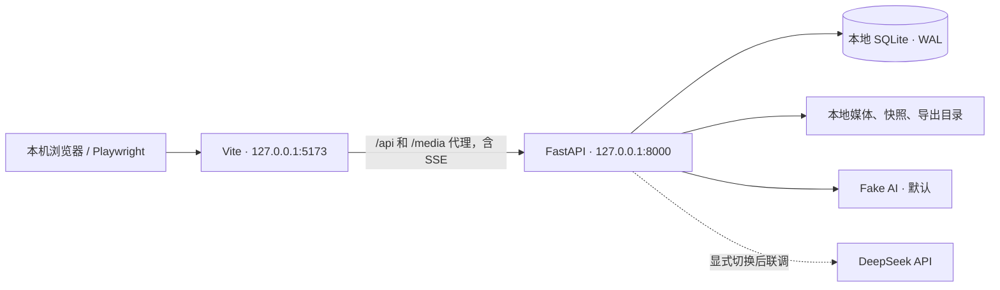

# 英语师范生 AI 协作教学资源制作系统
## 项目开发文档 v1.2 · 本地开发与测试对齐版

> 更新日期：2026-09-22。本文档根据《9.21 数据采集设计文档.md》整理，当前用于单台 Windows 电脑上的开发、联调和验收。源设计定义的功能、事件及研究边界保持为产品依据；局域网部署和课堂容量验证安排在后续独立阶段。本文件中的目录、脚本和命令是待实现的开发契约，并不代表项目代码已经完成。v1.2 已根据对齐检查报告统一事件语义、采集路径和验收要求；实现及测试完成状态仍以未勾选清单为准。

## 1. 项目目标与边界

### 1.1 产品目标

系统最终服务于线下英语师范生课堂任务。当前先在一台开发电脑上，通过本机浏览器完成“阅读任务要求 → 与 AI 协作 → 编写并运行单文件 HTML 游戏 → 反复检查和修改 → 提交作品”的全过程，本机 FastAPI 保存操作事件、对话、代码版本、计划文本、预览运行结果和提交快照。

当前交付目标是：功能在本机跑通，单元测试和集成测试可重复执行，并能从本地 SQLite 和快照目录核对每个模拟会话的事件及作品版本。系统不计算元认知得分、不推荐策略、不弹出干预提示。本地验收通过后再进入部署优化，不以当前结果推断真实课堂性能。

### 1.2 本期范围

- 任务页：任务目标、硬约束、示例视频、服务端校准时间、只读座位号。
- 工作区：AI 对话、文件附件、HTML 编辑器、手动运行预览、运行控制台、计划侧栏、提交作品。
- 过程保活：任务页和工作区往返时不销毁工作台状态，不意外重载 iframe。
- 数据采集：设计文档中定义的学生行为事件和系统结果事件，包含通用字段及专属字段。
- 作品归档：编辑器自动落库、代码不可变快照、计划版本、每次成功提交的独立快照。
- 本地运行：一台电脑运行前端、后端和数据库，以 1 个会话完成主流程，以 2–3 个隔离浏览器上下文验证数据隔离。
- 本地导出：按任务、会话、参与者和提交批次导出 JSONL/CSV/HTML 快照包，供开发者核对采集结果。

### 1.3 明确不做

- 不做实时元认知识别、评分、干预或学生画像。
- 不做多文件项目编辑；本期作品为一个可离线运行的 HTML 文件，CSS、JavaScript 和可用资源内嵌其中。
- 不让 AI 回复自动替换编辑器代码；学生必须自行复制、粘贴和修改。
- 不把鼠标移动、触摸移动、播放器暂停/拖动/全屏等高频原生事件写入行为库。
- 默认使用可控 fake AI，不要求配置真实 API 密钥；真实 DeepSeek 联调通过本机后端调用，密钥不下发浏览器。
- 不把失败的上传、AI 回复、预览和提交结果冒充学生行为计数。
- 当前不实施局域网 IP/防火墙配置、教师主控部署、20 台设备容量压测、希沃真机验收和课堂运维；后续事项见第 14 节。

### 1.4 工程实现约定

源设计没有规定身份入口、任务内容管理后台和导出界面。本项目采用以下默认决策，若后续研究方案改变，应先修改本文件和接口契约，再改代码：

1. **身份入口**：本地 seed 脚本生成 01–03 三个模拟座位及随机测试令牌，输出 `http://127.0.0.1:5173/enter?seat=01&token=...`。继续走真实 bootstrap/JWT/会话鉴权，不硬编码一个共享学生身份。教师发放令牌的界面后置。
2. **任务配置**：本期不做教师后台；配置中提供 `task-test`、至少两段本地示例视频和固定任务版本，每轮测试开始时锁定 `task_content_version`。
3. **事件传输**：浏览器优先批量发送事件；网络短暂中断时进入本地 outbox，恢复后按原 `occurred_at` 和客户端顺序补写。服务器以 `event_id` 幂等去重。
4. **代码持久化**：编辑器变更进入内存和本地草稿；800ms 防抖写入 IndexedDB，后台每 5 秒保存一次有变化的恢复检查点。运行、提交、离开工作台和结束会话强制 flush。检查点保存不生成 `code_edited`，不刷新预览；合并编辑事件仍按源设计边界产生。异常退出最多只能保证恢复已持久化内容，不能承诺恢复尚在内存的按键。
5. **时钟**：服务器返回 `server_now`，前端计算 `clock_offset_ms` 作为显示和 `occurred_at` 校准依据；服务器 `recorded_at` 永远由服务器生成。
6. **本地基线**：单个 FastAPI worker、单个 SQLite 文件、1 个主流程会话，2–3 个独立上下文验证隔离；AI 全局并发默认 2、每会话最多 1 个在途请求。20 台课堂目标留待部署阶段实测。
7. **环境隔离**：手工调试写 `data/local/`，自动测试每次创建独立临时目录；不得连接手工库或未来正式库。fake 模式在依赖安装完成后可完全离线运行。

### 1.5 本轮交付物

- 可以按第 13 节启动的本地应用、种子数据和环境配置样例。
- 可重复执行的单元测试、集成测试、Playwright E2E，以及本地人工评测记录。
- 本地导出样例和数据质量报告，能追溯到测试用例、会话和代码版本。
- 未勾选的开发清单；每项仅在对应本地实现与验收均通过后勾选。部署清单独立维护。

## 2. 需求解读与关键验收原则

### 2.1 数据采集原则

- 事件是可观测事实，不是研究结论。同一事件能否支持 Planning、Monitoring 或 Evaluating，需要课后结合上下文分析。
- 行为事件和系统结果事件必须分开。学生点击“运行”记录 `preview_run`，系统发现报错记录 `preview_error_detected`，不能合并成一个“运行失败行为”。
- 连续输入采用“暂存 + 边界合并”。`planner_edited`、`ai_request_edited`、`code_edited` 不逐字上报；必须在收起、运行、发送、提交、离开或结束等边界形成一条带差分的事件。
- 每条事件既有客户端发生时间，也有服务器接收时间和会话内序号，支持处理延迟、重试和同一毫秒内的操作。
- 所有成功提交都留档。学生继续修改不会改变已经提交的快照；没有点击提交时，结束会话仍保存最后一次自动落库内容。

### 2.2 用户可感知的关键行为

1. 首次打开进入任务页，点击示例卡片在同页弹层播放，关闭时保留播放位置。
2. 点击“去工作区”后进入三区工作台；从工作台返回任务页时工作台保活。
3. 点击“运行”才应用代码到预览；编辑、粘贴、收到 AI 回复均不会自动刷新预览。
4. 预览报错只显示原始控制台信息，不自动解释或一键修复。
5. 计划侧栏覆盖预览但不卸载 iframe，展开和收起不触发重新运行。
6. 提交需要二次确认，提交中不锁定编辑工作，成功或失败后都可以继续制作并再次提交。

### 2.3 必须保持的关系

- `task_started` 是每个会话的第一条业务事件，`task_ended` 至少出现一次；异常关闭时由服务端超时收尾任务补写。
- 首次任务页用 `task_viewed`，从工作台返回用 `task_revisited`；每次离开任务页都产生 `workbench_entered`。
- `example_opened` 与 `example_closed` 按 `example_id` 配对；关闭时记录播放位置和实际观看秒数。
- `preview_run`、`preview_ready`、`preview_error_detected` 通过 `run_id` 关联。
- `submit_confirmed`、`submit_succeeded`、`submit_failed` 通过 `submission_id` 关联；成功提交必须有 `snapshot_id`。
- `code_pasted` 与 `code_edited` 不能混为同一事件；粘贴可以随后触发一次合并的人工编辑事件。

## 3. 推荐总体架构

### 3.1 本地运行拓扑



### 3.2 分层设计

#### 前端层（Vue 3 + TypeScript）

- `router`：任务页、工作区和错误页；使用 `KeepAlive` 或单一壳组件切换，保证工作台不销毁。
- `stores/session`：JWT、座位号、参与者、会话、服务端时钟偏移、连接状态。
- `stores/task`：任务内容版本、示例列表、播放器状态、任务页计时。
- `stores/workbench`：当前页面、AI 请求状态、附件、代码、计划、预览和提交状态。
- `services/api`：REST、SSE、上传、重试和统一错误模型。
- `services/event-collector`：动作识别、合并窗口、事件 outbox、批量发送和幂等重试。
- `components`：任务页、视频弹层、AI 对话、附件列表、代码编辑器、预览 iframe、控制台、计划侧栏、提交弹窗。

#### 后端层（FastAPI）

- `api`：鉴权、任务、会话、上传、对话、代码、计划、预览、提交、事件和导出路由。
- `domain`：会话、附件、请求、代码 revision、运行、计划 revision、提交状态机。
- `services`：事件写入、AI 适配器、文件校验、快照、时间校准、导出和恢复。
- `repositories`：SQLite 事务和查询；禁止路由函数直接拼 SQL。
- `workers`：AI 流式响应、附件处理、会话超时收尾；本期使用进程内受控任务，不引入 Redis/Celery。
- `config`：环境变量、任务配置、文件类型/大小、AI provider、测试故障场景和超时参数。

#### 持久化层

- SQLite：结构化业务数据和事件元数据。
- 文件系统：原始附件、任务视频、代码快照、提交清单和导出包。
- 原始事件记录只追加不更新；逻辑顺序由版本化索引生成。数据质量问题写独立报告，不擅自增加行为事件或覆盖原记录。

### 3.3 建议项目目录

```text
project/
├─ backend/
│  ├─ app/
│  │  ├─ main.py
│  │  ├─ api/                 # 路由与依赖注入
│  │  ├─ domain/              # Pydantic DTO、状态机、枚举
│  │  ├─ services/            # 业务服务
│  │  ├─ repositories/        # SQLite 读写
│  │  ├─ workers/             # 流式 AI、收尾任务
│  │  └─ settings.py
│  ├─ migrations/
│  ├─ tests/unit/
│  └─ tests/integration/
├─ frontend/
│  ├─ src/
│  │  ├─ views/               # TaskView、WorkbenchView
│  │  ├─ components/
│  │  ├─ stores/
│  │  ├─ services/
│  │  ├─ composables/
│  │  └─ types/
│  └─ tests/
├─ config/
│  ├─ tasks/task-test.json
│  └─ examples/
├─ data/local/                # 手工调试数据，不提交源码仓库
│  ├─ app.db
│  ├─ attachments/
│  ├─ code-snapshots/
│  ├─ submissions/
│  ├─ exports/
│  └─ backups/
├─ tests/fixtures/            # 本地视频、附件、HTML、AI 固定回复
├─ scripts/                   # local_init、seed_local、export_session、validate_export、backup_local、restore_local
├─ artifacts/                 # 测试报告、trace、日志，不提交源码仓库
├─ docs/acceptance/            # 已完成验收的记录
├─ .env.local.example
└─ README.md
```

### 3.4 核心工程原则

- 所有写操作采用显式事务，事件和对应业务状态变更尽量在同一事务中提交。
- 事件接收接口采用客户端 `event_id` 幂等；重复请求返回 `accepted_duplicate`，不重复插入。
- 代码、计划和提交使用 revision/snapshot，不以“当前字段覆盖历史”替代版本。
- 浏览器只能拿到短期 JWT 和必要的匿名标识；AI key、数据库路径、文件系统路径不下发。
- 后端返回统一错误结构：`code`、`message`、`retryable`、`request_id`。
- 所有时间统一存 UTC ISO-8601，展示时转课堂时区 `Asia/Shanghai`。
- 服务器启动、关闭、磁盘不足、AI 不可用、数据库异常必须写结构化日志，但日志中不重复打印完整学生作品和 API 密钥。

### 3.5 本地开发选型和接口保留

- 保留 Vue 3、TypeScript、Vuetify、Pinia、FastAPI、Pydantic、httpx、SQLite；本地优先选择 CodeMirror 6 实现单文件编辑。最终版本写入锁文件。
- 先以 `AIProvider` 接口实现 fake 和 DeepSeek adapter；LangChain/LangGraph 的智能体编排不作为本地采集闭环的前置依赖。
- 前端接口全部使用相对地址 `/api/v1` 和 `/media`。通过 Vite 代理转发，统一使用 `127.0.0.1`，避免混用 `localhost` 造成 JWT/IndexedDB 存储与来源差异。
- Vite 和 FastAPI 均仅绑定回环地址。当前不用 Docker、反向代理、公网域名或外部数据库；未来部署通过配置替换入口地址和数据根目录。
- 任务视频、字体、编辑器和脚本来自本地资源；fake 模式下浏览器不需要访问 CDN。

## 4. 领域模型与状态机

### 4.1 会话状态与结束口径

```text
CREATED -> ACTIVE -> ENDING -> ENDED
                    | resume（仅限未定案的页面离开候选）
                    +-------> ACTIVE
```

- `CREATED`：座位凭证有效，等待建立本次会话；同一模拟参与者在新会话中沿用 participant_id，新建 session_id。
- `ACTIVE`：允许正常业务；同一 session 只有一个有效的前端写入租约（默认 60 秒，15 秒心跳续期），复制标签页不能双写。
- `ENDING`：暂存 pagehide 离开候选或正在显式结束。离开候选等 15 秒续接宽限期；显式结束不进入可续接分支。
- `ENDED`：拒绝新业务，允许查询、导出、结束前产生的历史事件及在途请求结果补传。记录已定案的 task_ended 仅一条，不因重复请求再次结束。

| 情景 | session 与事件规则 | 恢复边界 |
|---|---|---|
| 页内重看任务、切标签或最小化 | session 不变；页内往返记对应导航事件；确认不可见才记 window_left | 不终止上传/AI，不重载预览 |
| 普通刷新 | sessionStorage 的 tab_instance_id、恢复凭证及租约有效，且在 15 秒内续接，则撤销离开候选；不重复 task_started/task_viewed | 从已持久化草稿恢复，iframe 执行状态不保证恢复，也不自动造 preview_run |
| pagehide.persisted=true / bfcache 返回 | 不判结束；pageshow 后校验原租约，仍有效则续接 | 原会话已结束时只显示结束状态 |
| 关闭后新开标签 | 没有旧 tab 的恢复凭证，建立新 session；原 session 有离开候选时定案结束 | 可读取同参与者先前已归档内容，但不把新打开冒作刷新 |
| 浏览器崩溃或无离开信号 | 无心跳达到 30 分钟才由系统生成 task_ended(end_reason=timeout_unobserved) | occurred_at 使用系统判定时刻；真实关闭时刻未知，不回填为最后心跳时间 |
| 学生明确结束 / 后续教师结束 | 封存已收到内容并结束；新一轮必须新建 session | 分别使用 student_end / teacher_end，不恢复已结束 session |

pagehide.persisted=false 只证明文档离开，不能证明一定关闭。若宽限期内未续接，系统定案 `end_reason=page_exit_unresumed`：occurred_at 保留实际 pagehide 时间，recorded_at 为定案落库时间，actor=system；质量报告注明结束方式由未续接推定。浏览器会话恢复可能保留 sessionStorage，使用仍有效凭证恢复时标注技术元数据 resume_basis，不能宣称已准确区分所有关闭与刷新。

收到新标签的同座位 bootstrap 时，若旧租约仍活跃，拒绝双写；若旧租约已失联，先系统定案旧会话 `superseded_unobserved` 再创建新会话，不伪造精确关闭时间。pending 离开候选保留原发生顺序槽位；续接取消时在技术账本标记 cancelled，不生成 task_ended，也不把该槽位误判为事件丢失。恢复凭证和写入租约为运行元数据，不新增研究事件。

关闭前只尽力发送小型 detach/flush 请求，正常编辑过程中即持久化草稿与 outbox。采用带 Bearer header 的 fetch keepalive；不要假设 sendBeacon 能附带 Authorization，也不要把 beforeunload 当作可靠保存保证。

### 4.2 附件状态

```text
SELECTED -> UPLOADING -> PROCESSING -> READY
                         \-> FAILED -> RETRYING -> ...
SELECTED/READY/FAILED -> REMOVED
```

只有 `READY` 附件能出现在 `ai_request_sent.attachment_ids`。选择、移除不产生独立行为事件；处理完成产生 `file_attached`，失败产生 `attachment_failed`。

### 4.3 AI 请求状态

```text
DRAFT -> SENT -> STREAMING -> SUCCEEDED
                         \-> FAILED -> RETRYING -> SENT
```

同一会话同时最多一个 `SENT/STREAMING` 请求。失败重试创建新的 `request_id`，并在 `retry_of_request_id` 记录原请求。

### 4.4 代码、运行和提交状态

- 代码、计划和每个请求草稿分别维护逻辑文本 revision，按编辑事务递增；保存检查点不额外递增 revision。详细差分与快照约定见 §5.7。
- 点击运行时同步冻结正文并分配 run_id，封装 code_edited 后预留 preview_run 的事件编号和发生顺序，再执行保存。成功或失败均保留该次尝试，结果未知先核对原编号；完整流程见 §8.5。
- 每次运行都重建 iframe，运行编号独立；展开计划、返回任务页不重建 iframe。
- 提交确认时冻结编辑器和计划的当前内容，同时分配 `submission_id`、`snapshot_id`；成功或失败都沿用这两个编号，不能到成功时才生成提交编号。

## 5. 数据库与文件存储设计

### 5.1 通用字段与约束

业务对象使用 UUID 主键，时间统一 UTC；开启 SQLite foreign_keys、WAL 和 busy_timeout。区分“原始到达记录”与“完整研究事件”：

- `event_records`：append-only 原始记录，保存完整专属 payload、除 sequence_no 外的通用字段和内部 ingestion_no。`UNIQUE(event_id)`，同编号不同内容返回冲突；同编号同内容重传返回 duplicate，原 recorded_at 不变。
- `event_transport`：按 event_id 保存 producer_id、producer_seq、causal_parent_ids 等排序/传输元数据；它们不进入源设计的事件专属 payload。
- `event_order`：保存每个 order_version 内的 sequence_no；`UNIQUE(session_id, order_version, sequence_no)` 与 `UNIQUE(session_id, order_version, event_id)`。
- `events`：只读标准事件视图，把原始记录与一个明确的 order_version 关联，提供源设计全部 11 个通用字段及完整 payload。研究查询和导出使用此视图，不直接分析到达日志。
- actor 仅允许 student/system，具体值按事件注册表和可信发生端决定；producer 不等于 actor，后端也可记录由学生触发的行为。

**sequence_no 保持“会话逻辑事件顺序”的含义；ingestion_no 才是服务端写入顺序。** §5.5 定义排序与补传，禁止两者混用。

### 5.2 核心表

| 表 | 关键字段 | 作用 |
|---|---|---|
| `task_configs` | `task_id`、`version`、`content_json`、`status` | 锁定任务说明、硬约束和示例引用 |
| `sessions` | `session_id`、`participant_id`、`seat_no`、`task_id`、`status`、`started_at`、`ended_at`、`last_seen_at` | 会话和匿名身份 |
| `event_records` / `event_transport` | `event_id`、`ingestion_no`、通用字段、完整 `payload_json`；发生端序号与因果引用 | 原始不可变内容及独立技术元数据 |
| `event_order` / `events` 视图 | `session_id`、`order_version`、`event_id`、`sequence_no` | 逻辑顺序索引及标准研究事件 |
| `attachments` | `attachment_id`、`session_id`、`file_name`、`mime`、`size`、`sha256`、`status`、`storage_ref` | 上传文件和处理状态 |
| `ai_requests` | `request_id`、`session_id`、`draft_id`、`message_text`、`status`、`retry_of` | AI 请求生命周期 |
| `ai_responses` | `response_id`、`request_id`、`model_name`、`response_text`、`status` | 完整 AI 回复 |
| `code_revisions` | `revision_id`、`session_id`、`revision_no`、`content_ref`、`content_sha256`、`source` | 代码历史和当前指针 |
| `planner_revisions` | `revision_id`、`session_id`、`revision_no`、`content`、`content_sha256` | 计划历史 |
| `preview_runs` | `run_id`、`session_id`、`revision_id`、`status`、`started_at`、`ready_at` | 运行尝试及结果索引 |
| `submissions` | `submission_id`、`session_id`、`code_revision_id`、`plan_revision_id`、`snapshot_id`、`status` | 每次提交的状态 |
| `snapshots` | `snapshot_id`、`session_id`、`code_ref`、`plan_ref`、`manifest_ref`、`sha256` | 可复现作品包 |
| 浏览器 `outbox_events` | `client_event_id`、`payload_json`、`status`、`retry_count` | IndexedDB 对象存储，不是 SQLite 表；保存尚未确认的客户端事件 |

本地首版选择简单且可核对的完整 payload 存储：event_records 必须保留源 §4.3 要求的 message_text、response_text、edit_changes 等正文，业务表可同时保存便于查询。response_id 不能代替 response_text；只对源设计已经定义为引用的 code_snapshot_ref/snapshot_id 使用文件引用。输入、入库和导出字段约定见 §5.6。

### 5.3 文件目录与不可变快照

```text
data/local/
├─ attachments/{session_id}/{attachment_id}_{safe_name}
├─ code-snapshots/{session_id}/{revision_id}.html
├─ planner-snapshots/{session_id}/{revision_id}.txt
├─ submissions/{session_id}/{submission_id}/
│  ├─ index.html
│  ├─ plan.txt
│  ├─ manifest.json
│  └─ checksums.sha256
└─ exports/{export_id}.zip
```

写入采用临时文件 + `fsync` + 原子重命名；数据库只在文件落盘成功后写 `content_ref`。磁盘空间不足时保留编辑器内存、返回可重试错误，并记录 `submit_failed` 或相应系统错误，不得写入半个快照。

### 5.4 事件契约注册表

以下表是前后端共同使用的事件注册表。事件名、actor、触发边界和专属字段均为稳定契约；新增事件必须先更新源设计和本表。除专属字段外，每条事件都必须包含 `event_id`、`event_name`、`actor`、`participant_id`、`session_id`、`task_id`、`seat_no`、`occurred_at`、`recorded_at` 和会话逻辑 `sequence_no`。

| Event_Name | Actor | 触发/落库边界 | 专属字段（必须按 schema 校验） |
|---|---|---|---|
| `task_started` | student | 页面建立会话 | `entry_page` |
| `task_viewed` | student | 首次任务页完成呈现 | `task_content_version` |
| `example_opened` | student | 点击视频卡片、弹层打开 | `example_id` |
| `task_revisited` | student | 从工作台返回任务页 | `from_page` |
| `example_closed` | student | 关闭弹层或导航导致关闭 | `example_id`、`last_position_sec`、`watched_seconds`、`close_reason(manual/navigate/end)` |
| `workbench_entered` | student | 从任务页进入工作区 | `entry_source(first/return)` |
| `planner_opened` | student | 侧栏从收起变为展开 | 无 |
| `planner_edited` | student | 收起、离开、提交或结束时合并本轮修改 | `edit_changes[]`（`operation/inserted_text/deleted_text/edit_range`）、`content_length_after`、`base_plan_revision`、`plan_revision`、`edit_started_at`、`last_edit_at`、`flush_reason` |
| `file_attached` | student | 上传/处理成功进入 READY | `attachment_id`、`file_name`、`file_type`、`file_size` |
| `attachment_failed` | system | 上传或处理失败并显示失败状态 | `attachment_id`、`failure_stage`、`error_type`、`error_message` |
| `ai_request_edited` | student | 发送、离开或结束时合并未发送草稿 | `draft_id`、`edit_changes[]`（`operation/inserted_text/deleted_text/edit_range`）、`content_length_after`、`edit_started_at`、`last_edit_at`、`flush_reason` |
| `ai_request_sent` | student | 点击发送，文字和 READY 附件提交 | `request_id`、`draft_id`、`message_text`、`attachment_ids[]`、`retry_of_request_id`（可空） |
| `ai_response_received` | system | AI 流式输出完整结束 | `request_id`、`response_id`、`response_text`、`model_name`、`response_status` |
| `ai_response_failed` | system | AI 请求/回复失败且界面显示失败 | `request_id`、`failure_stage`、`error_type`、`error_message`、`retryable` |
| `ai_response_copied` | student | 从回复区复制文本或代码 | `response_id`、`content_type(text/code)` |
| `code_pasted` | student | 编辑器粘贴回调完成 | `pasted_text`、`paste_source(ai_response/other)`、`source_response_id`（可空）、`edit_range`、`code_revision` |
| `code_edited` | student | 运行、提交、离开或结束时合并非粘贴修改 | `edit_changes[]`（`operation/inserted_text/deleted_text/edit_range`）、`content_length_after`、`base_code_revision`、`code_revision`、`edit_started_at`、`last_edit_at`、`flush_reason` |
| `preview_run` | student | 点击运行并产生保存/运行尝试 | `run_id`、`code_revision`、`code_snapshot_ref`、`save_status` |
| `preview_ready` | system | iframe 成功加载并可交互 | `run_id` |
| `preview_error_detected` | system | 加载或交互中捕获错误 | `run_id`、`error_id`、`error_phase(load/interaction)`、`error_type`、`error_message`、`line`、`column`、`stack`（可空） |
| `preview_error_copied` | student | 从控制台复制错误 | `error_id` |
| `preview_interacted` | student | 完成一个定义好的游戏操作 | `run_id`、`interaction_type`、`target`、`outcome`（可空） |
| `window_left` | student | 页面确认不可见 | `leave_reason` |
| `window_returned` | student | 页面确认重新可见 | `return_reason` |
| `submit_dialog_opened` | student | 提交确认框打开 | 无 |
| `submit_confirmed` | student | 点击确认，进入提交中 | `submission_id`、`code_revision`、`plan_revision`、`snapshot_id` |
| `submit_cancelled` | student | 点击取消 | 无 |
| `submit_succeeded` | system | 快照和数据库保存完成 | `submission_id`、`snapshot_id` |
| `submit_failed` | system | 保存未完成并显示失败 | `submission_id`、`error_type`、`error_message`、`retryable` |
| `task_ended` | system/student | 主动结束、关闭或教师收尾 | `end_reason` |

实现时将 `task_ended` 的 actor 设为产生结束动作的一方：学生明确结束使用 `student`，未续接页面离开、超时收尾或教师结束使用 `system`，原因及时间口径见 §4.1。`preview_run` 记录发起尝试，`preview_error_detected` 记录系统结果；二者不得合并。`code_pasted` 和 `code_edited` 同样保持分离。

### 5.5 会话逻辑顺序、补传与顺序版本（A01）

本地单 worker 使用普通 SQLite 表和排序函数即可，无需引入消息队列或分布式框架。固定使用以下规则：

1. **发生端先编号**：浏览器在识别动作的同步回调中分配 event_id、producer_seq 和校准 occurred_at，随后持久化；同一 tab 的 producer_id/计数器跨刷新恢复。后端通过集中 emit_server_event 函数在结果形成时分配自己的 producer_seq，并立即持久化结果。actor 与发生端分别记录；延迟定案的 pagehide 结束事件沿用原离开候选保留的浏览器发生顺序，不能按后端定案时刻重新排到队尾。
2. **到达独立记录**：后端按接收事务分配 ingestion_no 和 recorded_at；补传不改 occurred_at/producer_seq。任何业务事件不得用 ingestion_no 填 sequence_no。
3. **构造有向先后约束**：同一 producer 按 producer_seq；请求/运行/提交尝试先于其结果；结果先于针对它的复制或交互；客户端已收到的结果先于随后观察到的动作。后者由传输元数据 causal_parent_ids 保存，导航/系统结果不会仅因晚到而排在后续操作之后。task_started 先于本会话所有记录；task_ended 的边界按 §4.1，不强行排在结束后才完成的在途系统结果之后。
4. **生成逻辑序列**：对上述图作稳定拓扑排序。候选节点之间没有已知因果关系时，按 occurred_at、event_id 确定可重复的展示顺序，并在独立 quality.json 中标记使用时间推定/并发不确定的事件。分配从 1 开始的 sequence_no；不根据 recorded_at 或 ingestion_no 推断动作先后。
5. **版本化保存**：每次补传批次到齐、结束或导出时生成新的 order_version，保存 event_order 索引；原始事件正文与旧索引均不覆盖。分页查询和导出必须固定一个 order_version，manifest 写入版本，不能把两版 sequence_no 混用。
6. **缺失和冲突**：除有记录的已取消候选槽位外，source 序号空洞、未到达的因果父事件、循环约束、重复编号不同内容写数据质量报告。允许导出带 incomplete 标记的诊断包；完整验收导出要求应有事件、正文与引用无缺失。不得静默丢弃冲突事件、伪造父事件或把到达顺序当作兜底证据。

sequence_no 是符合可观测因果关系的会话逻辑次序，不能证明物理上同时发生的跨端动作有绝对先后。时间间隔仍使用 occurred_at；不确定性、order_version、ingestion_no 均为独立工程元数据，不增加研究行为或修改源事件专属字段。编辑合并事件的 occurred_at 为 flush 边界，内部操作先后按 §5.7 的 revision 还原。

### 5.6 输入、存储与导出的统一 schema（A05）

| 层级 | 内容与约束 |
|---|---|
| 客户端输入 EventIn | event_id、event_name、actor、session_id、occurred_at、完整 payload；producer 元数据单列 transport。身份字段由 JWT 绑定，不能自行伪造 participant/seat/task |
| 服务端内部事件 | 同样的完整 payload；actor、结果状态和业务引用由对应服务生成。浏览器发来的 preview_ready/error 必须来自已校验的预览桥接 |
| event_records | 完整 payload 及事件事实写入一次；message_text/response_text/edit_changes 不能被 ID、文件路径或省略号替代 |
| events 标准视图 / JSONL | 固定 order_version 下全部 11 个通用字段，加注册表对应的全部 payload 字段；7 个系统结果不计学生行为频数 |
| 业务表 / 文件 | 请求、回复、revision 等便于查询的副本必须与事件事实一致；仅原本定义为引用的快照/附件需要按 ID 解析 |
| manifest / quality.json | 保存 schema_version、order_version、待定尝试、缺失引用、时序不确定和恢复依据；不塞进研究事件 payload |

实现一个事件注册表生成前端类型、后端验证与导出校验，禁止输入接受“仅 response_id”，导出才临时拼出 response_text。注册表中的可空字段输出 null，空的合法 message_text/plan 使用空字符串，空 attachment_ids 使用 []；不可将字段缺失与合法空值混为一谈。

最终 JSONL 应独立包含所有要求的事件正文；validate_export 同时检查文件引用、业务副本一致性和 schema。研究正文不主动截断；容量超限必须明确报错和保留本地待处理内容。普通运维日志不打印完整正文。

### 5.7 文本 revision、差分及交错操作协议（B02）

本节补充源文档未展开的 edit_range 数据类型，不增加顶层行为字段。三类文本统一使用 Unicode 字符串，编辑器内部及归档换行规范为 LF；长度、偏移按 JavaScript UTF-16 code unit 计，后端校验必须使用同样单位，不能直接用 Python len 处理 emoji 的偏移。

- 代码、计划、每个 draft_id 各有独立 revision，初始空文本为 0；每个实际文本变更事务递增。自动保存、防抖、flush、查找、光标移动不自行制造 revision 或编辑事件。
- edit_range 固定为 `{start, end, base_revision, result_revision}`；start/end 是基于该条变更前文本的 0 起始半开区间 `[start,end)`。deleted_text 必须等于该区间内容；结果为前缀 + inserted_text + 后缀。
- operation 使用 insert/delete/replace/undo/redo；未使用的 inserted_text/deleted_text 写空串。undo/redo 仍保存真实的增删文本，不依赖浏览器撤销栈才能重放。
- 一次多光标编辑拆成有序原子替换，从右向左应用，逐项指向对应中间 revision；多光标粘贴本期关闭，以保持一次 code_pasted 对应一个范围。IME 组合输入提交后形成实际变更，避免再计普通 input 的重复回调。
- code_pasted 保存 pasted_text 及完整 edit_range，code_revision 是此次粘贴后的逻辑版本；被替换的原文可由 base_revision 和范围恢复。粘贴生成的 change 不再进入 code_edited，之后撤销粘贴属于真实非粘贴编辑，可进入 code_edited。
- code_edited/planner_edited 的 base_*_revision 为本轮记录边界的基线，目标 revision 与 content_length_after 为 flush 时文本。只收集本轮对应的人工变更；同轮穿插的 code_pasted 通过范围 revision 并入重放。不能假设一条 code_edited 单独就是连续快照差分。
- ai_request_edited 用 draft_id 区分草稿，其范围也带局部 revision；发送后程序清空旧草稿并创建新 draft_id，不记作学生删除。恢复赋值不产生编辑或粘贴事件。

**交错示例**：空文本 r0 → 手输 A 得 r1 → 粘贴 B 得 r2 → 手输 C 得 r3 → 点击运行。应生成 code_pasted（r1→r2），并在运行边界生成一次 code_edited（含 r0→r1 和 r2→r3 两项）。重放时按内部 revision 组合得到 ABC，不按这两条合并事件的 sequence_no 逐项盲用偏移。

前端保留完整事务队列；检查点上传尚未归档的变更及当前文本，在 code_revisions/planner_revisions 保存可恢复的边界快照。被粘贴/flush/run/submit 引用的 revision 在服务端保存成功前不可宣称持久化完成。后端以已知基线和差分逐项验证最终文本；对不上时保留待处理内容并报告 revision_conflict，禁止静默覆盖。乱序到达的旧检查点只补历史，不降低当前 revision 指针；相同 revision 不同正文为冲突。前端仅在返回 revision 等于当前内容版本时显示“已保存”。

### 5.8 原始归档边界（B06）

完整原始数据包包含 SQLite（含事件正文、业务数据、顺序索引）与它引用的附件、代码/计划快照及提交文件。只复制正在使用的 app.db 不构成完整备份。导出/备份 manifest 必须枚举引用文件并校验存在性；恢复测试在独立目录同时恢复数据库和文件。

## 6. API 契约（MVP）

### 6.1 接口约定

- 前缀：`/api/v1`。
- JWT 放在 `Authorization: Bearer <token>`；所有接口校验 `session_id` 与令牌绑定的 `participant_id/seat_no`。
- JSON 接口返回 `request_id`；错误格式为 `{code, message, retryable, request_id}`。
- 写接口支持 `Idempotency-Key`，特别是事件批量、提交和 AI 重试。
- SSE 仅用于 AI 流式正文；断开后客户端显示已收到片段并允许重试，不自动重复发送。当前使用支持 Authorization 请求头的 fetch 流式读取，避免原生 EventSource 无法直接设置 Bearer header 的差异。

### 6.2 启动与会话

| 方法 | 路径 | 说明 |
|---|---|---|
| `POST` | `/session/bootstrap` | 校验座位令牌，返回短期 JWT、`session_id`、匿名 `participant_id`、座位号、任务版本、`server_now` 和时钟配置 |
| `GET` | `/session/me` | 恢复页面或刷新后获取会话状态、当前 revision 指针、未完成请求和附件 |
| `POST` | `/session/heartbeat` | 更新 last_seen_at 与写入租约；不产生学生行为事件 |
| `POST` | `/session/detach` | 接收 pagehide 离开候选与最后观察时间，按 §4.1 等待续接；不是新的行为事件 |
| `POST` | `/session/end` | 前端先提交可发送草稿和事件；后端保存已收到内容、写 `task_ended` 并结束会话，不能读取浏览器中尚未传输的内容 |

### 6.3 任务与媒体

| 方法 | 路径 | 说明 |
|---|---|---|
| `GET` | `/tasks/{task_id}` | 返回指定锁定版本的任务内容和硬约束 |
| `GET` | `/tasks/{task_id}/examples` | 返回视频卡片元数据、时长、封面和本机相对媒体 URL |
| `GET` | `/media/examples/{example_id}` | 流式返回视频，支持 Range；失败时前端显示重试 |

### 6.4 事件

`POST /events/batch` 请求示例（省略的身份字段由令牌绑定）：

```json
{
  "session_id": "session-01",
  "events": [
    {
      "event_id": "event-42",
      "event_name": "planner_opened",
      "actor": "student",
      "occurred_at": "2026-09-22T06:23:11.123Z",
      "transport": {
        "producer_id": "browser-01",
        "producer_seq": 42,
        "causal_parent_ids": ["event-41"]
      },
      "payload": {}
    }
  ]
}
```

响应逐条返回 accepted、accepted_duplicate 或 rejected、是否可重试和原因。accepted 表示完整事件事实已持久化；返回 ingestion_no/recorded_at 和当前顺序版本状态，不伪称已经获得永不变化的全局操作序号。标准查询按 §5.5 指定 order_version。

重复 event_id 且内容相同不覆盖原文；同编号内容不同返回 EVENT_ID_CONFLICT。临时故障退避重试，永久 schema 错误保留在失败队列。跨会话身份/父事件引用拒绝。后端业务服务生成的结果与浏览器回执使用同一个 event_id，不重复记录两次。

### 6.5 编辑器、计划和预览

| 方法 | 路径 | 说明 |
|---|---|---|
| `GET` | `/workbench/state` | 恢复代码、计划、对话摘要、附件、控制台和当前预览指针 |
| `PUT` | `/workbench/plan` | 保存当前计划文本，返回 `plan_revision`；用于自动保存和离开前 flush |
| `PUT` | `/workbench/code` | 自动检查点保存代码及未归档变更，返回逻辑 revision 和快照引用；不触发运行 |
| `POST` | `/workbench/preview/run` | 接收点击时已分配的 run_id/事件信封、冻结代码及 revision；保存并确定结果，完整事务见 §8.5 |
| `GET` | `/workbench/preview/{run_id}` | 返回同一次尝试的 pending/saved/failed 状态及已定案事件；用于超时核对，查询不再次运行 |
| `GET` | `/workbench/preview/{run_id}/logs` | 查询控制台日志、警告和错误 |
| `POST` | `/workbench/preview/{run_id}/interaction` | 由受控桥接上报有意义的游戏交互；不接收鼠标移动等原始高频事件 |

`PUT /workbench/code` 和 `POST /workbench/preview/run` 必须检查代码大小上限、内容编码和快照 SHA-256。运行接口返回保存失败时不得返回可加载的新预览地址。

### 6.6 附件与 AI

| 方法 | 路径 | 说明 |
|---|---|---|
| `POST` | `/attachments` | multipart 上传；校验扩展名、MIME、大小和病毒/格式策略，状态从 `UPLOADING` 到 `READY/FAILED` |
| `GET` | `/attachments/{attachment_id}` | 查询处理状态和错误 |
| `DELETE` | `/attachments/{attachment_id}` | 移除待发送附件；不产生单独行为事件 |
| `POST` | `/ai/requests` | 创建请求并返回 `request_id`；只能引用 READY 附件 |
| `GET` | `/ai/requests/{request_id}/stream` | SSE 流式返回回复片段和最终状态 |
| `POST` | `/ai/requests/{request_id}/retry` | 以新 request_id 重试，自动填写 `retry_of_request_id` |

文件允许列表、大小上限和 AI 超时必须放在配置中，并在前端上传入口显示实际值。服务器永远以服务端配置为准。

### 6.7 提交与导出

| 方法 | 路径 | 说明 |
|---|---|---|
| `POST` | `/submissions` | 点击确认时由前端发送冻结的代码、计划、revision、submission_id 和 snapshot_id；后端保存并返回状态，同一幂等键重试不得重复提交 |
| `GET` | `/submissions` | 查询所有提交、单调 submission_no、最近成功时间、最终成功作品指针及未提交兜底来源，按 §8.6 |
| `GET` | `/submissions/{submission_id}` | 查询同一次确认的确定结果；传输超时不直接发起第二次提交 |
| 本地 CLI | `scripts/export_session.py` | 当前用本地命令导出会话和作品，无需开发教师后台；导出 HTTP 管理接口后置 |

## 7. 前端实现细则

### 7.1 路由、保活与布局

TaskShell 持有稳定 WorkbenchView；页内切换通过可见性控制，不能卸载或换 key。即使采用 KeepAlive，也要用真实浏览器核对 iframe 节点和计时状态。初始三区宽度约 30%/35%/35%；顶部时间、只读座位、“返回任务页”“我的计划”“提交作品”常驻。

返回任务页时先在内存/IndexedDB 封装计划、请求草稿和代码的离开边界，再记录 task_revisited 并切换可见区域；不等待网络保存成功才导航。再次进入记 workbench_entered(entry_source=return)，不调用运行接口。上传任务、SSE 连接、待发送附件、输入草稿、控制台和 iframe 均由稳定宿主持有，不跟随任务页销毁。未完成的上传和 AI 回复继续进行，回来后显示已完成的同一结果，不重新请求。

### 7.2 事件采集器与记录边界

```ts
track(name, completePayload, occurrenceContext)
reserveAttempt(name, occurrenceContext)  // 保留编号、发生时间、producer_seq
finalizeAttempt(attemptId, completePayload)
appendDraftChange(kind, change)
flushDraft(kind, reason)
```

- 识别动作时立即取得 occurrenceContext，再异步持久化/发送；重试不改变 event_id、发生时间或原顺序。系统结果按可信服务或桥接来源校验，不能由浏览器随意声明保存成功。
- reserveAttempt 为运行等需等待结果的动作保存技术草稿；未定案前不向研究库写 payload 不全的事件。最终按原发生时刻生成一次完整记录，详见 §8.5。
- 计划仅在 close/leave/submit/end 合并；代码仅在 run/submit/leave/end 合并；请求草稿仅在 send/leave/end 合并。自动保存不清空累计变更。不能用统一 flushAll 在每个按钮上把三类草稿全部清空。
- 无实际变更不产生编辑事件；将非空文字全部删除仍是有效变更。程序恢复、发送后清空和快照加载不冒记人工编辑。
- visibilitychange=hidden、pagehide 触发 leave 边界时去重；pagehide 的结束候选按 §4.1 处理。每个活动编辑缓冲只能被同一边界消费一次。正常运行中持续持久化，关闭时 keepalive 只是尽力补发。
- window_left 以 hidden/pagehide 为依据，blur 只作辅助；window_returned 以 visible/pageshow 且存在未配对离开为依据。切进 iframe、视频全屏及 Alt-Tab 只按实际可见性信号判断，不伪造必然切出，也不弹“请勿离开”。

### 7.3 任务页与示例视频

任务目标和硬约束按锁定内容版本呈现：真实教材单元、8–10 个真实单元词汇、单文件离线 HTML、鼠标/触摸可操作、一轮 5 分钟内完成。要求属于任务内容，不自动判分或阻止学生提交。首次进入任务页记 task_viewed，页内返回记 task_revisited，离开任务页均记 workbench_entered；按钮始终显示“去工作区”，无时长/滚动/观看完成门槛。

- 至少两段本地视频用于开发验收，卡片有标题、封面和时长；按 task/version/example_id 独立保存进度。
- 弹层打开不自动播放；提供播放/暂停、进度拖动、音量/静音、全屏和结束后从头重播。退出全屏只返回原弹层。
- 关闭立即暂停并记录 example_closed；切工作区使用 close_reason=navigate，会话收尾尽力使用 end；重开保留位置并保持暂停，另一个视频的进度不受影响。
- 视频失败显示“视频暂时无法播放”和重试，任务阅读及进入工作区仍可用。细粒度媒体控制仅参与本地计时，不新增行为事件。
- 区分两个时长：opened→closed 的墙钟差是弹层停留时间，watched_seconds 是该次打开内实际播放的墙钟时长。仅在页面可见、媒体实际前进且未暂停/缓冲/seek 时，按 performance.now 累加；拖动跳过的媒体时间不计，倍速不乘入时长。窗口不可见时不累计 watched_seconds；是否继续播放由播放器及浏览器实际状态决定，采集器不自动更改播放状态。恢复可见后只累计真实播放片段，不因此额外发关闭事件。
- 示例浮层不暂停任务页停留计时。状态恢复若缺少真实关闭信号，不伪造精确观看结束，缺口进入质量报告。
- clock_offset_ms = server_now - 请求往返中点时间；显示 Date.now() + clock_offset_ms，保存事件时使用同一校准。每个校准段的偏移和误差估计仅存工程元数据。

### 7.4 AI 对话、附件和复制采集

发送按钮条件固定为：`(trim(message_text) 非空 或 READY附件数 > 0) 且所有待发送附件均为READY 且无本会话在途请求`。SELECTED/UPLOADING/PROCESSING/FAILED/RETRYING 任一存在均不可发送，即使文字不为空。移除不良附件后可继续；已移除附件不参与条件。后端二次校验附件状态和所属会话。

文字和附件显示为同一条用户消息；上传不触发 AI 请求。上传入口显示实际支持格式和大小。回复用 Markdown + 代码高亮渲染，禁用/净化不可信 HTML，支持滚动历史。生成中显示状态，输入框可编辑下一条草稿，代码、预览、计划和重看任务均可操作。失败保留原消息、附件及部分回复，明确重试才新建 request_id。

**复制覆盖三种入口**：显式复制按钮、回复/错误区域内的 Ctrl+C、右键复制。统一 CopyCollector 识别选区涉及的 response_id/error_id，代码块为 content_type=code，其他回复为 text。按钮在剪贴板写入成功后记录；原生 copy 由有效非空选区和可识别容器确认，不监听任意按键来猜复制，也不监控系统剪贴板。

一次浏览器 copy 或按钮操作产生一个内部 copy_gesture_id；按钮若走 execCommand 回退，原生回调和按钮处理共用该编号去重。同一 gesture、response_id、content_type 只记一次；跨多条回复/混合文本代码则按不同来源各记一条，gesture 分组只进技术元数据，分析物理复制次数时按组去重。错误选区按不同 error_id 同理，不把普通 log 复制记为 Copy_Error。

复制来源明确时可以在本次用户发起的 clipboardData 中保留会话内复制凭据；粘贴仅在凭据有效、文本匹配且能唯一归属某条回复时写 paste_source=ai_response/source_response_id。凭据被浏览器清除、跨回复混合或无法确认时写 other/null；不能只凭内容相似就断言来自 AI。本期不重复持久化 ai_response_copied 的复制文本。

### 7.5 编辑器、预览和运行控制台

- 单文件 HTML 编辑器提供 HTML/CSS/JS 高亮、粘贴、手动修改、撤销/重做和查找；编辑区顶部只提供“运行”，没有独立保存按钮。
- 点击运行：冻结正文并分配 run_id → 封装代码编辑边界 → 为 preview_run 预留顺序 → 调用统一 run 接口保存该正文 → 定案 preview_run → 成功才清空当前控制台并重建 iframe。不能先调用 PUT code 成功后才创建运行尝试；详细异常分支见 §8.5。
- 初次预览显示“点击运行，在这里查看作品”；状态为待运行/加载中/已加载/加载失败。“已加载”不代表玩法和词表正确；修改后提示“代码已修改，运行后更新预览”，旧游戏继续运行。
- iframe 使用 sandbox=allow-scripts，运行桥接按 §8.3 注入。预览与最终快照分别生成，不能把采集桥接脚本写回学生编辑器或最终提交 HTML。
- 控制台在编辑区下方默认展开，可收起、可调整高度。捕获 log/warn/error、同步异常与 unhandledrejection，运行中追加输出；收起时有新错误自动展开。错误原文可选中复制，不解释、不提供修复建议，预览区不另设错误条。
- 每次真正开始新 iframe 运行前清空当前显示，历史输出仍归原 run；保存失败不清空旧运行日志、不重载预览，只显示保存失败并可重试。再次运行相同代码仍从头开始。

### 7.6 计划侧栏及非干预约束

默认收起、空白自由文本，无预填示例、模板、必填校验、催写提示或自动展开。全程不使用或保持空计划仍可发送 AI 请求、运行、提交和结束；未使用计划本身是合法数据。

侧栏从右侧滑出，宽约 300–350px，高度为工具栏下方区域，无全屏遮罩，覆盖部分预览但不卸载/暂停 iframe；对话、编辑器和顶部按钮仍可操作。点击“我的计划”或“收起”关闭，点击外部不自动关闭。

展开记 planner_opened；输入防抖保存并显示“保存中/已保存/保存失败”，失败保留文字和重试。close/leave/submit/end 时合并 planner_edited；收起不新增行为事件。未修改不产编辑事件，删除到空有真实差分；从未编辑的空计划用 revision=0 和空字符串表示；删除后变空的计划沿用真实新 revision，不重置为 0，两者均可提交。

## 8. 后端实现细则

### 8.1 事件写入与规范视图

1. 校验 JWT、会话写入租约、发生端、事件 actor 和完整 payload。历史补传验证发生边界及在途业务引用，不重新激活已结束会话。
2. 在事务内按 event_id 幂等去重；同 ID 不同内容返回冲突。业务端权威结果不可被客户端覆盖。
3. 插入 event_records 的完整事实，分配 ingestion_no/recorded_at；transport 元数据独立写入。身份字段由会话补齐，occurred_at 不能被接收时间替代。
4. 相应业务状态与结果事件在同一事务提交；需要文件时按 pending/原子文件落盘流程恢复。提交后返回逐项确认。
5. 按 §5.5 生成版本化顺序索引供 events 视图查询。重复/冲突/缺失的诊断信息进入 quality，不自创研究事件。

事件 owner 必须唯一：file_attached 仅在 READY 被确认可供该学生发送时记录，上传失败不要求前置成功 file_attached；上传结果和 AI/提交结果由后端服务生成一次。预览日志/交互由当前 iframe 桥接通过父页采集；前端接收到后端结果只是回执，不再生成第二条同名事件。学生动作的发生时间取点击/复制/编辑边界，系统结果取真实结果或可观测反馈时刻。

后端异步结果携带稳定 event_id，前端后续动作可把已观察到的结果写入 transport.causal_parent_ids。客户端断线期间形成的结果仍归原 session；重新连接只补展示，不重复调用 provider 或重复记接收事件。

### 8.2 AI 适配器

实现 `AIProvider` 接口，至少包含 `stream_chat(messages, attachments, request_id)`。本地默认 `AI_PROVIDER=fake`，仅显式配置后使用 DeepSeek：

- 设置连接、首 token、总超时和最大输出长度。
- 流式片段进入缓冲并保存恢复检查点；完成后保存完整 `ai_responses.response_text`。中断时保存已收到片段并标注 partial/failed，不生成假成功事件。
- 超时、连接中断、服务端 4xx/5xx 分类为 `failure_stage` 和 `error_type`，明确 `retryable`。
- 不把学生请求全文写入普通应用日志；数据库和导出包才保存研究所需正文。
- 本地全局并发上限默认 2，每会话最多 1 个在途请求；用 3 个测试上下文验证排队，等待时仍可编辑代码和计划。

### 8.3 预览沙箱、通用交互识别和日志桥接（A04）

服务器以冻结的原始 HTML 生成临时预览副本，在作品脚本执行前注入桥接；保存原始快照与注入行号映射。桥接不能要求学生或 AI 主动添加采集代码。加载地址属于当前 run，最终作品下载使用未注入版本。

父页必须校验 event.source===iframe.contentWindow、当前 run_id、随机通道标识和消息 schema。sandbox 未启用 allow-same-origin 时 origin 通常为 null，不能仅匹配本机 URL；旧 iframe 消息丢弃。nonce 是通道隔离标识，不宣称能对同一 iframe 内的恶意代码实现防篡改证明。

桥接代理 console.log/warn/error，捕获 error/unhandledrejection。保持原文；能按映射还原时给原作品行列号，不能确定则置 null，不能把注入脚本行号冒充学生代码。DOMContentLoaded、load 及桥接握手均就绪才发一次 preview_ready；它只说明加载可交互，不评价作品正确性。

| 输入类型 | 识别与合并边界 | payload 约定 |
|---|---|---|
| 鼠标/触摸/键盘激活控件 | 采用可信 click 的最终激活，不再同时记 pointerdown/touchstart；目标为 button、可操作 input、链接、role=button、或已识别的游戏点击节点 | interaction_type=activate，target 描述实际控件，outcome 默认 null |
| select、checkbox、radio、range | 采用可信 change；忽略同次派生 click，range 不按每个移动刻度记录 | interaction_type=change |
| text/textarea/contenteditable | 只累积当前输入，可信 blur/change/确认动作时产生一次完成输入；IME 合成未结束不提交；只有内容改变才记录 | interaction_type=input_commit；不逐键采集，不记录密码内容 |
| 表单确认 | 同次 submit 覆盖提交按钮 click 和 Enter 的派生事件；必要的输入完成是另一个独立编辑结果 | interaction_type=submit |
| 普通自定义节点 | 对有 onclick、适当交互 role、或注入前已登记 click 监听的非根节点做识别；记录实际目标，不自动把 body/document 的委托监听解释为每处点击都有意义 | 能确定时记 activate；无法确定写能力诊断，不编造游戏结果 |

桥接在捕获阶段识别可信用户输入（isTrusted），以每次激活的内部 gesture_id 合并派生消息；element.click()/dispatchEvent 和作品定时器不能伪装学生操作。冒泡只取一个有效目标。target 使用结构化 `{tag, id, role, label}`，缺失 id 可空，label 有界截取；不上传整棵 DOM，不把分数或正确率从文案里猜为 outcome。

空白背景点击、鼠标/触摸移动、滚动、动画帧不进入行为库。Canvas 游戏可以保留可观测的激活事实，但不能断言命中何种答案；难以识别的委托/拖拽玩法标明能力边界。可选作品适配器只能为同一可信 gesture 附加可验证的 target/outcome 或识别自定义操作，不能自行产生学生行为。基础验收必须使用不含埋点代码的普通 HTML，不能全用自报事件的 fixture。

### 8.4 提交事务

提交确认接口必须在一个可恢复流程中完成：

1. 接受确认时冻结的代码/计划正文及 revision，分配本次 submission_no；绝不重新读取接口完成时的“当前编辑器”。
2. 生成 `index.html`、`plan.txt`、`manifest.json` 和校验文件到临时目录。
3. 校验文件完整性、大小和 SHA-256；单文件离线运行质量单列为作品评测项，不因学生代码有语法错误或外链就拒绝归档。
4. 原子移动到 `submissions/{session_id}/{submission_id}`。
5. 数据库写入 `snapshots`、`submissions(status=SUCCEEDED)` 和 `submit_succeeded` 事件。

明确失败时保留 `submission_id`，写 `submit_failed` 和可重试原因；状态未知先查询原编号，不把超时直接当保存失败。同一提交事务产生的状态、快照引用和结果事件应一致。失败后明确再次确认使用新 submission_id；同一请求的传输重试沿用原编号。已部分写入的文件通过 pending 记录核对恢复，绝不直接标成功。

### 8.5 运行尝试的完整保存流程（A02）

1. 点击时在浏览器冻结代码/revision，先 flush 本轮 code_edited 并为随后 preview_run 保留 event_id、run_id、producer_seq 和原始 occurred_at；将两者及冻结正文写入本地持久队列。后续编辑属于新状态，不改变本次正文。
2. 向 POST /workbench/preview/run 发送同一尝试的完整命令。后端以 run_id 幂等登记 pending，保存冻结版本，不从“最新草稿指针”取代正文；PUT code 仅用于自动检查点，不能成为创建尝试的前置请求。
3. 保存成功时写 code_snapshot_ref、save_status=saved 及一次完整 preview_run；返回同一快照的预览地址。前端获得成功结果后才重建 iframe，随后由桥接产生 preview_ready 或 preview_error_detected。
4. 明确保存失败时写 save_status=failed、code_snapshot_ref=null 的 preview_run，保留同一 run_id、逻辑 code_revision 及点击时间；不制造预览运行错误、不发 ready、不加载新 iframe。保存错误详情保存在运行技术记录/响应中，不扩大源事件 payload。
5. 网络超时但命令可能已到达时，UI 显示“保存结果待确认”，GET 查询原 run_id 或幂等重传同一命令，不能先写 failed 后又改成 saved。完全未发出的离线点击可本地明确失败，并将最终事件留 outbox 补传；后端不得在恢复后自动执行已判失败的尝试。
6. 后端/磁盘不可写时，原尝试保存在 IndexedDB，恢复后按结果定案并补传。pending 尝试不是半条正式事件；归档时仍未知则在 quality/manifest 标为未完成，不伪造成功或失败。新一次主动点击使用新 run_id；同一尝试的查询/传输重试不新增行为。

所有状态最终按 event_id 对账；已经入库的事件正文不变更。注入明确保存失败与“已保存但响应丢失”必须是两个独立验收场景。

### 8.6 最终作品、兜底与提交反馈（A07）

- 确认框文案为“提交当前编辑器中的作品，提交后仍可继续修改并再次提交”。当前内容不同于最近一次运行内容时补“当前修改尚未运行预览”，仍允许确认；本次确认时才冻结代码和计划。
- 提交中只禁重复确认，编辑、计划和 AI 仍可用；成功显示“提交成功”和最近成功提交时间。失败保留输入及原最近成功时间，显示可重试原因；网络结果未知先查原 submission_id。
- 每个 session 的提交确认按服务端事务分配 submission_no，幂等重传沿用该编号；同一 session 只有一个未定案提交，避免请求乱序。选择 status=SUCCEEDED 中 submission_no 最大者为最终成功作品，不按文件更新时间或最新草稿选择。
- `GET /submissions` 返回历史列表、last_success_at、final_submission_id、final_snapshot_id 与归档来源；查询/导出读取同一规则，不各自推断。
- 至少有一次成功提交时，最终作品只取最后成功快照；之后草稿更改或失败提交不覆盖它。所有成功历史和当前草稿分别保留。
- 没有任何成功提交时，结束归档采用最新已持久化 code/plan 检查点，manifest 标注 artifact_source=autosave_fallback、submitted=false；不制造 submit_succeeded、不判会话无效。初始空文本也可留档并标明为空，不能虚构作品。
- source 指针、submission_no、last_success_at 属于业务/manifest 元数据，不增添事件注册表专属字段。原始代码存在语法错误或外链也照实归档，离线运行质量作为独立评测。

## 9. 分阶段开发计划（本地优先）

推荐顺序：工程骨架 → 会话与采集基础 → 任务页 → 工作区与计划 → 编辑与预览 → 附件与 AI → 提交 → 导出与恢复 → 本地综合验收。每个阶段完成本阶段的自动测试与人工核对再勾选对应任务；涉及尚未开发模块的交互用 fake/stub 临时联调，最终必须在阶段 8 用真实本地服务复验。

### 阶段 0：本地工程骨架和测试入口（P0）

**实现目标**：一台 Windows 电脑上可启动前后端；不配置 DeepSeek、不连接局域网也能开发。

**任务**：建立 Python/Node 锁文件、`.env.local.example`、Vite 代理、FastAPI `/health`、SQLite 迁移、local init/seed 脚本，以及 Ruff、pytest、Vitest、Playwright 执行入口。目录和命令必须兑现第 13 节约定。

**实现逻辑**：前端监听 `127.0.0.1:5173`，后端监听 `127.0.0.1:8000`，手工数据写 `data/local/`；读取 `AI_PROVIDER=fake`，不要求真实密钥。健康检查返回版本、数据库和数据目录状态。

**易错点及兜底**：使用 pathlib 处理中文路径；端口占用时报清楚错误，不静默换端口；测试启动时创建临时数据库，拒绝使用手工库；fake 模式不校验不存在的真实 API key。

**验收标准**：依赖安装完成后按第 13 节命令可启动，两个服务都只监听回环地址；本地检查命令成功退出；断开公网后可加载空壳和本地素材。CI 接入可后置，本地测试必须可执行。

### 阶段 1：会话、时钟和事件采集基础（P0）

**实现目标**：在编写业务界面之前具备可验证的会话、事件入库和补写链路。

**任务**：实现模拟座位 seed、JWT、bootstrap/me/heartbeat/detach/end、完整事件 schema、原始记录/逻辑顺序索引、`/events/batch`、IndexedDB outbox、幂等和时钟校准。优先完成 P0-05～08、P0-13～14、P0-35、P0-36、P0-42。

**实现逻辑**：测试令牌创建独立匿名会话；刷新恢复未结束 session；同一会话多标签避免双写。事件先入 outbox，服务端确认后再移除；传输重试沿用 event_id。会话结束后保留查询和历史事件补传通道，不接受新的业务命令。

**易错点及兜底**：区分页面切换与结束会话；使用可控时钟测试超时，不实际等待 30 分钟。永久 schema 错误进入可查看的失败队列，不无限重试。跨会话对象访问必须拒绝。

**验收标准**：1 个会话完成创建、恢复、结束；2–3 个独立上下文互不串线；重复传输只保存一次。ALIGN-01/05/12 验证乱序补传、完整正文、刷新/关闭和未观察到的超时结束，不仅检查 HTTP 200。

### 阶段 2：任务页与示例播放器（P0）

**实现目标**：在本地完成首次读题、示例查看、进入工作区和重看任务。

**任务**：固定任务内容、至少两个本地视频卡片/弹层、独立进度、播放/拖动/音量/静音/全屏/重播、观看计时和失败重试；覆盖相应事件。

**实现逻辑**：内容版本锁定；视频不自动播放；关闭暂停并保存位置；导航关闭记录 `close_reason=navigate`；不设置阅读时长和滚动门槛。

**易错点及兜底**：实际播放时间不能用弹层打开时间代替；拖动进度不累加观看时间；播放器全屏退出返回弹层；缺失视频返回可重试提示，进入工作区仍可用。

**验收标准**：首次/秒点进入、重看、视频 404、多视频独立进度及全部播放控制通过 ALIGN-09；按 §7.3 验证播放、缓冲、seek、后台、倍速计时。只有规定的示例开关行为，不新增媒体控制事件。

### 阶段 3：工作区与计划工具（P0）

**实现目标**：三区界面和计划侧栏可操作，任务页往返不丢状态。

**任务**：稳定工作区、三区比例与顶部工具栏、默认收起的自由计划侧栏、300–350px 无遮罩覆盖、自动保存及 revision、编辑合并和失败重试。

**实现逻辑**：使用稳定组件和 `v-show` 等方式保留 iframe 节点，不能仅假设 KeepAlive 一定保持浏览器 iframe 状态；800ms 防抖保存计划，收起/离开/提交/结束时合并行为记录。

**易错点及兜底**：自动保存和行为 flush 是两件事；将原有文字清空也是有效编辑，只有没有修改才不发事件；故障恢复不得覆盖更新的本地输入。

**验收标准**：多次开关、删除到空、失败重试及差分重放正确；ALIGN-06 证明全程不使用计划可提交，ALIGN-14 验证侧栏外部点击不收起且不挡对话/编辑。阶段 4、6 完成后补做真实预览与空计划提交复验。

### 阶段 4：编辑器、手动运行和控制台（P0）

**实现目标**：完整验证“保存当前代码 → 手动运行 → 操作预览 → 查看原始错误 → 修改再运行”。

**任务**：编辑器高亮/撤销重做/查找、§5.7 差分、恢复检查点、§8.5 运行尝试、sandbox、通用交互桥接、可调控制台和全部复制入口。

**实现逻辑**：点击时先保留运行尝试及文本，再在同一 run 命令内保存；成功才刷新预览/控制台，失败也保留 preview_run。桥接注入预览副本，原始代码与提交内容不加入采集脚本。

**易错点及兜底**：粘贴不能重复计入普通编辑；旧 iframe 的消息不能进入新 run；sandbox 的不透明 origin 按 §8.3 校验。普通 iframe 不保证将无限循环隔离到独立进程，超时回调也可能无法执行；本期测试使用可终止的错误 fixture，出现浏览器卡死时关闭标签页并恢复已持久化草稿，不承诺主页面永不受影响。

**验收标准**：基础运行及原始错误测试通过；ALIGN-02/04/08/13/14/15 覆盖失败尝试、未埋点 HTML、错误自动展开、交错重放、编辑器功能及丢失响应核对。修改/导航不自动运行；同内容重跑从头开始。

### 阶段 5：附件和 AI 对话（P0）

**实现目标**：通过 fake AI 稳定验收上传、处理、发送、流式回复、失败重试和复制流程。

**任务**：附件状态机和真实本地解析、支持格式/大小配置、AIProvider、fake provider、DeepSeek adapter、SSE、请求锁及对应事件。

**实现逻辑**：只有 READY 附件可发送；解析后的内容传入 provider，不能仅保存附件名就算完成附件功能。fake provider 输出固定 HTML 或可配置错误；DeepSeek adapter 用模拟 HTTP 响应测试协议。真实服务联调单独执行，不阻塞无密钥环境下的本地验收。

**易错点及兜底**：SSE 订阅/重连不再次调用模型；保留失败前片段；重试关系可追踪。用户明确重试才创建新的 request_id；网络重传创建请求使用原幂等键。真实调用失败不得偷偷切换 fake 并显示成功。

**验收标准**：三种发送方式及支持格式解析通过；ALIGN-03/10/11/14 验证三种复制入口、Markdown 高亮、在途任务重看和混合附件门禁；成功/失败/重试及会话隔离完整。真实 API 单列“已验证/未验证”。

### 阶段 6：提交、快照与结束收尾（P0）

**实现目标**：提交确认时的内容可独立归档，多次提交不互相覆盖。

**任务**：确认弹窗及未运行提示、`POST /submissions`、不可变快照、成功/失败结果、最近成功时间、最终成功作品指针、无成功提交的自动保存兜底、结束与恢复。

**实现逻辑**：确认时冻结代码与计划，即使未运行也可提交；预分配 submission_id/snapshot_id 关联尝试与结果。提交中仍可编辑，新内容属于后续版本；取消不创建成功提交。

**易错点及兜底**：弹窗打开时不提前冻结作品；提交失败保留文本；文件系统和 SQLite 不能作为一个原子事务，使用 pending 状态和启动时核对恢复半完成记录。注入写盘错误验证失败，不实际耗尽开发机磁盘。

**验收标准**：确认时快照和重复传输幂等通过；ALIGN-07/15 验证成功后失败、继续编辑不覆盖最终作品、全程未提交仍归档、最近成功时间和未知结果核对；空计划/未运行修改可提交。

### 阶段 7：本地导出、校验与恢复（P0）

**实现目标**：开发者能在本机核查采集成果，完成从导出到恢复的闭环。

**任务**：CLI 导出 JSONL/CSV/HTML、manifest、引用检查、SQLite 备份和向独立本地目录恢复。

**实现逻辑**：导出包含任务版本、会话、事件、对话、附件引用、代码和提交；比对数量与内容。备份包含数据库及所引用文件；本地可停写备份或用 SQLite backup API，不能只复制正在写入的 app.db。

**易错点及兜底**：JSON 中的 Unicode 和换行不可损坏；CSV 中的逗号与多行文本需转义；恢复目录与原数据目录分开，缺失文件直接报错。

**验收标准**：数据库与引用文件同时恢复，完整 payload JSONL 通过 ALIGN-05；manifest 固定 order_version，quality 报告缺失与不确定顺序，最终作品选择通过 ALIGN-07。无需第二台机器或教师后台。

### 阶段 8：本地综合验收（P0）

**实现目标**：单机完成模拟任务，形成可以交给下一阶段使用的功能基线。

**任务**：运行单元、集成、E2E、脚本 A–G 和 ALIGN-01～15；核对 30 个事件、全文、顺序、交互边界、恢复与导出，整理证据。

**实现逻辑**：先清洁测试环境，再运行固定 fixture；主流程使用真实本地前后端/数据库，仅 AI provider 为 fake。汇总 UI、数据库和导出三方结果，不能仅凭截图勾选。

**易错点及兜底**：E2E 运行时关闭热重载，避免保存代码导致服务重启；HMR 重载不是产品恢复测试；自动测试数据不得进入 `data/local/`。

**验收标准**：第 12 节本地门槛全部通过；P0 清单都有验收记录。该结论代表本地功能完成，部署和真实设备性能由后续清单独立验收。

## 10. 开发清单与优先级

仅在“实现完成 + 对应自动测试通过 + 本地人工/数据验收通过 + 证据可定位”后将 `[ ]` 改为 `[x]`。只有代码或只有模拟界面时保持未勾选；发现回归改回未勾选并记录原因。本次文档修订不代表任何功能已实现。

### P0：本地完整验收必须完成

- [ ] P0-01 建立 monorepo、依赖锁文件、本地启动说明和 `.env.local.example`。
- [ ] P0-02 建立 lint、类型检查、pytest、Vitest、Playwright 本地入口。
- [ ] P0-03 实现 SQLite 迁移、WAL、外键和手工/自动测试数据目录隔离。
- [ ] P0-04 实现 `/health`、结构化日志、统一错误和 request_id。
- [ ] P0-05 实现本地三座位 seed、测试令牌、匿名 participant_id 和 JWT。
- [ ] P0-06 实现会话建立、恢复、心跳、结束和超时收尾。
- [ ] P0-07 实现时钟校准、只读座位和可控时钟测试。
- [ ] P0-08 实现本地任务/媒体 fixture 和内容版本锁定。
- [ ] P0-09 实现任务页和首次进入工作区流程。
- [ ] P0-10 实现示例视频弹层、进度恢复、失败重试和观看计时。
- [ ] P0-11 实现任务页/工作区往返并验证 iframe 节点和状态保留。
- [ ] P0-12 实现三区布局和顶部工具栏。
- [ ] P0-13 实现事件 schema、批量接收及幂等写入。
- [ ] P0-14 实现 IndexedDB outbox、合并 flush、本地中断补传和失败队列。
- [ ] P0-15 实现计划侧栏、自动保存、revision 和编辑合并。
- [ ] P0-16 实现代码编辑、粘贴区分、差分和恢复检查点。
- [ ] P0-17 实现保存成功后才手动刷新预览。
- [ ] P0-18 实现 iframe sandbox、消息校验和同步/异步错误捕获。
- [ ] P0-19 实现控制台日志、错误复制和有效预览交互事件。
- [ ] P0-20 实现附件上传、真实本地解析、READY 状态和失败重试。
- [ ] P0-21 实现 AIProvider、可配置 fake AI 和 DeepSeek adapter 的模拟协议测试。
- [ ] P0-22 实现流式回复、每会话请求锁、失败片段保留和重试关系。
- [ ] P0-23 实现回复文本/代码复制事件。
- [ ] P0-24 实现确认时冻结内容、多次提交及重复提交保护。
- [ ] P0-25 实现不可变快照、写入失败处理和半完成状态恢复。
- [ ] P0-26 实现窗口离开/返回识别与去重。
- [ ] P0-27 完成源设计 30 个事件及字段、actor、引用的契约核对。
- [ ] P0-28 完成本地 API 中断、AI 超时、视频错误、关闭页面、写盘失败测试。
- [ ] P0-29 完成事件、业务记录、快照和导出的内容一致性检查。
- [ ] P0-30 完成本地脚本 A–G、综合验收记录和阻断缺陷修复。
- [ ] P0-31 实现本地 JSONL/CSV/ZIP 导出与校验 CLI。
- [ ] P0-32 完成本地备份及向独立目录恢复验证。
- [ ] P0-33 完成 2–3 个浏览器上下文的会话隔离和越权测试。
- [ ] P0-34 完成单元、集成和 E2E 测试报告归档。
- [ ] P0-35 实现独立 ingestion_no、因果排序、版本化 sequence_no 与乱序补传验收。
- [ ] P0-36 完成输入/入库/导出完整 payload 契约及正文一致性校验。
- [ ] P0-37 完成按钮、Ctrl+C、右键及跨回复复制的分组/去重和来源验收。
- [ ] P0-38 完成未埋点 HTML 的通用交互识别，过滤移动和程序触发事件。
- [ ] P0-39 验证全程不用计划可提交，空计划、删除到空及无催写约束。
- [ ] P0-40 实现最后成功作品选择、最近成功时间、无提交归档兜底及未运行提示。
- [ ] P0-41 完成多视频、Markdown/高亮、编辑器查找、控制台/侧栏和在途往返验收。
- [ ] P0-42 完成刷新/关闭/bfcache/失联会话口径、恢复与推断结束标注。

### P1：本地体验与联调增强

- [ ] P1-01 使用真实 DeepSeek 完成一次文字请求与一次支持的附件请求联调，记录实际模型和结果。
- [ ] P1-02 增加本地运行诊断视图，查看 pending 事件和失败请求。
- [ ] P1-03 增加任务配置/媒体预检工具。
- [ ] P1-04 完善键盘可达性、焦点顺序和浏览器触控模拟检查。
- [ ] P1-05 完成大代码、长回复和较长运行的本机性能优化。
- [ ] P1-06 将已通过的本地检查接入 CI，CI 沿用隔离测试环境。

### P2：后续功能增强

- [ ] P2-01 多任务切换和配置管理界面。
- [ ] P2-02 导出字段自定义视图。
- [ ] P2-03 更完整的静态资源预缓存。
- [ ] P2-04 研究者事件查询界面；采集期不增加实时评分。

第 14 节 DEP 清单属于后续部署优化，不影响本轮 P0 完成情况。导出和本机恢复已列入 P0，不能以部署后置为由省略。

## 11. 本地测试计划

### 11.1 测试分层及环境隔离

| 层级 | 工具与环境 | 验证对象 | 执行时机 |
|---|---|---|---|
| 单元 | pytest、Vitest、可控时钟、必要依赖 mock | schema、状态机、差分、时间计算、请求锁 | 修改相应模块后 |
| 后端集成 | FastAPI + 临时文件型 SQLite + 临时目录 + fake provider | API、事务、持久化、事件关联、SSE、恢复 | 跨模块变更后 |
| 前端组件/集成 | Vitest + Vue Test Utils + 模拟接口 | 按钮条件、状态保存、失败提示、组件通信 | 前端逻辑变更后 |
| E2E | Playwright + 实际本地前后端，AI 使用 fake | 全流程、iframe、媒体、复制、刷新和隔离 | 阶段联调及综合验收 |
| 人工评测 | 本机 Edge/Chromium + DevTools + 导出 CLI | 页面操作、真实窗口切换、内容和数据对应 | 每阶段及最终验收 |

后端集成用文件型 SQLite 覆盖锁和重启场景，不能全用内存库代替。Playwright 使用独立 BrowserContext 模拟不同学生；复制同一浏览器标签页不能代表数据隔离测试。触控模拟仅验证事件路径，希沃真机兼容性后置。

自动测试不依赖公网、真实 API key 或系统当前时间。每次 run 创建独立数据目录；成功可清理，失败保留数据库、日志和 trace 供诊断。故障注入只能在 test 模式或依赖替换中启用。

### 11.2 单元测试清单

| 编号 | 模块 | 必测输入与边界 | 断言 |
|---|---|---|---|
| UT-01 | 身份/权限 | 有效、过期、篡改令牌；跨会话对象 | 正确接受或拒绝，不返回他人内容 |
| UT-02 | 时间/会话 | 时钟偏移、超时、重复结束 | 不重复结束，显示时间校准正确 |
| UT-03 | 事件契约 | 30 个事件的最小合法及非法样本 | 名称、actor、必填字段、类型和空值符合契约 |
| UT-04 | 编辑差分 | 插入/删除到空、交错粘贴、emoji、CRLF、中文输入法、撤销重做 | 按 UTF-16 和 range revision 重放，粘贴不重复计入编辑 |
| UT-05 | 合并边界 | close/run/send/leave/submit/end；无修改 | 有修改才 flush；相应 revision 和时间正确 |
| UT-06 | outbox | 重复确认、超时、部分成功、永久拒绝 | 仅删除已确认项，重传沿用 event_id |
| UT-07 | UI 状态机 | 上传中、READY、失败、生成中、代码已修改 | 发送/运行/提交按钮条件正确 |
| UT-08 | 文件解析 | 支持格式、损坏文件、大小边界、伪装类型、路径穿越 | 真实解析成功或明确失败，不越出数据目录 |
| UT-09 | AI adapter | 流式 chunk 边界、超时、429/5xx、半流中断 | 拼接正确、部分内容保留、重试属性明确 |
| UT-10 | 预览消息 | 当前/旧 run、伪造 source、缺失行号 | 仅当前有效消息进入控制台与事件流 |
| UT-11 | 提交快照 | 确认后继续键入、重复确认、文件写入异常 | 快照仍为确认时内容，不重复成功 |
| UT-12 | 窗口与视频 | visibility/pagehide 重复信号；暂停/拖动视频 | 离开去重，观看时长不包含暂停和跳转 |

单元测试归属实现所在端，不为了数量在两端重复测试同一个纯函数；前后端各自的输入校验仍要分别验证。

### 11.3 集成测试清单

| 编号 | 链路/场景 | 验收断言 |
|---|---|---|
| IT-01 | seed → bootstrap → me → end | 匿名身份、任务版本、会话生命周期与数据库一致 |
| IT-02 | 批量 → 重复/冲突 → 乱序补传 → 导出 | 原始正文不变；ingestion 与逻辑顺序分离，固定 order_version，无缺失父事件 |
| IT-03 | 计划/代码保存 → 新 revision → 重启查询 | 当前内容、历史版本和事件引用存在 |
| IT-04 | 附件上传 → 本地解析 → READY → AI 请求 | 同会话附件可引用；失败/他人附件不得发送；provider 收到解析内容 |
| IT-05 | 创建 AI 请求 → SSE → 完成/失败 → 重试 | 同请求订阅不重复调用 provider；终态和重试关系可查 |
| IT-06 | 点击分配尝试 → 保存成功/失败 → 运行结果/查询核对 | 明确失败也有一次 preview_run；超时不伪报失败；同一 run 内容不变 |
| IT-07 | 提交 → 重传 → 二次成功/失败 → 最终归档 | 幂等、确认时快照、最近成功时间、最后成功作品和无提交兜底均符合 §8.6 |
| IT-08 | 保存失败/磁盘写入异常/数据库忙 | 通过 mock 或受控锁模拟，失败不被标记成功 |
| IT-09 | 服务重启/会话结束 → 恢复/补传 | 恢复已持久化内容；迟到历史事件不误当新业务命令 |
| IT-10 | 导出 → 校验 → 独立目录恢复 | 数量、正文、关联及快照一致，无密钥混入 |
| IT-11 | 2–3 个模拟参与者同时操作 | 对话、附件、代码、计划、提交和事件互不串线 |

### 11.4 E2E 与人工验证矩阵

| 编号 | 本机操作 | 检查项 |
|---|---|---|
| E2E-01 | 首次进入、视频开关、去工作区 | 无阅读门槛，事件与 UI 操作对应 |
| E2E-02 | 草稿存在且正在上传/流式回复时返回任务页再回来 | 静态状态保留；在途任务继续，不重复请求，iframe 不重建 |
| E2E-03 | 运行正常及有错误的 HTML，复制报错 | 手动运行、原始错误、复制事件 |
| E2E-04 | 生成回复期间继续编辑/运行/写计划 | 仅再次发送禁用，其他功能正常 |
| E2E-05 | 取消提交、确认提交、继续编辑、再提交 | 快照与每次确认内容一致 |
| E2E-06 | Playwright route.abort 或 DevTools 拦截 API 后恢复 | 内容保留、补传、失败提示和重试 |
| E2E-07 | 刷新、关闭重开、后端重启 | 已保存状态可恢复；不得要求保留整个浏览器内存或 iframe 运行堆栈 |
| E2E-08 | 三个隔离上下文、交替输入不同标记文本 | 对话/快照/事件只归属各自 session |
| MAN-01 | 切换标签页、最小化、Alt-Tab、视频全屏 | 实测可见性信号和去重；普通 blur 不当成必然离开 |
| MAN-02 | Windows 浏览器实际复制/粘贴、中文输入法、键盘操作 | 与编辑差分、复制来源和焦点行为一致 |

iframe/媒体/剪贴板行为须在浏览器中测，不以 jsdom 单元测试替代。断网优先拦截本机 API；仅拔掉外网网线不会切断回环地址，不能作为本地补传测试的证据。

### 11.5 测试材料与 Fake AI 场景

阶段 0–5 逐步准备固定 fixtures：任务说明、至少两段 10–20 秒本地视频、不含埋点代码的正常单文件游戏、语法错误游戏、交互时报错游戏、Promise 报错游戏，以及支持/不支持/损坏/超限附件。

fake provider 至少提供 `success`、`slow_stream`、`first_token_timeout`、`partial_then_error`、`rate_limited` 场景。回复固定并能分块输出；配置场景在测试装置中完成，不在学生任务页提供“修复/提示”功能。测试模型名记录为 `fake-local-v1`，不得伪称 DeepSeek。

真实 API 采用显式配置并只发送合成测试材料。记录模型名、附件解析方式、首 token 耗时和结果；未执行时标注“未验证”，P0 的 fake 通过不能代替 P1-01。

### 11.6 本地数据质量检查

每轮综合验收从已知操作脚本和测试端 outbox 建立预期事件集合，导出质量报告：

- 合法事件落库率：恢复连接并排空队列后，预期合法 event_id 全部存在，目标 100%。被明确拒绝不算成功采集，需单独列原因。
- 幂等性：重复发送仍只存一条事件，目标 100%。
- 顺序核对：按 §5.5 检查逻辑 sequence_no 与独立 ingestion_no，保持发生端顺序和已知因果关系；相同 order_version 的导出应可重复。时序不确定、序号缺口和 pending 尝试写 quality，不用到达顺序伪造真实先后。
- 关联完整性：每次运行/AI/提交均有对应结果或明确未完成状态；缺失引用目标为 0。
- 快照一致性：成功提交文本等于确认时冻结文本，可读且不被后续编辑覆盖，目标 100%。
- 恢复能力：对服务器已确认保存内容不得丢失；尚在 outbox/IndexedDB 的内容单列恢复结果，不把未落盘按键当作保证范围。
- 会话隔离：不同测试参与者的内容串线为 0；所有人工编辑差分可重放到相应快照。
- 行为边界：没有逐字编辑事件，没有多余播放器控制事件，没有系统失败计入学生行为。

### 11.7 对齐回归用例（纳入本轮 P0）

以下是待开发的测试规格，不表示已执行。每个用例保存 UI 结果、事件 JSONL、业务记录与必要的 trace；验收从标准事件视图读取固定 order_version。

| 编号 / 层级 | 步骤和故障输入 | 必须通过的断言 | 对应任务 |
|---|---|---|---|
| ALIGN-01 · 单元+集成 | 同一浏览器先 A 后 B，故意先传 B；插入后端结果 C，补传 A，再对同一版本导出两次 | ingestion 顺序可不同；逻辑顺序保持 producer 与因果约束；两次导出一致，旧版索引未覆盖，不确定跨端次序有质量标注 | P0-13/35 |
| ALIGN-02 · 集成+E2E | 首次点击运行前注入明确写入失败；另有旧预览时再测一次 | 一次 preview_run(save_status=failed, code_snapshot_ref=null)，有 run_id 和点击时间，无 ready；旧预览/日志/代码保留 | P0-17/25 |
| ALIGN-03 · 组件+浏览器人工 | 同一回复分别按钮、Ctrl+C、右键；混选两条回复；复制错误及系统外部文本 | 单来源单 gesture 不重复；跨来源按 §7.4 分组；response/error 归属正确，外部文本不猜 AI 来源；按钮写剪贴板失败不报成功复制 | P0-23/37 |
| ALIGN-04 · E2E | 加载完全未埋点的 HTML，按钮、选择、文本输入、表单提交、触摸激活，再移动指针和脚本 click | 通用交互按 §8.3 产生；派生 click/change/submit 去重；无逐键/移动事件，程序事件不冒作学生，outcome 不臆测 | P0-19/38 |
| ALIGN-05 · 集成 | 请求含多行正文、回复含代码、编辑含 emoji，导出；再构造缺失快照或业务副本不一致 | 单独 JSONL 即含所有规定正文和字段；schema 合法；引用/正文冲突明确失败而非填空；数据库和文件一起备份恢复 | P0-29/31/32/36 |
| ALIGN-06 · E2E | 一轮始终不展开计划，直接协作并提交；另一轮写计划后全部删除 | 第一轮提交成功且两个计划行为均为 0；第二轮删除到空有真实差分；无预填、催写、自动展开或必填 | P0-15/39 |
| ALIGN-07 · 集成+E2E | 提交 A 成功，B 明确失败，再改 C 不提交；另开会话只自动保存不提交，结束并导出 | 最终成功作品仍为 A，最近成功时间不变；另会话使用 autosave_fallback，submitted=false，既不伪记成功也不判无效；未运行提示不阻止提交 | P0-24/40 |
| ALIGN-08 · E2E | 默认控制台展开；调高度、收起，点击游戏触发异常；复制错误，再成功运行 | 异常自动展开，原文/位置按映射记录；复制关联原 error_id；新运行只清当前显示，历史仍可查 | P0-18/19/41 |
| ALIGN-09 · E2E+人工 | 两视频交替打开；暂停、seek、音量/静音、全屏退出、播完重播、后台及倍速 | 各自进度和暂停状态正确；watched_seconds 按可见实际播放墙钟计算，seek/缓冲/后台不累加；没有额外媒体行为事件 | P0-10/41 |
| ALIGN-10 · E2E | slow_upload 与 slow_stream 时返回任务页，稍后回来；期间查看视频 | 同一上传/请求继续且结果完整，无第二次调用/结果事件；草稿/附件/控制台/iframe 保留，不产生 preview_run | P0-11/22/41 |
| ALIGN-11 · 组件+集成 | 文字非空，依次混入 SELECTED、UPLOADING、PROCESSING、FAILED、RETRYING 附件；删除该附件后重试 | 任何未 READY 附件均禁发；移除后能发；后端越过 UI 仍拒绝无效附件；上传失败不补成功 file_attached | P0-20/22 |
| ALIGN-12 · 可控时钟+E2E | 刷新续接、pagehide 后不续接、bfcache、无心跳崩溃、已结束页面重开 | 按 §4.1 保持或新建 session；取消候选不生成结束，定案仅一次；未知关闭使用系统判定时间，不冒充真实关闭；历史补传不激活会话 | P0-06/42 |
| ALIGN-13 · 单元+集成 | 手输 A、粘贴 B、手输 C、运行；再测 CRLF、emoji、中文 IME、选区替换、撤销重做 | UTF-16 范围及中间 revision 连贯；合并事件和粘贴组合重放为相同正文，删除内容匹配，无逐键行为，无程序恢复编辑 | P0-16 |
| ALIGN-14 · 组件+E2E+人工 | Markdown/代码高亮、查找/撤销重做；侧栏 300–350px 覆盖预览，点击其他区域；检查常驻工具栏 | 页面布局与 §7 一致；查找不运行，侧栏不因外部点击关闭，不挡对话/编辑；全部控件状态可操作 | P0-12/15/21/41 |
| ALIGN-15 · 集成+E2E | run/submit 已在后端成功但响应丢失；客户端超时后查询/幂等重传原编号 | 不写假的失败后再改成功；最终仅一次尝试和确定结果；不产生第二份成功快照/模型调用，原确认内容不变 | P0-17/24/25 |

slow_upload 使用测试端网络节流/路由控制，不作为学生界面功能；时钟与磁盘故障均在隔离测试环境注入。真实 Ctrl+C、右键、全屏和 bfcache 的浏览器限制要记录，模拟 DOM 测试不能替代这些能力的实际验收。

## 12. 功能评测与本地验收标准

### 12.1 你后续如何逐功能评测

先用 seed 创建新一轮测试会话，打开本地浏览器，按下表执行。每个脚本完成后用导出 CLI 查看事件和作品；发现问题记录用例编号、session_id、现象与预期，不直接修改数据库来“修好”结果。

| 脚本 | 操作 | 界面应看到 | 数据应查到 |
|---|---|---|---|
| A 读题与示例 | 不看示例直接进入；另开会话播放 3 秒、暂停、关闭、重开 | 随时可进入，重开仍在原位置且暂停 | 首次/重看区分，示例开关成对，暂停时间不计观看 |
| B 协作制作 | 输入问题，上传支持附件，发送，复制 HTML 到编辑器，人工改一处后运行 | 附件 READY 才能发送，回复逐段显示，预览可操作 | 请求正文/附件关联、复制、粘贴、编辑、运行和结果可串联 |
| C 调试 | 运行错误 HTML，复制错误，再修改运行 | 原始报错可复制，新运行清空旧显示 | 两个 run_id、错误归属和对应代码快照正确 |
| D 计划与保活 | 写计划并收起；运行计时游戏；返回任务页再回来 | 计划保存，iframe 未重建，计时可能持续 | planner 合并边界正确，往返没有多余 preview_run |
| E 提交 | 先取消；确认时写 A，提交中改成 B；完成后再提交 | 取消无成功提示，两次确认均有各自结果 | 第一份为 A，第二份为 B；当前草稿不覆盖历史 |
| F 故障恢复 | 拦截 API，编辑并尝试运行/提交，解除拦截；切 fake 为半途失败并重试 | 草稿仍在，失败可重试，旧预览保留 | 事件补写无重复，失败结果和 retry 关系明确 |
| G 隔离与导出 | 2–3 个上下文写不同标记，导出并恢复到新目录 | 每个页面只显示自己的内容 | 身份隔离、事件数量、快照正文和引用核对通过 |

窗口切换另按 MAN-01 人工执行；触摸路径可在 DevTools 模拟，真实希沃测试留在 DEP 清单。

### 12.2 本机性能观察

本轮性能记录用于发现明显阻塞，不作 20 台课堂容量结论。记录 Windows、CPU、内存、浏览器、运行模式和测试版本；同一环境比较结果。

- 以单会话、100 KB 以内代码、50 条以内事件批次为基准，每项采样 30 次并报告 P95：任务页和工作区可操作目标 ≤ 2 秒，保存/创建预览目标 ≤ 1 秒，事件批量接收目标 ≤ 500ms。
- 缓存冷热分别记录，排除 npm/Python 安装和外部 AI 网络耗时；Vite 开发模式与构建预览的数据分开记录。
- 用 3 个 fake AI 会话验证排队和隔离；生成期间编辑器与计划可持续操作，无明显长时间卡死。
- 本地模拟使用 30 分钟，检查关闭对话/更换预览后资源可释放。内存指标记录趋势，不预设无硬件依据的绝对上限。
- 真实 AI 延迟只在 P1 联调记录。性能目标未达时记录可复现条件并排查，不通过更换测试口径掩盖问题。

### 12.3 本地完成门槛

本轮可标记完成须同时满足：

1. P0 清单全部实现并有验收证据；单元、集成、E2E 本地命令均成功，无跳过核心路径的测试。
2. 脚本 A–G 及 ALIGN-01～15 通过，30 个事件的契约、正文、逻辑顺序、关联和编辑边界核对通过。
3. 数据隔离、失败重试、已保存内容恢复、不可变快照和导出/恢复通过。
4. 本机普通 Windows 浏览器上的必要人工操作通过；已知问题和 P1 未做项被明确记录。
5. 未达到本机性能目标的项有测量记录和处置；持续卡死、无法操作或丢数据属于阻断缺陷。

真实 DeepSeek、局域网、20 台并发、教师主控、希沃真机、安装发布包均不作为本轮完成门槛，分别列入 P1 或 DEP 验收。

### 12.4 验收记录模板

每项清单验收后，在 `docs/acceptance/<清单ID>-<日期>.md` 填写：

```text
清单 ID / 关联用例：
实现版本（commit 或源码归档编号）：
环境（OS、浏览器、Python/Node、运行模式）：
AI provider（fake 场景 / 真实模型 / 未验证）：
任务版本 / session_id / 数据目录：
前置条件与操作步骤：
预期 UI 与数据结果：
实际结果：
自动测试命令、退出码与报告路径：
导出包、事件 ID、快照/日志/trace 证据：
已知限制及待办：
验收结论（通过 / 未通过）、执行人、日期：
```

记录通过后才能勾选；真实服务未验证必须如实填写，不能写成完整外部服务已验收。

## 13. 本地环境、启动和日常测试手册

### 13.1 环境与配置契约

以下是后续开发需提供的命令接口；当前交付为文档，脚本和源码须按清单实现后才能执行。

建议 Python 3.12、Node.js 22 LTS、npm 和本机 Edge/Chromium。依赖及 Playwright 浏览器首次安装可联网；安装完成后 fake 模式的功能和自动测试不依赖公网。SQLite 使用 Python 自带驱动即可。

`.env.local.example` 建议包含：

```dotenv
APP_ENV=local
DATA_DIR=./data/local
DATABASE_URL=sqlite:///./data/local/app.db
AI_PROVIDER=fake
FAKE_AI_SCENARIO=success
AI_MAX_CONCURRENCY=2
AI_CONNECT_TIMEOUT_SEC=10
AI_FIRST_TOKEN_TIMEOUT_SEC=30
AI_TOTAL_TIMEOUT_SEC=120
DEEPSEEK_API_KEY=
DEEPSEEK_MODEL=
JWT_SECRET=
TASK_ID=task-test
HEARTBEAT_INTERVAL_SEC=15
SESSION_TIMEOUT_SEC=1800
PAGE_RESUME_GRACE_SEC=15
WRITER_LEASE_SEC=60
```

所有相对数据路径以项目根目录解析，禁止因启动目录不同落到其他数据库。`local_init` 仅为本机生成随机 JWT secret 并写 `.env.local`；重复执行保留原 secret，避免重启时令牌全部失效。`.env.local`、data、artifacts 和测试缓存加入 `.gitignore`。

`AI_PROVIDER=deepseek` 时必须填写实际模型和密钥；fake 模式可以为空。这里的超时是起始默认值，自动测试用可控时钟/短超时验证，不能为了一个用例真的等两分钟。

### 13.2 首次初始化（从项目根目录执行）

```powershell
py -3.12 -m venv .venv
.\.venv\Scripts\python.exe -m pip install -e "./backend[dev]"
npm --prefix frontend ci
npm --prefix frontend exec -- playwright install chromium
if (-not (Test-Path -LiteralPath '.env.local')) {
    Copy-Item -LiteralPath '.env.local.example' -Destination '.env.local'
}
.\.venv\Scripts\python.exe scripts/local_init.py --env-file .env.local
.\.venv\Scripts\python.exe scripts/seed_local.py --env-file .env.local
```

开发阶段 0 必须提供 backend pyproject 的 dev 依赖组、frontend package-lock 及这些脚本。初始化迁移和 seed 可重复运行；不删除已有数据、不重复生成任务/座位。seed 首次输出模拟入口，并可显式新建下一轮测试批次。

### 13.3 启动前后端

终端 A（项目根目录，日常开发）：

```powershell
.\.venv\Scripts\python.exe -m uvicorn app.main:app --app-dir backend --env-file .env.local --host 127.0.0.1 --port 8000 --reload
```

终端 B（项目根目录）：

```powershell
npm --prefix frontend run dev -- --host 127.0.0.1 --port 5173 --strictPort
```

访问 seed 输出的 `http://127.0.0.1:5173/enter?...`。检查 `http://127.0.0.1:8000/health`；前端的 `/api`、`/media` 代理指向 8000，包含流式响应，不能将 SSE 缓冲到结束才返回。

长流程人工验收时去掉后端 `--reload`，避免代码修改中断在途任务。端口占用先停止本项目旧进程或同步修改两端配置，不结束无关程序。

### 13.4 本地检查命令

后端检查（根目录）：

```powershell
.\.venv\Scripts\python.exe -m ruff check backend
.\.venv\Scripts\python.exe -m pytest backend/tests/unit -q
.\.venv\Scripts\python.exe -m pytest backend/tests/integration -q
```

前端检查（根目录；对应 npm scripts 由阶段 0 建立）：

```powershell
npm --prefix frontend run lint
npm --prefix frontend run typecheck
npm --prefix frontend run test:unit -- --run
npm --prefix frontend run build
npm --prefix frontend run test:e2e
```

`test:e2e` 负责以 test 环境启动独立前后端：建议端口 5174/8001、每轮临时数据目录、单个 Playwright worker 起步，3 个上下文在隔离用例内部创建。测试 WebServer 禁用热重载，不复用手工 8000 服务。后端 pytest fixtures 强制注入 test settings，不能继承 `.env.local` 的数据库或真实 provider。

验收报告保存到 `artifacts/<run-id>/`，包括 JUnit/Vitest/Playwright 报告和失败 trace。日常运行与改动相关的用例，阶段结束运行该阶段集成用例，阶段 8 运行全套检查。

### 13.5 本地导出、检查和恢复

待实现的 CLI 契约示例：

```powershell
.\.venv\Scripts\python.exe scripts/export_session.py --env-file .env.local --session-id "<session_id>" --output artifacts/manual-check
.\.venv\Scripts\python.exe scripts/validate_export.py --input artifacts/manual-check
.\.venv\Scripts\python.exe scripts/backup_local.py --env-file .env.local --output artifacts/local-backup
.\.venv\Scripts\python.exe scripts/restore_local.py --input artifacts/local-backup --target data/local-restored
```

执行前将 `<session_id>` 替换为本轮实际编号。导出是研究内容视图，备份是可恢复的数据库及文件包，两者分开。校验报告包含事件计数、缺失引用和快照内容比对；失败退出码非零。

恢复到未占用的新目录，再使用该目录的独立配置查询，原 `data/local/` 不覆盖。需要重新测试时优先新建批次或新数据根目录；清理前先保留待查证据，不能把“清空数据库后没问题”作为修复证明。

## 14. 后续部署优化与本地风险处理

### 14.1 延后到部署阶段的工作

以下保留为下一阶段待办，本轮无需执行：

- [ ] DEP-01 确定服务器硬件、局域网 IP、端口、访问入口、防火墙和网络隔离方案。
- [ ] DEP-02 配置前端构建产物托管、服务启动/停止、必要代理及正式环境密钥。
- [ ] DEP-03 设计教师端课堂创建、座位令牌发放、只读状态看板和结束课时控制。
- [ ] DEP-04 按 2 台、5 台、20 台真实客户端进行容量、上传、视频、SSE 和 SQLite 压测。
- [ ] DEP-05 在希沃一体机验证触控、分辨率、软键盘、浏览器版本和长时间预览行为。
- [ ] DEP-06 调整真实 DeepSeek 配额、并发、超时和公网中断处置，验证只有后端调用外部 API。
- [ ] DEP-07 完成课堂备份轮换、磁盘监测、日志、恢复和现场故障流程。
- [ ] DEP-08 完成安装/启动包、版本回滚、真实课堂试运行及正式采集验收。

开始部署优化时以已通过的本地代码和数据契约为基线，另补部署文档及实测指标。这里不提前承诺具体部署实现。

### 14.2 当前需验证的风险和兜底

| 风险 | 本地触发方式 | 应有结果 |
|---|---|---|
| 本机 API 暂时不可达 | 拦截请求或停后端 | 草稿保留、outbox 待传；恢复后幂等补写 |
| AI 请求失败 | fake 超时/半流失败 | 保留消息及部分回复，允许明确重试 |
| 浏览器关闭 | flush 后关闭；另测强制终止 | 恢复已持久化内容，报告未确认数据边界 |
| 数据库锁/写盘失败 | 临时库持锁、注入 I/O 异常 | 明确失败，不能标记提交成功 |
| 预览错误/失控 | 可终止的错误 HTML、异常消息 | 原始报错、旧 run 隔离；卡死时关闭标签页恢复草稿 |
| 自动测试污染手工数据 | 检查 test settings 和数据根目录 | 测试拒绝使用 data/local，临时库独立 |
| 窗口信号不完整 | 标签页、Alt-Tab、最小化人工测试 | 仅记录可观测事实；不把 blur 直接当作确定离开 |

## 15. 本地完成定义（Definition of Done）

单个功能勾选前必须满足：

1. 实现、配置和对应清单 ID 可定位到代码版本。
2. 必要单元测试通过；涉及 API、数据库、文件或组件联动时，相应集成/E2E 通过。
3. 在本机验证相关成功、失败、重试和恢复路径，不要求无关功能重复所有故障场景。
4. 事件字段、ID 关联、正文和快照已核对；仅 UI 成功不足以通过。
5. Windows 本机浏览器的必要手工验收有记录，当前无需真实希沃或多台电脑。
6. 验收记录包含测试命令、结果、数据证据和限制；fake 验证与真实服务验证写清楚。

整体验收以全部 P0 和第 12.3 节为准。完成后再进入 DEP 部署清单；开发和测试过程中持续保留“手动运行、工作区保活、采集行为事实、提交快照不可变”等产品要求。

## 16. 对齐修订追踪（v1.2）

本节对应《开发与采集文档对齐检查报告.md》的编号。“已修订”仅指开发规范已形成明确实现和验收要求，所有开发项仍未验收。源设计不新增行为名称、不改变研究概念；未明确的浏览器和协议细节采用下列工程口径。

| 检查项 | 本版落点 | 验收依据 |
|---|---|---|
| A01 顺序语义 | §5.1、§5.5、§6.4、§8.1：逻辑 sequence_no 与 ingestion_no 分离 | ALIGN-01，P0-35 |
| A02 失败运行尝试 | §4.4、§6.5、§7.5、§8.5：先保留尝试，确定保存结果后只写一次 | ALIGN-02/15 |
| A03 复制范围 | §7.4：三入口、来源识别、跨回复分组和去重 | ALIGN-03，P0-37 |
| A04 通用交互识别 | §8.3：注入式识别，不依赖作品自报，说明能力边界 | ALIGN-04，P0-38 |
| A05 正文存储 | §5.2、§5.6：本地首版直接存完整 payload，只有规定快照字段存引用 | ALIGN-05，P0-36 |
| A06 可选计划 | §7.6：默认空白收起，全程不使用也能提交 | ALIGN-06，P0-39 |
| A07 最终作品 | §6.7、§8.6：最后成功提交与无成功提交兜底分别归档 | ALIGN-07/15，P0-40 |
| A08 UI 与在途状态 | §7、§9 阶段 2–6：明确界面行为及上传/AI 跨页面继续 | ALIGN-08～11/14，P0-41 |
| B01 会话边界 | §4.1：刷新宽限、关闭候选、bfcache、未知关闭和失联替换 | ALIGN-12，P0-42 |
| B02 缺少差分协议 | §5.7：UTF-16、LF、半开区间、revision 和交错重放 | ALIGN-13 |
| B03 窗口口径 | §7.2 采用源 §4.1.1 正式事件表，blur 不单独判离开 | MAN-01、UT-12 |
| B04 视频两种时长 | §7.3：弹层停留与可见实际播放时间分开 | ALIGN-09 |
| B05 附件失败前置 | §8.1：只有 READY 有 file_attached，失败无须前置成功事件 | ALIGN-11 |
| B06 完整备份 | §5.8、阶段 7：SQLite + 引用文件包 | ALIGN-05 |

真实课堂网络、希沃设备、容量和运维仍由 DEP 清单后续验收；真实 DeepSeek 使用 P1-01 单列。文档对齐不替代实现验证，也不将模拟 AI 验收写成真实服务已通过。
