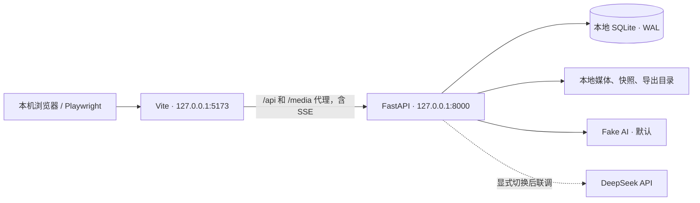

# 英语师范生 GAI 协作英语课堂互动网站制作系统
## 项目开发文档 v1.3 · 与数据采集设计 v0.7 对齐

> 更新日期：2026-10-12。本文件是 v1.3 的实现与验收契约，按[数据采集设计 v0.7](9.21%20数据采集设计文档.md)的2026-10-12修订对齐。本文定义实现与验收，采集设计§3—§5定义事件、字段与归档主表，§1.4定义正式任务及四维作品要求，§7定义伦理与数据生命周期；M/C编码及统计规则仍见[研究方案](研究方案.md)。本次仅修改两份文档，不改代码、事件注册文件或历史资料，也不重新执行测试。已有实现及本地验证见[2026-10-09验收记录](docs/acceptance/collection-v1.3-2026-10-09.md)；其旧导航、资源级引用和问卷规则不代表最新要求已完成。新版要求按§10—§12逐项验收，不批量勾选。

**教材接入更新：2026-10-12。** 用户更正任务单元为 Unit 6: Fantastic friends。统一材料包为目录介绍、印刷94–109页主体及118、130–132、150–152、158–159页相关附录，共27页；原整册对应页码见采集设计§1.2.1和 `config/resources/unit6-fantastic-friends-source-v1.mapping.json`。`config/task-templates/unit6.json` 为草稿，尚未进入 `config/tasks` 或分配正式会话：v2 已包含可提取文字层，但存在 OCR 错误；2026-10-13 已加入版本化逐页校对文件，阅读器显示 v2 PDF，AI 当前页引用读取对应校对正文。教材发布上限独立为100 MiB，学生附件仍10 MiB。归档保留 PDF、原 OCR、校对文件与实际 AI 输入；修改任一内容须发布新资源版本。正式采集前仍需研究者独立复核校对稿；不增加截图或在线 OCR。默认测试任务继续使用合成教材，可用 `scripts/prepare_unit6_preview.py` 添加本地 Unit 6 工程试用任务。

## 1. 项目目标与边界

### 1.1 产品目标

服务师范生在课堂中与 GAI 协作制作英语课堂互动网站的任务，保留人机对话、操作与版本、屏幕视觉及作品，支持后续过程描述、可靠识别和作品质量关系分析。平台采集事实，不计算元认知分数、不做实时干预。

目标流程：研究者落实同意与参与安排 → 认证 → 任务列表 → 选择任务并处理背景问卷（作答或明确拒答） → 任务/示例/教材/工作台四页自由切换 → 与AI协作、编辑和手动测试 → 提交网站与简要设计说明或结束归档。先完成单机增量改造和可重复验收，再进行正式采集前的真实模型、局域网、设备及录像回放核验；非研究教学安排不纳入研究采集。

### 1.2 本期目标与现有实现

| 项目 | 本轮文档锁定的目标 | v1.3 实现状态与剩余验收 |
|---|---|---|
| 任务与身份 | 任务列表、稳定匿名参与者、任务分配、正式Unit 6条件冻结、允许拒答的五题背景问卷 | 旧入口/问卷已完成本地验证；拒答、同意及非研究安排、正式配置待落实验收 |
| 页面与资源 | 四页导航、Unit 6文本PDF阅读器、单次当前整页引用及多页合并发送、示例视频/网页 | 旧导航/资源级引用已有本地验证；四页范围、页码及实际页级AI输入、可选用途/说明待实现验收 |
| AI 协作 | 普通对话/复制粘贴与逐项确认提议并存 | fake 流程及提议全链路已实现；真实 DeepSeek 未联调 |
| 编辑与预览 | CodeMirror 6、修改明细、编辑/实际预览双版本、手动运行、原始控制台、布局/全屏保活 | 旧编辑/运行链已验证；双版本及加载在途/失败语义、动态结果/录屏核验、输入法触控与长时验收待完成 |
| 采集契约 | 49个名称、通用信封及完整正文；48类会话记录＋1类采集元数据 | 契约注册、生成和后端校验已实现；全量现场触发仍需验收 |
| 归档 | 完整业务记录/版本、备课记录/作品/设计说明、条件记录、录屏与锚点、课后编码/四维评分及必要回溯 | 旧导入/导出/恢复已验证；新增资料入口或随包登记、真实媒体PTS与评分资料待核验 |
| 伦理与现场 | 同意/拒答/停止研究、限定录屏、外部AI告知、权限/保存/撤回制度及真实回放 | 当前制度待研究者定稿，工程支持按§5.10及ALIGN-30验收；不是已有技术测试能代替的合规结论 |

现有实现状态查 [README](README.md) 与[本轮验收记录](docs/acceptance/collection-v1.3-2026-10-09.md)；旧版通过的测试仅证明旧契约。本文件清单继续作为逐项验收记录，不把自动测试结果扩写为真实课堂结论。

### 1.3 范围边界

- 首个正式任务使用2024新外研版七年级上册完整Unit 6，个人完成，单元内知识点及互动形式自主选择；任务全文与四维评价按采集设计§1.4发布。8–10词汇游戏只作开发样例，不增加固定题量、必选语法或活动模板。
- 本版编辑/导出单文件HTML，CSS/JS内联；按采集设计§2.2运行要求，目标作品可离线运行、最终HTML自包含，局域网链接不替代最终依赖打包。平台照实保存有缺陷作品，不以技术质量拒绝留档；离线可用性按四维量规的互动功能等适用内容评价，不另增独立评分维度。
- AI 提议须经学生逐项确认才可应用；普通文字回复不自动改代码。系统不提供推荐采纳、强制理由或元认知提示。
- 参与者界面统一称“我的备课记录”，自由文本且全程可选，可自然记录个人标准和判断；后台沿用plan/planner名称。不增加必填COPES/SMART表、预填示例或催写提示；问卷处理完成后无阅读时长、页面顺序或强制运行门槛。
- 本地配置/脚本负责发布任务、教材、示例、问卷、条件清单和参与者分配；本次不设独立美化资源入口。教师管理后台可后置；20台容量、希沃与正式任务时长的现场核验在正式采集前完成（§12.5、§14），不因本地完成而免验。
- fake 仅验证工程流程；真实采集必须记录实际模型及任务版本。模型不能接收的图像/扫描件不得假装已作为文字内容发送。

### 1.4 工程实现约定

1. 继续使用 Vue 3/TypeScript/Vuetify/Pinia/CodeMirror 6、FastAPI/Pydantic/httpx/SQLite。LangChain/LangGraph 与 Vuetify MCP 不作为运行依赖。
2. 本地模拟3个匿名参与者与座位；入口先认证，任务选择后才建立会话。同一研究参与者新任务沿用 participant_id，新建 session_id。
3. 统一 /api/v1 与 /media 相对路径，本地为127.0.0.1:5173/8000，后端单 worker、每会话最多1个在途 AI 请求，全局并发默认2。
4. 本地草稿800 ms持久化，后端5 s有变化检查点；编辑事件与明细边界严格按采集设计 §4.6，不以自动保存刷新预览。
5. occurred_at/recorded_at 分别为真实发生端校正时间与入库时间。sequence_no 为不可变入库序号；派生时间线另用 order_index/order_version。
6. 任务目标、四维标准全文、教材/页码映射、问卷（含拒答选项）、模型工具与允许帮助等条件按采集设计§1.6在发布/会话前锁定版本；独立rubric_version与task_content_version对应归档。具体时限、评分锚点/权重、伦理制度由研究者确定，平台不代填。
7. 自动测试使用独立临时目录，手工调试为 data/local；不得运行测试污染已有研究资料。

### 1.5 后续代码交付物

后续交付为适配本文件的应用增量、配置/迁移、事件类型/校验器、研究者资料接入/导出工具及必要验收证据。49名称机器契约和生成器已有本地实现；此次问卷空值、引用用途/说明、页级内容、预览状态及设计说明等修订需按§16更新相关契约和兼容读取，不因本轮文档修改宣称完成。

## 2. 需求解读与关键验收原则

### 2.1 数据采集原则

- M/C 的认定发生在课后编码，平台只存源事实、来源、时间及版本。
- AI 生成/实际显示、学生选择/系统执行、复制/粘贴、保存失败/运行报错分别记录。
- 同一导航动作共享 action_id；修改汇总与明细共享事实；不能按全部事件行数统计调节次数。
- 所有成功提交不可变，草稿和无成功提交的兜底另存；未提交不自动视为无效数据。
- 录屏关联、原始时间与缺失状态纳入归档；没有材料时标缺失，不补造发生时间或心理标签。
- 四元组覆盖、对象歧义及操作盲区按采集设计§4.2.1/4.2.2核查；只评估可观察关键操作，不承诺采样全部认知操作。SMART与SRL四阶段不新增为强制分类。
- 编辑代码、冻结的运行代码、实际显示的动态画面分别定位；代码变化、preview_ready、无报错和outcome声明不证明功能正确或调节有效。
- 课后交付研究者证据包，通用工具生成必要统计表/时间线；已有AI提议采纳不是SRL干预采纳率，不增加实时分析或反馈分层。

### 2.2 用户可感知的关键行为

背景问卷可作答或明确拒答，处理后显示任务要求，四个页签自由切换。目标与评价标准始终可返回查阅，无反复“已阅读”确认。我的备课记录和提交作品在任务内常驻；工作台三区默认30%/35%/35%，可拖拽。全屏预览隐藏其他区，退出恢复同一iframe。AI生成期间仍可编辑、测试及查资料；仅再次发送受在途锁限制。接受提议只改编辑器，编辑与实际预览版本分别显示，只有运行才加载新作品。提交确认冻结代码、记录与设计说明，随后修改不改变本次提交。

### 2.3 必须保持的关系

- PREPARING 先保存问卷；task_started 在首次任务页实际呈现后至多一次，不是会话所有记录的第一条。
- task_viewed 首访、task_revisited 返回任务页、workbench_entered 真正进入工作台；与 nav_changed 共享 action_id。
- example/resource 开关按 viewer_instance_id 及版本关联；无关闭信号则记未知，不制造完整时长。
- 请求与显示按 response_id/content_revision；提议按 proposal_id/application_id；运行按 run_id；提交按 submission_id/snapshot_id 关联。
- 采集同步可在任务前后发生，使用独立接口和媒体范围绑定；不要求重新激活会话。
- 同意/撤回由研究者限制访问管理，问卷回执不等于同意、结束会话不等于撤回。缺题不等于拒答；outcome声明不等于可见反馈；请求代码基准不等于被评价预览。

## 3. 推荐总体架构

### 3.1 本地运行拓扑



### 3.2 分层设计

#### 前端层（Vue 3 + TypeScript）

- `router`：认证入口、任务列表、背景问卷、任务内四页和错误页；使用 `KeepAlive` 或单一壳组件切换，保证工作台不销毁。
- `stores/session`：JWT、座位号、参与者、会话、服务端时钟偏移、连接状态。
- `stores/task`：任务分配、目标/标准版本、背景题与拒答状态、示例、Unit 6页级材料/映射及阅读恢复状态。
- `stores/workbench`：当前页面、AI请求、附件与独立页级引用、提议、代码/备课记录、待确认运行与实际已加载运行、提交及设计说明状态；不把API保存结果当作iframe已加载。
- `services/api`：REST、SSE、上传、重试和统一错误模型。
- `services/event-collector`：动作识别、合并窗口、事件 outbox、批量发送和幂等重试。
- `components`：任务页、视频弹层、AI 对话、附件列表、代码编辑器、预览 iframe、控制台、计划侧栏、提交弹窗。

#### 后端层（FastAPI）

- `api`：鉴权、任务、会话、上传、对话、代码、计划、预览、提交、事件和导出路由。
- `domain`：会话、附件、请求、代码 revision、运行、计划 revision、提交状态机。
- `services`：事件写入、AI 适配器、文件校验、快照、时间校准、导出和恢复。
- `repositories`：SQLite 事务和查询；禁止路由函数直接拼 SQL。
- `workers`：AI 流式响应、附件处理、会话超时收尾；本期使用进程内受控任务，不引入 Redis/Celery。
- `config`：环境变量、任务配置、文件类型/大小、AI provider、测试故障场景和超时参数。

#### 持久化层

- SQLite：结构化业务数据和事件与采集关联元数据。
- 文件系统：原始附件、任务视频、代码快照、提交清单和导出包。
- 正常业务中原始事件及sequence_no只追加，不覆盖；另生成版本化order_index时间线。获批准的撤回、隐私处理和到期销毁按§5.10优先执行，记录缺口，不以不可变规则拒绝数据删除。

### 3.3 建议项目目录

```text
project/
├─ backend/
│  ├─ app/
│  │  ├─ main.py
│  │  ├─ api/                 # 路由与依赖注入
│  │  ├─ domain/              # Pydantic DTO、状态机、枚举
│  │  ├─ services/            # 业务服务
│  │  ├─ repositories/        # SQLite 读写
│  │  ├─ workers/             # 流式 AI、收尾任务
│  │  └─ settings.py
│  ├─ migrations/
│  ├─ tests/unit/
│  └─ tests/integration/
├─ frontend/
│  ├─ src/
│  │  ├─ views/               # TaskList、Prerequisite、TaskShell、四页内容
│  │  ├─ components/
│  │  ├─ stores/
│  │  ├─ services/
│  │  ├─ composables/
│  │  └─ types/
│  └─ tests/
├─ config/
│  ├─ tasks/task-test.json
│  ├─ resources/              # 版本化教材及提取内容
│  ├─ assignments/            # 匿名参与者与任务分配
│  └─ examples/
├─ data/local/                # 手工调试数据，不提交源码仓库
│  ├─ app.db
│  ├─ attachments/
│  ├─ code-snapshots/
│  ├─ submissions/
│  ├─ exports/
│  └─ backups/
├─ tests/fixtures/            # 本地视频、附件、HTML、AI 固定回复
├─ scripts/                   # local_init、seed_local、export_session、validate_export、backup_local、restore_local
├─ artifacts/                 # 测试报告、trace、日志，不提交源码仓库
├─ docs/acceptance/            # 已完成验收的记录
├─ .env.local.example
└─ README.md
```

### 3.4 核心工程原则

- 所有写操作采用显式事务，事件和对应业务状态变更尽量在同一事务中提交。
- 事件接收接口采用客户端 `event_id` 幂等；重复请求返回 `accepted_duplicate`，不重复插入。
- 代码、计划和提交使用 revision/snapshot，不以“当前字段覆盖历史”替代版本。
- 浏览器只能拿到短期 JWT 和必要的匿名标识；AI key、数据库路径、文件系统路径不下发。
- 后端返回统一错误结构：`code`、`message`、`retryable`、`request_id`。
- 所有时间统一存 UTC ISO-8601，展示时转课堂时区 `Asia/Shanghai`。
- 服务器启动、关闭、磁盘不足、AI 不可用、数据库异常必须写结构化日志，但日志中不重复打印完整学生作品和 API 密钥。

### 3.5 本地开发选型和接口保留

- 保留 Vue 3、TypeScript、Vuetify、Pinia、FastAPI、Pydantic、httpx、SQLite；统一使用 CodeMirror 6 实现单文件编辑。最终版本写入锁文件。
- 先以 `AIProvider` 接口实现 fake 和 DeepSeek adapter；LangChain/LangGraph 的智能体编排不作为本地采集闭环的前置依赖。
- 前端接口全部使用相对地址 `/api/v1` 和 `/media`。通过 Vite 代理转发，统一使用 `127.0.0.1`，避免混用 `localhost` 造成 JWT/IndexedDB 存储与来源差异。
- Vite 和 FastAPI 均仅绑定回环地址。当前不用 Docker、反向代理、公网域名或外部数据库；未来部署通过配置替换入口地址和数据根目录。
- 任务视频、字体、编辑器和脚本来自本地资源；fake 模式下浏览器不需要访问 CDN。

## 4. 领域模型与状态机

### 4.1 会话状态与结束口径

研究者先按采集设计§7落实同意及非研究教学安排，再启用研究认证、日志和录像；当前系统不能区分非研究路径时，另用不纳入研究采集的教学环境。认证返回匿名身份和授权任务；选择后创建/恢复session，状态PREPARING→ACTIVE→ENDING→ENDED。准备阶段退出可为ABANDONED，不伪造任务开始/结束。participant_id来自任务分配，新会话不新造身份，旧资料仅按可靠映射关联。

- PREPARING：冻结任务/问卷/资料，可恢复处理状态。五题各有合法回答或明确拒答后保存task_prerequisite_completed（student），重传不重复；配置中的拒答以条目存在且answer_value=null表示，缺少条目仍为记录缺口，全部拒答也可继续。
- ACTIVE：问卷处理完成（含拒答）、任务页首次实际呈现及开始接口确认后记一次task_started（system，取显示回执）；随后访问/导航共用action_id。未处理准备流程的业务仍拒绝；不以必须提供五个有效回答阻止任务。
- ENDING：暂存 pagehide 候选或处理明确结束。离开候选15 s续接宽限，明确结束无续接分支。
- ENDED：拒绝新业务，但允许查询、归档、结束前发生的历史记录及在途结果补传；task_ended 至多一次。录屏元数据走独立工具，不受此门禁限制。

| 情景 | 会话及时间规则 |
|---|---|
| 四页/任务列表往返、最小化 | 保留同一任务会话；任务列表期间工作台宿主仍保活，导航按实际可见性记录。进入其他任务先明确结束当前任务 |
| 普通刷新 | 持有效恢复凭证且15 s内续接，撤销离开候选；不重复问卷完成/task_started/task_viewed。恢复已保存状态，预览堆栈不保证恢复，也不自动新增运行 |
| bfcache | pagehide.persisted=true 不判结束，pageshow 校验租约后续接；已结束会话只读 |
| 关闭后新开 | 无可用恢复凭证则建立新 session；原租约仍有效时拒绝第二写者，失联时先定案原会话；同一人保留 participant_id |
| 无心跳/未知关闭 | 30 min 后按系统判定时间记 timeout_unobserved；不能将最后心跳冒充真实关闭时间 |
| 明确结束 | student_end 使用 student；teacher_end/超时/未续接定案使用 system；保存已收到内容及未提交兜底 |

每个 session 仅一个有效写入租约（60 s、15 s续期）。pagehide.persisted=false 本身不证明关闭；15 s未续接才定案 page_exit_unresumed，保留实际 pagehide 时刻并注明推定依据。取消的离开候选保存在技术账本，不发 task_ended，也不占用正式事件序号。

任务开始前因退出废弃的问卷只保留准备状态；重开已结束任务需新会话，是否复用已完成背景问卷由锁定任务配置明确，本版默认每次新会话独立完成。task duration 从 started_at 起算，不含准备问卷。

正常编辑持续持久化 outbox；关闭前 fetch keepalive 仅尽力补发，不能依赖 beforeunload 保存全部内容。恢复凭证、租约和技术候选不作为新增研究事件。

### 4.2 附件状态

```text
SELECTED -> UPLOADING -> PROCESSING -> READY
                         \-> FAILED -> RETRYING -> ...
SELECTED/READY/FAILED -> REMOVED
```

只有READY附件能进入ai_request_sent.attachment_ids。处理完成记file_attached，失败记attachment_failed；普通移除只取消待发送关联并记attachment_removed，保留已发送历史。正式撤回和到期销毁另按§5.10处理。教材页级引用使用reference_id，与上传attachment_id分开，同次请求可并列发送；多页逐条加入/移除，不合并为跨页板块。

### 4.3 AI 请求状态

```text
DRAFT -> SENT -> STREAMING -> SUCCEEDED
                         \-> FAILED -> RETRYING -> SENT
```

同一会话同时最多一个 `SENT/STREAMING` 请求。失败重试创建新的 `request_id`，并在 `retry_of_request_id` 记录原请求。

### 4.4 代码、运行和提交状态

- 代码、计划和每个请求草稿分别维护逻辑文本 revision，按编辑事务递增；保存检查点不额外递增 revision。详细差分与快照约定见 §5.7。
- 点击运行时同步冻结正文并分配 run_id，封装 code_edited 后预留 preview_run 的事件编号和发生顺序，再执行保存。成功或失败均保留该次尝试，结果未知先核对原编号；完整流程见 §8.5。
- 保存成功仅表示可加载该冻结版本。分别维护编辑revision、待保存/待加载run、iframe承载run和实际已加载状态，保存响应不直接设为“已加载”；旧预览仍显示时保留其run/版本，加载期间实际画面不可用就显示不可用，不伪标新版本。展开记录、切页或全屏不重建iframe，完整规则见§8.5。
- 提交确认冻结编辑器、备课记录及简要设计说明，同时分配submission_id、snapshot_id；成功/失败沿用编号，不在完成时重新读取当前文本。说明是事后成果描述，不自动作为同期M/C理由。

### 4.5 AI 提议状态

GENERATED → DISPLAYED → ACCEPTED/REJECTED；ACCEPTED 后的应用尝试单独为 PENDING → APPLIED/FAILED。显示状态不代表已阅读。提议不直接取得修改权限；学生逐项决定，不提供全部采纳。一次 application_id 幂等，版本冲突不得覆盖，按采集设计 §4.5 与本文 §8.7 执行。

## 5. 数据库与文件存储设计

### 5.1 通用字段与约束

通用信封完全采用采集设计 §4.2；事件名称与 payload 采用其 §3.1/§4.3。目标 schema_version 为 teaching-workbench-events-v1.3。UUID、UTC、SQLite 外键/WAL/busy_timeout 沿用。

- events：不可变完整事件事实，event_id 唯一，sequence_no 是同一会话的持久化顺序；补传追加且不改既有序号。不能将它迁移成另一种逻辑序号。
- event_transport：producer、原始时钟、校准、action_id、因果父引用等；导出时补齐通用信封，不能用接收时间冒充发生时间。
- event_order：可选的研究时间线索引，保存 order_version、order_index、event_id、排序依据和不确定性；与原始 sequence_no 分开。
- capture_events：独立同步元数据，capture_sync_marker 使用 capture_sequence_no 与 recording_id；可在任务开始前/结束后写入，不强行创建会话。
- actor 根据来源设定；客户端系统显示记录须校验其允许事件类型，保存成功/AI完成等权威结果只能由所属服务写入。

同 event_id 同内容返回 accepted_duplicate；内容不同明确冲突。历史基线资料保留旧 schema 和已知时间来源，读取适配器可输出 unknown_legacy；不得为补新字段虚构事实。

### 5.2 核心表

| 表 | 关键字段 | 作用 |
|---|---|---|
| `task_configs` | `task_id`、`version`、`content_json`、`status` | 锁定目标/标准全文、五题及拒答选项、Unit 6页码/材料、示例、工具模型及正式条件；独立量规版本与task_content_version对应 |
| `participants` / `task_assignments` | participant_id、task_id、condition_id、seat_no、assignment_id | 稳定研究身份及任务授权，座位重用不合并身份 |
| `resources` / `resource_references` | resource_id/version/type、处理状态、page映射/页级内容引用；reference_id、draft_id、page、fragment、reference_purpose、reference_note | 原教材及每次独立当前页引用；type=textbook，purpose/note可空且非心理代码 |
| `sessions` | `session_id`、`participant_id`、`seat_no`、`task_id`、`status`、`started_at`、`ended_at`、`last_seen_at` | 会话和匿名身份 |
| `events` / `event_transport` | event_id、sequence_no、完整 payload、发生端序号与时钟/因果引用 | 不可变原始事实与独立技术元数据 |
| `event_order` | session_id、order_version、event_id、order_index、basis | 派生展示顺序，不覆盖原事件 |
| `capture_events` / `recording_sessions` | recording_id、marker_id、capture_sequence_no、session_id、媒体范围 | 独立采集元数据和会话绑定 |
| `attachments` | `attachment_id`、`session_id`、`file_name`、`mime`、`size`、`sha256`、`status`、`storage_ref` | 上传文件和处理状态 |
| `ai_requests` | request_id、session_id、draft_id、message_text、status、retry_of、base_code_revision/基准内容、实际模型输入及引用来源 | 冻结请求及实际送出的页级内容；编辑基准不能代表被评价预览 |
| `ai_responses` / `ai_response_chunks` | response_id、request_id、model_name、正文、status、content_revision、chunk/range | 最终及历史已呈现正文可还原 |
| `ai_proposals` / `proposal_applications` | proposal_id、base_code_revision、decision、application_id、结果版本及状态 | 人的选择与系统应用分别持久化 |
| `request_drafts` / `draft_revisions` | draft_id、draft_revision、文本、附件/引用状态 | 未发送草稿及版本 |
| `code_revisions` | `revision_id`、`session_id`、`revision_no`、`content_ref`、`content_sha256`、`source` | 代码历史和当前指针 |
| `planner_revisions` | `revision_id`、`session_id`、`revision_no`、`content`、`content_sha256` | 自由备课记录历史，保留个人标准与判断原文 |
| `preview_runs` | run_id、session_id、revision_id、保存status、started_at、ready_at及独立加载状态/依据 | 冻结运行与加载状态分开；加载诊断走业务/技术元数据，不新增心理事件 |
| `submissions` | submission_id、session_id、code_revision_id、plan_revision_id、snapshot_id、status、design_rationale | 提交状态与确认时简要设计说明；原文入快照，不另设COPES答题栏 |
| `snapshots` | `snapshot_id`、`session_id`、`code_ref`、`plan_ref`、`manifest_ref`、`sha256` | 可复现作品包 |
| 浏览器 `outbox_events` | `client_event_id`、`payload_json`、`status`、`retry_count` | IndexedDB 对象存储，不是 SQLite 表；保存尚未确认的客户端事件 |

本地首版选择简单且可核对的完整 payload 存储：events 必须保留源 §4.3 要求的 message_text、response_text、edit_changes 等正文，业务表可同时保存便于查询。response_id 不能代替 response_text；只对源设计已经定义为引用的 code_snapshot_ref/snapshot_id 使用文件引用。输入、入库和导出字段约定见 §5.6。

### 5.3 文件目录与不可变快照

```text
data/local/
├─ attachments/{session_id}/{attachment_id}_{safe_name}
├─ resources/{resource_id}/{resource_version}/
├─ proposals/{session_id}/{proposal_id}.json
├─ capture/                 # 清单、校准、锚点及归档录屏
├─ research/                # 课后标注/评分，按版本保存
├─ code-snapshots/{session_id}/{revision_id}.html
├─ planner-snapshots/{session_id}/{revision_id}.txt
├─ submissions/{session_id}/{submission_id}/
│  ├─ index.html
│  ├─ plan.txt
│  ├─ design_rationale.txt    # 同次提交的简要说明，历史缺失不补造
│  ├─ manifest.json
│  └─ checksums.sha256
└─ exports/{export_id}.zip
```

写入采用临时文件 + `fsync` + 原子重命名；数据库只在文件落盘成功后写 `content_ref`。磁盘空间不足时保留编辑器内存、返回可重试错误，并记录 `submit_failed` 或相应系统错误，不得写入半个快照。

### 5.4 事件契约注册表

采集设计 §3.1/§4.3 为唯一名称、actor、触发和 payload 主表。本节仅列实现索引，避免维护第二套字段定义。49个名称必须逐个注册；既有30类名称的扩展字段也要更新校验。capture_sync_marker 使用独立采集入口。

| # | Event_Name | Actor | 字段依据 |
|---|---|---|---|
| 1 | `task_started` | SYS | 采集设计 §4.3 同名行 |
| 2 | `task_prerequisite_completed` | S | 采集设计 §4.3 同名行 |
| 3 | `nav_changed` | S | 采集设计 §4.3 同名行 |
| 4 | `task_viewed` | S | 采集设计 §4.3 同名行 |
| 5 | `task_revisited` | S | 采集设计 §4.3 同名行 |
| 6 | `example_opened` | S | 采集设计 §4.3 同名行 |
| 7 | `example_closed` | S/SYS | 采集设计 §4.3 同名行 |
| 8 | `resource_opened` | S | 采集设计 §4.3 同名行 |
| 9 | `resource_view_changed` | S | 采集设计 §4.3 同名行 |
| 10 | `resource_closed` | S/SYS | 采集设计 §4.3 同名行 |
| 11 | `resource_reference_added` | S | 采集设计 §4.3 同名行 |
| 12 | `resource_reference_removed` | S | 采集设计 §4.3 同名行 |
| 13 | `workbench_entered` | S | 采集设计 §4.3 同名行 |
| 14 | `planner_opened` | S | 采集设计 §4.3 同名行 |
| 15 | `planner_edited` | S | 采集设计 §4.3 同名行 |
| 16 | `file_attached` | S | 采集设计 §4.3 同名行 |
| 17 | `attachment_failed` | SYS | 采集设计 §4.3 同名行 |
| 18 | `attachment_removed` | S/SYS | 采集设计 §4.3 同名行 |
| 19 | `ai_request_edited` | S | 采集设计 §4.3 同名行 |
| 20 | `ai_request_sent` | S | 采集设计 §4.3 同名行 |
| 21 | `ai_response_received` | SYS | 采集设计 §4.3 同名行 |
| 22 | `ai_response_displayed` | SYS | 采集设计 §4.3 同名行 |
| 23 | `ai_response_failed` | SYS | 采集设计 §4.3 同名行 |
| 24 | `ai_response_copied` | S | 采集设计 §4.3 同名行 |
| 25 | `ai_proposal_created` | SYS | 采集设计 §4.3 同名行 |
| 26 | `ai_proposal_displayed` | SYS | 采集设计 §4.3 同名行 |
| 27 | `ai_proposal_reviewed` | S | 采集设计 §4.3 同名行 |
| 28 | `ai_proposal_decided` | S | 采集设计 §4.3 同名行 |
| 29 | `ai_proposal_applied` | SYS | 采集设计 §4.3 同名行 |
| 30 | `ai_proposal_failed` | SYS | 采集设计 §4.3 同名行 |
| 31 | `code_pasted` | S | 采集设计 §4.3 同名行 |
| 32 | `code_edited` | S | 采集设计 §4.3 同名行 |
| 33 | `code_edit_delta` | S | 采集设计 §4.3 同名行 |
| 34 | `preview_run` | S | 采集设计 §4.3 同名行 |
| 35 | `preview_save_failed` | SYS | 采集设计 §4.3 同名行 |
| 36 | `preview_ready` | SYS | 采集设计 §4.3 同名行 |
| 37 | `preview_error_detected` | SYS | 采集设计 §4.3 同名行 |
| 38 | `preview_error_copied` | S | 采集设计 §4.3 同名行 |
| 39 | `preview_interacted` | S | 采集设计 §4.3 同名行 |
| 40 | `ui_region_visibility_changed` | SYS | 采集设计 §4.3 同名行 |
| 41 | `window_left` | S | 采集设计 §4.3 同名行 |
| 42 | `window_returned` | S | 采集设计 §4.3 同名行 |
| 43 | `submit_dialog_opened` | S | 采集设计 §4.3 同名行 |
| 44 | `submit_confirmed` | S | 采集设计 §4.3 同名行 |
| 45 | `submit_cancelled` | S | 采集设计 §4.3 同名行 |
| 46 | `submit_succeeded` | SYS | 采集设计 §4.3 同名行 |
| 47 | `submit_failed` | SYS | 采集设计 §4.3 同名行 |
| 48 | `task_ended` | S/SYS | 采集设计 §4.3 同名行 |
| 49 | `capture_sync_marker` | SYS | 采集设计 §4.3 同名行 |

S/SYS 的条件按采集设计 §3.1：主动/导航关闭为学生，任务结束清理为系统。后台收到浏览器回执不重复写同名服务事件；actor 与 producer 分开。

### 5.5 入库顺序、发生端时间与派生时间线（A01）

1. 浏览器及 iframe 在动作发生时取得 event_id、producer_seq、raw_time/monotonic_ms 和校准引用；系统结果在结果形成时取时。同一实例内递增，重启新 producer_id；待定尝试提前保留发生上下文。
2. 服务端持久化时分配 sequence_no/recorded_at；补传原 event_id 与发生上下文不变，按到达顺序追加。sequence_no 永远不是心理或动作顺序。
3. 原始 events.jsonl/CSV 按 sequence_no 导出。研究者需要排序时，由端内顺序、请求/版本/显示引用和录屏锚点生成 event_order；保存 order_index/order_version，不重写原行。
4. 对缺少已知先后的节点，用校正时间和 event_id 形成可重复展示序，同时标记时间推定/并发不确定；误差内的前后不作确定推断。父引用缺失或约束冲突记录 quality，不伪造父事件。
5. 问卷完成可先于 task_started，捕获同步位于独立文件；结束后完成的在途系统结果仍归原会话，不硬挤到 task_ended 之前。
6. 校准在会话/实例建立时及刷新、录屏分段后核查，原始时钟和往返误差保留。校时更新不追改已持久化 occurred_at；需要重新映射时保存新的派生版本。

schema 校验失败、pending、取消候选和时间缺口写质量/技术记录，不伪造行为事件。编辑内部顺序用 revision 与明细重放。完整验收需核查确定的端内和业务先后，不能用导出行序代替。

### 5.6 输入、存储与导出的统一 schema（A05）

| 层级 | 内容与约束 |
|---|---|
| 客户端输入 EventIn | schema_version、event_id、event_name、actor、session_id、occurred_at、完整 payload；producer、时钟、action_id 等元数据单列 transport。批量接口 session_id 可由外层传入；身份字段由 JWT 绑定，不能自行伪造 participant/seat/task |
| 服务端内部事件 | 同样的完整 payload；actor、结果状态和业务引用由对应服务生成。浏览器发来的 preview_ready/error 必须来自已校验的预览桥接 |
| events | 完整 payload 及事件事实写入一次；message_text/response_text/edit_changes 不能被 ID、文件路径或省略号替代 |
| 标准 JSONL/CSV | 采集设计 §4.2 全部通用字段及 §4.3 对应完整 payload；system 结果和重复事实不另计学生行为 |
| 业务表 / 文件 | 请求、回复、revision 等便于查询的副本必须与事件事实一致；仅原本定义为引用的快照/附件需要按 ID 解析 |
| manifest / quality.json | 保存 schema_version、order_version、待定尝试、缺失引用、时序不确定和恢复依据；不塞进研究事件 payload |

实现一个事件注册表生成前端类型、后端验证与导出校验，禁止输入接受“仅 response_id”，导出才临时拼出 response_text。注册表中的可空字段输出 null，空的合法 message_text/plan 使用空字符串，空 attachment_ids 使用 []；不可将字段缺失与合法空值混为一谈。

最终 JSONL 应独立包含所有要求的事件正文；validate_export 同时检查文件引用、业务副本一致性和 schema。研究正文不主动截断；容量超限必须明确报错和保留本地待处理内容。普通运维日志不打印完整正文。

### 5.7 文本 revision、差分及交错操作协议（B02）

本节落实采集设计 §4.6，两处约定须同步。

编辑器统一使用 **CodeMirror 6**。代码、计划及每个请求草稿分别维护 revision；初始为 0，每次实际文本变更事务递增，保存/查找/光标移动不递增。发送后清空草稿、恢复赋值不记为人工编辑。

- 换行统一 LF；偏移、长度和选区均采用 **UTF-16 code unit、0 起始半开区间**。`edit_range={start,end}` 指该项变更前文本；行列号仅供显示，不作为第二套重放坐标。
- `edit_changes[]` 每项为 `{operation,inserted_text,deleted_text,edit_range,base_revision,result_revision}`。`operation` 为 insert/delete/replace/undo/redo；撤销重做仍保存实际增删文本。一次事务的多处替换按 CodeMirror ChangeSet 转成可顺序重放的原子替换；同事务可共享版本对，以数组次序重放，再校验最终版本。
- `code_edit_delta.changes[]` 使用相同结构，逐批覆盖不重叠的人工变更区间；`code_edited.delta_ids[]` 引用本次合并涉及的明细，汇总正文与明细重放必须一致。两者是同一修改事实的汇总与明细，不相加计数。
- 人工代码变更以 500 ms 空闲批量封装明细；持续输入最多 30 s 封装一次。运行、切页、窗口离开、提交、结束、粘贴前及应用 AI 提议前强制 flush。30 s 边界也封装一次 code_edited，避免无限积累；500 ms 明细不各自新增 code_edited。
- 粘贴前先封存人工修改，粘贴单独记录 code_pasted；AI 应用前同样封存，应用只记 ai_proposal_applied。两者均不重复进入人工 code_edited/code_edit_delta；随后真实手动修改或撤销进入新的人工区间。
- 计划的 flush_reason 为 close/tab_switch/leave/submit/session_end；请求草稿为 send/tab_switch/leave/submit/session_end；代码为 run/tab_switch/leave/submit/session_end/idle/paste/proposal。无变更不发编辑事件。稿件正文未变但附件/引用变化时更新草稿关联状态，保留 draft_revision，不伪造文本编辑。
- 800 ms 本地草稿持久化、5 s 有变化时的后端检查点、上述行为封装是不同机制；任一自动保存都不刷新预览。乱序检查点只补历史，不回退当前指针；版本冲突保留本地输入并明确报错。

例：手输 A（r0→r1）→ 粘贴 B（r1→r2）→ 手输 C（r2→r3）→ 运行，产生前后两个 code_edited 区间及各自明细，中间一个 code_pasted；按版本重放为 ABC，不能按到达行序叠加两份相同差分。

### 5.8 原始归档边界（B06）

完整原始数据包包含一致性SQLite备份与其引用的任务/标准全文、页级教材与映射、附件/引用状态、提议、回复历史/未发送草稿、代码/备课记录/运行/提交及说明；events.jsonl/CSV与records/*.json等完整业务记录共同导出。条件清单/现场记录、实际媒体/锚点、独立编码/评分和必要回溯按实际清单归档，不只有编号。未归档或未提供的资料显式缺失，不称完整多模态包。manifest枚举实际文件并核对内容/引用；停止写入或使用一致性备份，不直接拷贝活跃app.db。独立目录恢复须同时恢复数据和文件，并尊重§5.10已执行的撤回/销毁，不重新纳入已撤回资料。

### 5.9 录屏、同步及课后资料

文件清单与字段直接采用采集设计 §5。研究者导入工具校验 participant/session/recording 绑定、实际媒体 PTS、锚点、误差与文件存在性；使用独立研究者权限或本地 CLI，学生端不能写评分与标注。

录屏可先外部采集，元数据可通过人工 CSV 导入；本地验收仍须真实检查一段录屏及前后锚点、刷新分段和缺失情况。缺失文件标记诊断状态，不能用演示视频替代真实录屏。媒体绑定为多对多，录制开始早于任务时 session_id 可空，课后绑定实际范围。

artifact_ratings.csv按采集设计§1.4/§5定义作品/评分者/量规引用及四维口径，具体评分锚点由研究者定稿，评分方法按研究方案执行。本轮不新增量表或更改编码模板。

当前四维为教学目标匹配、内容准确性、互动功能、教学支持，以采集设计§1.4为正式发布口径；研究者冻结锚点/权重/总分及rubric_version，不沿用研究方案旧五类候选。编码者按现有CSV模板在source_refs引用原文、标准/代码/运行版本、录屏；编码版本/独立记录/裁决分开留存，系统不判断“监控正确/调节有效”。

条件清单、重要现场变化和有限回溯按采集设计§1.6/§5.1由研究者记录：会话/片段、发生或访谈时间来源、回忆间隔、展示录像/版本、提问/回答原文及事后来源标识。现有工具不支持时可独立文件随包归档并在manifest列明，不为此开发实时模块；保留未开展、无法回忆、缺失和矛盾，回溯不回填同期理由。录像限定告知的工作区域，默认无声音/摄像/非任务窗口；真实PTS核验与实测误差不能用标记页面测试代替。

### 5.10 伦理与数据生命周期的工程支持

制度主定义采用采集设计§7；本期以研究者配置、受限文件和必要脚本落实，不开发大型隐私管理面板。正式研究启用前研究者定稿伦理/同意版本、非研究教学安排、联络方式、录屏/外部AI范围、访问保护、保存期限、撤回截止及销毁责任；日期和法律结论不得由代码默认值代填。

- 身份对应表与研究数据分开保管；学生只能读写自己的任务资料，研究者导入/导出需独立权限；评分者仅获去标识作品/必要教学说明，不获身份表或过程标签。CLI同样受存储和操作系统权限限制。
- 外部AI实际发送消息、上下文、代码及可处理引用/附件以请求归档核对；普通日志不打印原文/密钥。告知真实服务商及其保存/使用政策，内网不等于不外传，未发送草稿不自动交给服务商。
- 普通附件移除、会话结束与研究撤回分开。研究者收到停止参与请求后停止该参与者研究采集/录像，并按制度处理未发送队列、在途结果及后续导出，防止已撤回资料被离线补传或备份恢复重新纳入。
- 按可靠participant/session关联定位需处理的事件/业务记录、附件、代码/记录/提交、媒体范围、分析副本、导出和备份；核对共享资源与多会话录像，避免误删其他参与者。保留受限的处理记录及可解释缺口，匿名汇总限制和远端AI数据处理据实际政策告知，不承诺本地删除能清除远端数据。
- 意外个人信息在分析/展示副本遮挡或排除；原始资料不默认公开。归档后本地录像、到期资料及备份按批准制度清理；不可变历史规则不凌驾于合法撤回/删除。

停止采集、权限隔离及研究者处理流程在隔离测试目录核验；不得对现有研究资料试删。机构制度与真实现场流程是正式采集前条件，本地工程通过不能单独证明合规。

## 6. API 契约（本轮目标）

### 6.1 接口约定

- 前缀：`/api/v1`。
- JWT 放在 Authorization: Bearer；认证入口令牌只可读授权任务/创建会话，任务业务使用绑定 participant_id/session_id/seat_no 的令牌。采集/研究者接口使用单独权限，不借学生会话伪造评分或录屏关联。
- JSON 接口返回 `request_id`；错误格式为 `{code, message, retryable, request_id}`。
- 写接口支持 `Idempotency-Key`，特别是事件批量、提交和 AI 重试。
- SSE 仅用于 AI 流式正文；断开后客户端显示已收到片段并允许重试，不自动重复发送。当前使用支持 Authorization 请求头的 fetch 流式读取，避免原生 EventSource 无法直接设置 Bearer header 的差异。

### 6.2 启动与会话

| 方法 | 路径 | 说明 |
|---|---|---|
| POST | /entry/bootstrap | 校验分配/座位凭证，返回稳定 participant_id、入口令牌与可参加任务摘要；不生成 task_started |
| POST | /session/bootstrap | 选择 task_id/assignment_id 后创建或恢复 PREPARING/ACTIVE 会话；绑定任务版本并返回任务令牌 |
| GET | /session/me | 当前状态、准备问卷/已保存作答、租约、当前版本、未完成请求等 |
| POST | /session/prerequisite | 验证五题条目及冻结问卷版本：原量尺值或明确拒答null均合法，缺题/非法值拒绝；全部拒答可继续，幂等记录task_prerequisite_completed，不代替同意 |
| POST | /session/start | 问卷处理完成（含拒答）后接收任务页实际显示回执，幂等设ACTIVE/started_at及task_started |
| POST | /session/heartbeat | 续租及更新 last_seen_at，不增加学生事件 |
| POST | /session/detach | 记录离开候选，按 §4.1 等待续接 |
| POST | /session/end | 正式任务明确结束，保存已收到状态、task_ended 和兜底；准备阶段只标废弃 |

开始接口确认前浏览器保存首屏回执到 outbox；网络失败显示连接状态并重传同一命令，不能提前启用 AI/提交业务或生成多个开始事件。

### 6.3 任务与媒体

| 方法 | 路径 | 说明 |
|---|---|---|
| GET | /tasks | 按入口身份返回授权任务卡片；准备完成前仅标题/摘要，不暴露完整任务要求 |
| GET | /tasks/{task_id} | 按准备/任务权限返回问卷配置或锁定任务详情；任务要求只在前置完成后可读 |
| GET | /tasks/{task_id}/examples | 视频/网页示例的版本、封面、媒体类型及本地地址 |
| GET | /media/examples/{example_id} | 视频支持 Range；网页示例使用隔离沙箱展示 |
| GET | /tasks/{task_id}/resources | 本任务锁定教材列表、展示及 AI 输入可用状态 |
| GET | /resources/{resource_id}/versions/{version} | 授权返回完整Unit 6原件、页序/印刷页码映射、页级内容与处理状态；AI输入按引用页解析，不能用整资源全文替代 |
| POST / DELETE | /drafts/{draft_id}/references[/{reference_id}] | 添加/移除独立当前页引用；保存reference_id、资源/版本、page、fragment=null、可空reference_purpose/reference_note与草稿版本；时间随事件保留，支持同草稿多个引用 |
| PUT | /drafts/{draft_id} | 保存正文、文本 revision 及附件/引用状态，支持未发送草稿恢复 |

发布和预处理使用本地配置/脚本，无需教师编辑后台。每页提取文本与原排版核对，版本化归档；文字模型仅输入实际可处理文本，扫描/图片未经处理不能冒充文字。不将本机文件绝对路径送给学生或模型。引用页码未知时保留诊断并禁用当前页发送，阅读/手工复制仍可继续；历史空页码资源级引用按原语义读取，不伪造页级定位。

### 6.4 事件

`POST /events/batch` 请求示例（身份字段由令牌绑定，sequence_no/recorded_at 在持久化时分配；transport 在导出时展开为采集设计 §4.2 的字段）：

```json
{
  "session_id": "session-01",
  "events": [
    {
      "schema_version": "teaching-workbench-events-v1.3",
      "event_id": "event-42",
      "event_name": "planner_opened",
      "actor": "student",
      "occurred_at": "2026-09-22T06:23:11.123Z",
      "transport": {
        "producer_id": "browser-01",
        "producer_seq": 42,
        "client_sequence_no": 42,
        "raw_time": "2026-09-22T06:23:11.120Z",
        "monotonic_ms": 14231.5,
        "clock_calibration_id": "calibration-01",
        "time_source": "client_clock",
        "action_id": "action-42",
        "causal_parent_ids": ["event-41"]
      },
      "payload": {}
    }
  ]
}
```

响应逐条返回 accepted、accepted_duplicate 或 rejected、是否可重试和原因。accepted 表示完整事件事实已持久化；返回已分配的 sequence_no/recorded_at，它只表示入库顺序。请求派生时间线时另指定 order_version；不得混同两种序号。

重复 event_id 且内容相同不覆盖原文；同编号内容不同返回 EVENT_ID_CONFLICT。临时故障退避重试，永久 schema 错误保留在失败队列。跨会话身份/父事件引用拒绝。后端业务服务生成的结果与浏览器回执使用同一个 event_id，不重复记录两次。

### 6.5 编辑器、计划和预览

| 方法 | 路径 | 说明 |
|---|---|---|
| `GET` | `/workbench/state` | 恢复代码/记录、对话、附件/页级引用、控制台、待确认运行及运行/加载证据；旧ready不证明刷新后新iframe已加载，重新核对实际呈现 |
| `PUT` | `/workbench/plan` | 保存当前计划文本，返回 `plan_revision`；用于自动保存和离开前 flush |
| `PUT` | `/workbench/code` | 自动检查点保存代码及未归档变更，返回逻辑 revision 和快照引用；不触发运行 |
| `POST` | `/workbench/preview/run` | 接收点击时已分配的 run_id/事件信封、冻结代码及 revision；保存并确定结果，完整事务见 §8.5 |
| `GET` | `/workbench/preview/{run_id}` | 返回同次保存pending/saved/failed及独立加载证据/状态；用于超时核对，保存成功不冒充实际呈现，查询不再次运行 |
| `GET` | `/workbench/preview/{run_id}/logs` | 查询控制台日志、警告和错误 |
| `POST` | `/workbench/preview/{run_id}/interaction` | 由受控桥接上报有意义的游戏交互；不接收鼠标移动等原始高频事件 |

`PUT /workbench/code` 和 `POST /workbench/preview/run` 必须检查代码大小上限、内容编码和快照 SHA-256。运行接口返回保存失败时不得返回可加载的新预览地址。

### 6.6 附件与 AI

| 方法 | 路径 | 说明 |
|---|---|---|
| `POST` | `/attachments` | multipart 上传；校验扩展名、MIME、大小及实际格式，按已配置解析能力处理，状态从 `UPLOADING` 到 `READY/FAILED` |
| `GET` | `/attachments/{attachment_id}` | 查询处理状态和错误 |
| `DELETE` | `/attachments/{attachment_id}` | 普通待发送移除并记attachment_removed，历史保留；研究撤回/销毁按§5.10另执行，不以此接口冒充删除全部研究资料 |
| `POST` | `/ai/requests` | 冻结request_id、正文/草稿版本、编辑基准、READY附件及reference_ids[]各页实际输入；可合并多页，不把整单元全文替代被引用页；来源与模型配置归档 |
| `GET` | `/ai/requests/{request_id}/stream` | SSE 流式返回回复片段和最终状态 |
| `POST` | `/ai/requests/{request_id}/retry` | 以新 request_id 重试，自动填写 retry_of_request_id |
| GET | /ai/proposals/{proposal_id} | 获取不可变提议及其 base_code_revision 对应的改动详情 |
| POST | /ai/proposals/{proposal_id}/decision | 幂等保存单项 accept/reject 和实际显示引用；不自动应用 |
| POST | /ai/proposals/{proposal_id}/applications | 已接受后申请 application_id，检查基线版本，原子保存结果版本及应用事件 |
| GET | /ai/proposals/{proposal_id}/applications/{application_id} | 查询未知应用结果，重传不重复写入 |

文件允许列表、大小上限和 AI 超时必须放在配置中，并在前端上传入口显示实际值。服务器永远以服务端配置为准。

### 6.7 提交与导出

| 方法 | 路径 | 说明 |
|---|---|---|
| `POST` | `/submissions` | 确认时冻结代码、记录、revision、submission_id/snapshot_id及design_rationale自由文本；事后说明与同次快照保存，重传不重复，不从最终代码倒写理由 |
| `GET` | `/submissions` | 查询所有提交、单调 submission_no、最近成功时间、最终成功作品指针及未提交兜底来源，按 §8.6 |
| `GET` | `/submissions/{submission_id}` | 查询同一次确认的确定结果；传输超时不直接发起第二次提交 |
| 本地 CLI | `scripts/export_session.py` | 当前用本地命令导出会话和作品，无需开发教师后台；导出 HTTP 管理接口后置 |

### 6.8 研究者采集归档入口

已有本地导入/导出和独立采集入口见2026-10-09记录，本节为继续核对和扩充的目标，不暴露为学生按钮：参与者/媒体绑定、capture_sync_marker、真实sync_anchors/clock_calibrations、课后annotations/artifact_ratings、条件记录和必要retrospective。字段与内容按采集设计§1.6/§5；不支持的研究者资料允许独立文件随包登记，不能伪造已自动接入。权限与撤回执行按§5.10。

同步标记可在任务前后写入，已有 marker_id 重传不重复；真实媒体时间由视频核验后绑定，不能直接把按钮点击时间当 PTS。导出可包含缺失说明的诊断包，完整多模态包须校验实际文件与引用。

## 7. 前端实现细则

### 7.1 路由、保活与布局

入口依次为认证、授权任务列表、任务会话准备问卷、TaskShell。任务壳提供 task/example/textbook/workbench 四页和常驻时间/座位/我的备课记录/提交按钮；返回任务列表仍保留当前活动任务宿主。列表页不提供对未选任务的提交入口。

TaskShell 持有稳定 WorkbenchView；切页不卸载或换 iframe key，不依赖 KeepAlive 的名字假定浏览器状态一定保留。上传、SSE、草稿、附件/资源引用、提议、控制台和预览由稳定宿主持有，返回后显示同一请求结果，不重复调用模型。

每次实际切页先在本地封装编辑边界，再记 nav_changed；首次 task 另记 task_viewed，返回 task 另记 task_revisited，真正进入 workbench 才记 workbench_entered，同一动作共享 action_id。切页不等待网络落库才改变显示，不自动运行。

初始三区30%/35%/35%，拖拽结束记录布局可见性。全屏仅改变原iframe容器，隐藏记录/编辑区，退出恢复原宽度，不重载作品。布局事件记录实际区域而非注视。背景题/拒答选项及校验读取锁定配置；五题均有作答或明确拒答后四页自由访问，全部拒答不设额外门槛。保存研究同意由研究者安排，不以问卷回执替代。

### 7.2 事件采集器与记录边界

```ts
track(name, completePayload, occurrenceContext)
reserveAttempt(name, occurrenceContext)  // 保留编号、发生时间、producer_seq
finalizeAttempt(attemptId, completePayload)
appendDraftChange(kind, change)
flushDraft(kind, reason)
```

- 识别动作时立即取得 occurrenceContext，再异步持久化/发送；重试不改变 event_id、发生时间或原顺序。系统结果按可信服务或桥接来源校验，不能由浏览器随意声明保存成功。
- reserveAttempt 为运行等需等待结果的动作保存技术草稿；未定案前不向研究库写 payload 不全的事件。最终按原发生时刻生成一次完整记录，详见 §8.5。
- 每类文本的合并与明细边界严格采用采集设计 §4.6/本文 §5.7；切页使用 tab_switch、窗口离开使用 leave、结束使用 session_end。自动保存不消费行为缓冲，不能在所有按钮上无差别清空全部草稿。
- 无实际变更不产生编辑事件；将非空文字全部删除仍是有效变更。程序恢复、发送后清空和快照加载不冒记人工编辑。
- visibilitychange=hidden、pagehide 触发 leave 边界时去重；pagehide 的结束候选按 §4.1 处理。每个活动编辑缓冲只能被同一边界消费一次。正常运行中持续持久化，关闭时 keepalive 只是尽力补发。
- window_left 以 hidden/pagehide 为依据，blur 只作辅助；window_returned 以 visible/pageshow 且存在未配对离开为依据。切进 iframe、视频全屏及 Alt-Tab 只按实际可见性信号判断，不伪造必然切出，也不弹“请勿离开”。

### 7.3 任务、示例与资料库

任务页按采集设计§1.4完整呈现Unit 6任务背景、五项要求、基本要求和四维标准；标题、正文及学生实际可见标准随task_content_version保存，独立rubric_version与之关联。标准持续可查，无重复“我已阅读”确认或阅读解锁；访问不等于采用标准。任务页首次/返回与工作台进入按§7.1记录，四页无时长/滚动/观看门槛。原词汇游戏只作fixture，平台不自动判分或阻止有缺陷作品归档。

- 至少两段本地视频用于开发验收，卡片有标题、封面和时长；按 task/version/example_id 独立保存进度。
- 弹层打开不自动播放；提供播放/暂停、进度拖动、音量/静音、全屏和结束后从头重播。退出全屏只返回原弹层。
- 关闭立即暂停并记录 example_closed；切工作区使用 close_reason=navigate，会话收尾尽力使用 end；重开保留位置并保持暂停，另一个视频的进度不受影响。
- 视频失败显示“视频暂时无法播放”和重试，任务阅读及进入工作区仍可用。细粒度媒体控制仅参与本地计时，不新增行为事件。
- 区分两个时长：opened→closed 的墙钟差是弹层停留时间，watched_seconds 是该次打开内实际播放的墙钟时长。仅在页面可见、媒体实际前进且未暂停/缓冲/seek 时，按 performance.now 累加；拖动跳过的媒体时间不计，倍速不乘入时长。窗口不可见时不累计 watched_seconds；是否继续播放由播放器及浏览器实际状态决定，采集器不自动更改播放状态。恢复可见后只累计真实播放片段，不因此额外发关闭事件。
- 示例浮层不暂停任务页停留计时。状态恢复若缺少真实关闭信号，不伪造精确观看结束，缺口进入质量报告。
- clock_offset_ms = server_now - 请求往返中点时间；显示 Date.now() + clock_offset_ms，保存事件时使用同一校准。每个校准段的偏移和误差估计仅存工程元数据。

教材页直接打开统一 Unit 6 文本PDF材料包；发布者可接收整册原件并提取非连续页段，参与者不浏览整册，也不设置额外资源选择页。打开成功、稳定页范围变化、关闭及引用按采集主表记录，不逐像素滚动采集。网页示例用独立沙箱及example开关，不重复记resource，两个视频字段为空。引用不自动切工作台或发送请求。

**教材阅读器目标（2026-10-12对齐，待实现验收）：** 左侧可收起缩略图、中央连续滚动区、上方引用当前页/去工作台、底部翻页、页序跳转、缩放/适宽，四页导航和记录入口保持可用。文件page从1起始，与印刷页码映射分开。当前页取阅读区可见面积最大页面，面积相同时取较小页序；点击冻结该页，后续滚动不改变既有引用。翻页、缩略图、缩放及记录开关后保留页序/位置/缩放/侧栏状态，离开关闭可见区间，返回恢复位置并记新打开。不记录不可见的后台阅读时长；详细布局按采集设计§2.2。

事件名和字段沿用采集主表：page统一为资源文件内1起始页序，印刷页码从版本化映射显示；教材当前页引用用page＋fragment=null。页码/缩略图跳转、滚动或缩放引起的稳定范围变化复用resource_view_changed，阅读器恢复状态不新增行为指标。切离教材关闭可见阅读区间，返回恢复原位置并重新记录打开；“加入引用”不切工作台、不自动请求AI，实际发送时冻结内容及来源。

每次只加入当前整页，允许在同一草稿中先后加入多页，各自reference_id和来源独立，可单独移除，发送以reference_ids[]组合。不提供跨页板块、范围选择或复杂批注；同一页多次被实际加入时分别保留引用记录，不悄悄合并来源。卡片显示教材、文件页序、印刷页码及可用状态。reference_purpose与reference_note全程可选，选项/空值语义按采集设计§4.5，未填保存null；目的/备注与引用时间/请求关联，不弹催写提示，也不直接作为M/C证据。当前页或页级内容不能可靠取得时不得用整册/单元全文悄悄兜底；展示失败/未知，仍允许阅读或复制文字。

### 7.4 AI 对话、附件和复制采集

发送按钮条件固定为：`(trim(message_text) 非空 或 READY附件/有效资源引用数 > 0) 且待发送附件和引用均可用 且无本会话在途请求`。SELECTED/UPLOADING/PROCESSING/FAILED/RETRYING 任一存在均不可发送，即使文字不为空。移除不良附件后可继续；已移除附件不参与条件。后端二次校验附件/引用状态、资源版本、模型支持形式及所属会话/任务。

文字和附件显示为同一条用户消息；上传不触发 AI 请求。上传入口显示实际支持格式和大小。回复用 Markdown + 代码高亮渲染，禁用/净化不可信 HTML，支持滚动历史。生成中显示状态，输入框可编辑下一条草稿，代码、预览、计划和重看任务均可操作。失败保留原消息、附件及部分回复，明确重试才新建 request_id。

**复制覆盖三种入口**：显式复制按钮、回复/错误区域内的 Ctrl+C、右键复制。统一 CopyCollector 识别选区涉及的 response_id/error_id，代码块为 content_type=code，其他回复为 text。按钮在剪贴板写入成功后记录；原生 copy 由有效非空选区和可识别容器确认，不监听任意按键来猜复制，也不监控系统剪贴板。

一次浏览器 copy 或按钮操作产生一个内部 copy_gesture_id；按钮若走 execCommand 回退，原生回调和按钮处理共用该编号去重。同一 gesture、response_id、content_type 只记一次；跨多条回复/混合文本代码则按不同来源各记一条，gesture 分组只进技术元数据，分析物理复制次数时按组去重。错误选区按不同 error_id 同理，不把普通 log 复制记为 Copy_Error。

复制来源明确时可以在本次用户发起的 clipboardData 中保留会话内复制凭据；粘贴仅在凭据有效、文本匹配且能唯一归属某条回复时写 paste_source=ai_response/source_response_id。凭据被浏览器清除、跨回复混合或无法确认时写 other/null；不能只凭内容相似就断言来自 AI。本期不重复持久化 ai_response_copied 的复制文本。

AI 正文渲染保存 content_revision、实际呈现及可见字符范围，按采集设计 §4.5 合并显示事件；隐藏页面仅后台接收，不冒记可见。提议卡片显示查看改动/采纳/拒绝，不强制理由；单项决定后由应用接口返回确定的新版本，才更新编辑器并高亮。过期基线或未知结果先核对，不覆盖当前编辑；普通回复的复制路径继续可用。

### 7.5 编辑器、预览和运行控制台

- 单文件HTML编辑器支持高亮、粘贴、编辑、撤销重做和查找；顶部只提供“运行”操作，并显示当前编辑版本（如“编辑版本v4”），不展示内部编号。
- 点击运行：冻结正文并分配 run_id → 封装代码编辑边界 → 为 preview_run 预留顺序 → 调用统一 run 接口保存该正文 → 定案 preview_run → 成功才清空当前控制台并重建 iframe。不能先调用 PUT code 成功后才创建运行尝试；详细异常分支见 §8.5。
- 初次显示“点击运行，在这里查看作品”，无虚假预览版本；加载后标明实际版本（如“预览版本v3”）。编辑改为v4但未运行时旧作品继续，保留双版本及“代码已修改，运行后更新预览”。保存/加载在途不提前将旧画面标新版本；保存失败保留旧预览，加载失败明确不可用或仍显示的旧状态，不把新版本标为已加载。
- iframe使用sandbox="allow-scripts allow-forms"，不启用allow-same-origin，CSP保留外部提交/连接限制；allow-forms沿用2026-10-09实测调整以支持作品内可信submit，禁止外部提交。桥接只注入临时预览副本，不写回代码或最终作品。
- 控制台在编辑区下方默认展开，可收起、可调整高度。捕获 log/warn/error、同步异常与 unhandledrejection，运行中追加输出；收起时有新错误自动展开。错误原文可选中复制，不解释、不提供修复建议，预览区不另设错误条。
- 每次真正开始新 iframe 运行前清空当前显示，历史输出仍归原 run；保存失败不清空旧运行日志、不重载预览，只显示保存失败并可重试。再次运行相同代码仍从头开始。

### 7.6 备课记录侧栏及非干预约束

默认收起、空白自由文本，无预填示例、模板、必填校验、催写提示或自动展开。全程不使用或保持空计划仍可发送 AI 请求、运行、提交和结束；未使用计划本身是合法数据。

参与者标题为“我的备课记录”，允许自然写页码、知识点、目标、个人标准和判断；“希望答错后给提示”等仅为研究文档说明，不写成界面必答问题。界面改名不改变planner_opened/planner_edited或plan_revision，不将空记录判成缺少元认知。

侧栏从右侧滑出，宽约 300–350px，高度为工具栏下方区域，无全屏遮罩，覆盖部分预览但不卸载/暂停 iframe；对话、编辑器和顶部按钮仍可操作。点击“我的备课记录”或“收起”关闭，点击外部不自动关闭。

展开记 planner_opened；输入防抖保存并显示“保存中/已保存/保存失败”，失败保留文字和重试。close/tab_switch/leave/submit/session_end 时合并 planner_edited；收起不新增独立学生行为，但按实际布局记 ui_region_visibility_changed。未修改不产编辑事件，删除到空有真实差分；从未编辑的空计划用 revision=0 和空字符串表示；删除后变空的计划沿用真实新 revision，不重置为 0，两者均可提交。

## 8. 后端实现细则

### 8.1 事件写入与规范视图

1. 校验 JWT、会话写入租约、发生端、事件 actor 和完整 payload。历史补传验证发生边界及在途业务引用，不重新激活已结束会话。
2. 在事务内按 event_id 幂等去重；同 ID 不同内容返回冲突。业务端权威结果不可被客户端覆盖。
3. 插入 events 的完整事实，分配 sequence_no/recorded_at；transport 元数据独立写入。身份字段由会话补齐，occurred_at 不能被接收时间替代。
4. 相应业务状态与结果事件在同一事务提交；需要文件时按 pending/原子文件落盘流程恢复。提交后返回逐项确认。
5. 原始事件按入库序号查询；需要时按 §5.5 另生成版本化 order_index 时间线。重复/冲突/缺失的诊断信息进入 quality，不自创研究事件。

事件 owner 必须唯一：file_attached 仅在 READY 被确认可供该学生发送时记录，上传失败不要求前置成功 file_attached；上传结果和 AI/提交结果由后端服务生成一次。预览日志/交互由当前 iframe 桥接通过父页采集；前端接收到后端结果只是回执，不再生成第二条同名事件。学生动作的发生时间取点击/复制/编辑边界，系统结果取真实结果或可观测反馈时刻。

后端异步结果携带稳定 event_id，前端后续动作可把已观察到的结果写入 transport.causal_parent_ids。客户端断线期间形成的结果仍归原 session；重新连接只补展示，不重复调用 provider 或重复记接收事件。

### 8.2 AI 适配器

实现 `AIProvider` 接口，至少包含 `stream_chat(messages, attachments, request_id)`。本地默认 `AI_PROVIDER=fake`，仅显式配置后使用 DeepSeek：

- 设置连接、首 token、总超时和最大输出长度。
- 流式片段以有序块和 content_revision 保存，历史已显示范围必须可还原；完成后保存完整 ai_responses.response_text。中断时保存已收到片段并标注 partial/failed，不生成假成功事件。
- 超时、连接中断、服务端 4xx/5xx 分类为 `failure_stage` 和 `error_type`，明确 `retryable`。
- 不把学生请求全文写入普通应用日志；数据库和导出包才保存研究所需正文。
- 本地全局并发上限默认 2，每会话最多 1 个在途请求；用 3 个测试上下文验证排队，等待时仍可编辑代码和计划。

### 8.3 预览沙箱、通用交互识别和日志桥接（A04）

服务器以冻结的原始 HTML 生成临时预览副本，在作品脚本执行前注入桥接；保存原始快照与注入行号映射。桥接不能要求学生或 AI 主动添加采集代码。加载地址属于当前 run，最终作品下载使用未注入版本。

桥接在 iframe 实际动作回调中取得 raw_time/monotonic_ms/producer_seq，父页映射校准时间并转传；服务端不得用接收时刻覆盖。父页必须校验 event.source===iframe.contentWindow、当前 run_id、随机通道标识和消息 schema。sandbox 未启用 allow-same-origin 时 origin 通常为 null，不能仅匹配本机 URL；旧 iframe 消息丢弃。nonce 是通道隔离标识，不宣称能对同一 iframe 内的恶意代码实现防篡改证明。

桥接代理 console.log/warn/error，捕获 error/unhandledrejection。保持原文；能按映射还原时给原作品行列号，不能确定则置 null，不能把注入脚本行号冒充学生代码。DOMContentLoaded、load 及桥接握手均就绪才发一次 preview_ready；它只说明加载可交互，不评价作品正确性。

| 输入类型 | 识别与合并边界 | payload 约定 |
|---|---|---|
| 鼠标/触摸/键盘激活控件 | 采用可信 click 的最终激活，不再同时记 pointerdown/touchstart；目标为 button、可操作 input、链接、role=button、或已识别的游戏点击节点 | interaction_type=activate，target 描述实际控件，outcome 默认 null |
| select、checkbox、radio、range | 采用可信 change；忽略同次派生 click，range 不按每个移动刻度记录 | interaction_type=change |
| text/textarea/contenteditable | 只累积当前输入，可信 blur/change/确认动作时产生一次完成输入；IME 合成未结束不提交；只有内容改变才记录 | interaction_type=input_commit；不逐键采集，不记录密码内容 |
| 表单确认 | 同次 submit 覆盖提交按钮 click 和 Enter 的派生事件；必要的输入完成是另一个独立编辑结果 | interaction_type=submit |
| 普通自定义节点 | 对有 onclick、适当交互 role、或注入前已登记 click 监听的非根节点做识别；记录实际目标，不自动把 body/document 的委托监听解释为每处点击都有意义 | 能确定时记 activate；无法确定写能力诊断，不编造游戏结果 |

桥接在捕获阶段识别可信用户输入（isTrusted），以每次激活的内部 gesture_id 合并派生消息；element.click()/dispatchEvent 和作品定时器不能伪装学生操作。冒泡只取一个有效目标。target 使用结构化 `{tag, id, role, label}`，缺失 id 可空，label 有界截取；不上传整棵 DOM，不把分数或正确率从文案里猜为 outcome。

outcome_source=artifact表示读取作品声明属性（如data-outcome），不是已核实的操作后反馈。当前输入值只用于变化检测，未随事件保存；捕获阶段构造后延迟发送也不代表重新取得画面。静默失效可能无错误。关键测试以run_id、冻结代码与同步录屏核对对象/输入/可见结果/学生判断；同名或无ID控件不可唯一定位时标记歧义，不按标签自动合并。真实试采反复缺少核心对象/输入证据时才补必要定位或提交值，不预设全量DOM、逐键或自动成功判定。

空白背景点击、鼠标/触摸移动、滚动、动画帧不进入行为库。Canvas 游戏可以保留可观测的激活事实，但不能断言命中何种答案；难以识别的委托/拖拽玩法标明能力边界。可选作品适配器只能为同一可信 gesture 附加可验证的 target/outcome 或识别自定义操作，不能自行产生学生行为。基础验收必须使用不含埋点代码的普通 HTML，不能全用自报事件的 fixture。

### 8.4 提交事务

提交确认接口必须在一个可恢复流程中完成：

1. 接受确认时冻结的代码/记录正文及revision、design_rationale，分配submission_no；不在接口完成时重读当前编辑器或说明。
2. 生成index.html、plan.txt、design_rationale.txt、manifest.json和校验文件；说明与同次提交关联。历史无说明标缺失，未提交不伪造说明。
3. 校验文件完整性、大小和SHA-256；离线运行情况据四维量规记录，不增独立评分维度，不因代码错误或外链拒绝归档。
4. 原子移动到 `submissions/{session_id}/{submission_id}`。
5. 数据库写入 `snapshots`、`submissions(status=SUCCEEDED)` 和 `submit_succeeded` 事件。

明确失败时保留 `submission_id`，写 `submit_failed` 和可重试原因；状态未知先查询原编号，不把超时直接当保存失败。同一提交事务产生的状态、快照引用和结果事件应一致。失败后明确再次确认使用新 submission_id；同一请求的传输重试沿用原编号。已部分写入的文件通过 pending 记录核对恢复，绝不直接标成功。

### 8.5 运行尝试的完整保存流程（A02）

1. 点击时在浏览器冻结代码/revision，先 flush 本轮 code_edited 并为随后 preview_run 保留 event_id、run_id、producer_seq 和原始 occurred_at；将两者及冻结正文写入本地持久队列。后续编辑属于新状态，不改变本次正文。
2. 向 POST /workbench/preview/run 发送同一尝试的完整命令。后端以 run_id 幂等登记 pending，保存冻结版本，不从“最新草稿指针”取代正文；PUT code 仅用于自动检查点，不能成为创建尝试的前置请求。
3. 保存成功写code_snapshot_ref、save_status=saved及一次preview_run，返回冻结地址。前端此时可开始加载candidate run，但不提前设为实际已加载版本；按实际iframe绑定核验消息，合法preview_ready后确认显示版本。加载中如果旧画面仍显示则保留旧标识，如果已切为加载画面就明确不可用。加载失败/超时与保存失败分开记录技术状态和依据，不新增行为/心理事件；可确定的作品加载错误仍归原run，普通错误不自动等于整页加载失败。刷新恢复也不得用以前的ready推定新iframe已加载。
4. 明确保存失败时写 save_status=failed、code_snapshot_ref=null 的 preview_run，保留同一 run_id、逻辑 code_revision 及点击时间；不制造预览运行错误、不发 ready、不加载新 iframe。另写同一 run_id 的 preview_save_failed，保存 error_type/error_message/retryable；不能以 preview_error_detected 冒充保存失败。
5. 网络超时但命令可能已到达时，UI 显示“保存结果待确认”，GET 查询原 run_id 或幂等重传同一命令，不能先写 failed 后又改成 saved。完全未发出的离线点击可本地明确失败，并将最终事件留 outbox 补传；后端不得在恢复后自动执行已判失败的尝试。
6. 后端/磁盘不可写时，原尝试保存在 IndexedDB，恢复后按结果定案并补传。pending 尝试不是半条正式事件；归档时仍未知则在 quality/manifest 标为未完成，不伪造成功或失败。新一次主动点击使用新 run_id；同一尝试的查询/传输重试不新增行为。

所有状态按event_id和run_id对账，不变更已入库正文。当前iframe消息与其承载run对应，在途/旧运行不能串线；run保存响应、实际加载和后续动态测试是三种事实。明确保存失败、“已保存但响应丢失”及“保存成功但加载未完成/失败”分别验收。

### 8.6 最终作品、兜底与提交反馈（A07）

- 确认框文案为“提交当前编辑器中的作品，提交后仍可继续修改并再次提交”。当前内容不同于最近一次运行内容时补“当前修改尚未运行预览”，仍允许确认；本次确认时才冻结代码和计划。
- 提交入口提供一个简短自由文本说明，提示说明所选知识点、教学目标、互动设计与理由，不分成必填COPES栏目、不要求每次操作填理由。不因说明缺失阻止作品留档，说明状态与原文随design_rationale保存；研究者按任务要求处理缺失。它是任务后成果描述，不能自动补为同期判断或控制理由。
- 提交中只禁重复确认，编辑、计划和 AI 仍可用；成功显示“提交成功”和最近成功提交时间。失败保留输入及原最近成功时间，显示可重试原因；网络结果未知先查原 submission_id。
- 每个 session 的提交确认按服务端事务分配 submission_no，幂等重传沿用该编号；同一 session 只有一个未定案提交，避免请求乱序。选择 status=SUCCEEDED 中 submission_no 最大者为最终成功作品，不按文件更新时间或最新草稿选择。
- `GET /submissions` 返回历史列表、last_success_at、final_submission_id、final_snapshot_id 与归档来源；查询/导出读取同一规则，不各自推断。
- 至少有一次成功提交时，最终作品只取最后成功快照；之后草稿更改或失败提交不覆盖它。所有成功历史和当前草稿分别保留。
- 没有任何成功提交时，结束归档采用最新已持久化 code/plan 检查点，manifest 标注 artifact_source=autosave_fallback、submitted=false；不制造 submit_succeeded、不判会话无效。初始空文本也可留档并标明为空，不能虚构作品。
- source指针、submission_no、last_success_at及design_rationale属于业务/manifest资料，不新增事件payload。代码错误或外链照实留档，运行质量按正式四维量规评价，不额外增评分维度。

### 8.7 提议应用与版本一致性

结构化提议校验后保存原始内容、response_id 与 base_code_revision，产生 ai_proposal_created；浏览器实际显示/查看/决定各自记录。普通模型文本不能直接作为可执行补丁运行。

学生 accept 后仍需创建 application_id：先 flush 人工缓冲，提交当前已保存 revision 和已接受提议；服务端事务检查当前基线、生成并保存新版本与 ai_proposal_applied。stale_base 时失败且保留原编辑器，不自动覆盖。应用在途期间短暂禁止编辑该代码文档，避免响应覆盖并发输入；计划和对话可操作。查询未知结果后释放锁，成功应用不自动运行。

拒绝不发应用命令；应用失败只记真实失败，不把“采纳”改成“拒绝”。同 application_id 重传返回同一结果，明确再次应用才新建编号并保存重试关系。原始提议与已生成代码版本不覆盖；生成结构或解析失败保留 AI 原回复和诊断，不制造不存在的提议。

## 9. 分阶段开发计划（本地优先）

这些是下一轮代码修改阶段，本轮仅对齐文档。每阶段核对相应既有实现并做增量改造，不因清单仍未勾选就全部重写。

| 阶段 | 实现范围 | 关键验收 |
|---|---|---|
| 0 契约与迁移 | 核对已有49名称；增量适配拒答null、页级用途/说明与输入、业务元数据；保留旧语义及版本 | P0-13/27/35/36/43/44/55/56，旧资料不伪补信息 |
| 1 入口与准备 | 同意/非研究安排、身份、允许拒答问卷、幂等开始及恢复 | ALIGN-12/16/17/30 |
| 2 四页与资料 | Unit 6正式任务/四维标准、四页保活、PDF页码与多页独立引用 | ALIGN-09/10/18/19/27 |
| 3 AI 语义与提议 | 正文版本、显示范围、提议详情/决定/原子应用与失败 | ALIGN-03/11/20/21 |
| 4 编辑与预览 | 修改来源/UTF-16、保活/布局、真实发生端时间、编辑/实际预览双版本 | ALIGN-02/04/08/13/15/22/23/24/28/32 |
| 5 提交归档 | 确认快照/说明、最终作品与兜底、完整业务文件备份恢复 | ALIGN-05/06/07/15/31 |
| 6 多源关联 | 录屏PTS/媒体范围、四维评分/现有编码、条件变化与必要回溯随包归档 | ALIGN-25/26/29 |
| 7 本地综合 | 全部目标事件/字段与 UI 操作核对，必要浏览器人工测试 | §12 完成门槛；不把 fake 结果当真实课堂验证 |

部署阶段独立验证真实AI、局域网、希沃及20台容量；全部正式采集前条件见§12.5，不能以本地完成跳过。研究试编码由研究者用真实资料按现行手册执行，fixtures不能作为实证样本。

## 10. 开发清单与优先级

仅在“实现完成 + 对应自动测试通过 + 本地人工/数据验收通过 + 证据可定位”后将 `[ ]` 改为 `[x]`。只有代码或只有模拟界面时保持未勾选；发现回归改回未勾选并记录原因。本次文档修订不代表任何功能已实现。

### P0：本地完整验收必须完成

- [ ] P0-01 建立 monorepo、依赖锁文件、本地启动说明和 `.env.local.example`。
- [ ] P0-02 建立 lint、类型检查、pytest、Vitest、Playwright 本地入口。
- [ ] P0-03 实现 SQLite 迁移、WAL、外键和手工/自动测试数据目录隔离。
- [ ] P0-04 实现 `/health`、结构化日志、统一错误和 request_id。
- [ ] P0-05 实现本地三座位 seed、测试令牌、匿名 participant_id 和 JWT。
- [ ] P0-06 实现会话建立、恢复、心跳、结束和超时收尾。
- [ ] P0-07 实现时钟校准、只读座位和可控时钟测试。
- [ ] P0-08 实现本地任务/媒体 fixture 和内容版本锁定。
- [ ] P0-09 实现任务页和首次进入工作区流程。
- [ ] P0-10 实现示例视频弹层、进度恢复、失败重试和观看计时。
- [ ] P0-11 实现任务页/工作区往返并验证 iframe 节点和状态保留。
- [ ] P0-12 实现三区布局和顶部工具栏。
- [ ] P0-13 实现事件 schema、批量接收及幂等写入。
- [ ] P0-14 实现 IndexedDB outbox、合并 flush、本地中断补传和失败队列。
- [ ] P0-15 实现计划侧栏、自动保存、revision 和编辑合并。
- [ ] P0-16 实现代码编辑、粘贴区分、差分和恢复检查点。
- [ ] P0-17 实现保存成功后才手动刷新预览。
- [ ] P0-18 实现 iframe sandbox、消息校验和同步/异步错误捕获。
- [ ] P0-19 实现控制台日志、错误复制和有效预览交互事件。
- [ ] P0-20 实现附件上传、真实本地解析、READY 状态和失败重试。
- [ ] P0-21 实现 AIProvider、可配置 fake AI 和 DeepSeek adapter 的模拟协议测试。
- [ ] P0-22 实现流式回复、每会话请求锁、失败片段保留和重试关系。
- [ ] P0-23 实现回复文本/代码复制事件。
- [ ] P0-24 实现确认时冻结内容、多次提交及重复提交保护。
- [ ] P0-25 实现不可变快照、写入失败处理和半完成状态恢复。
- [ ] P0-26 实现窗口离开/返回识别与去重。
- [ ] P0-27 完成采集设计49个事件名称及字段、actor、引用的契约核对。
- [ ] P0-28 完成本地 API 中断、AI 超时、视频错误、关闭页面、写盘失败测试。
- [ ] P0-29 完成事件、业务记录、快照和导出的内容一致性检查。
- [ ] P0-30 完成本地脚本 A–G、综合验收记录和阻断缺陷修复。
- [ ] P0-31 实现本地 JSONL/CSV/ZIP 导出与校验 CLI。
- [ ] P0-32 完成本地备份及向独立目录恢复验证。
- [ ] P0-33 完成 2–3 个浏览器上下文的会话隔离和越权测试。
- [ ] P0-34 完成单元、集成和 E2E 测试报告归档。
- [ ] P0-35 统一不可变入库 sequence_no、发生端时间和独立 order_index/order_version，验证补传不改原序号。
- [ ] P0-36 完成输入/入库/导出完整 payload 契约及正文一致性校验。
- [ ] P0-37 完成按钮、Ctrl+C、右键及跨回复复制的分组/去重和来源验收。
- [ ] P0-38 完成未埋点 HTML 的通用交互识别，过滤移动和程序触发事件。
- [ ] P0-39 验证全程不用计划可提交，空计划、删除到空及无催写约束。
- [ ] P0-40 实现最后成功作品选择、最近成功时间、无提交归档兜底及未运行提示。
- [ ] P0-41 完成多视频、Markdown/高亮、编辑器查找、控制台/侧栏和在途往返验收。
- [ ] P0-42 完成刷新/关闭/bfcache/失联会话口径、恢复与推断结束标注。

### P0 增量：落实采集设计 v0.7

- [ ] P0-43 完成 v1.3 的49名称注册、共用类型生成及旧格式读取适配；不改变历史 sequence_no 与时间语义。
- [ ] P0-44 稳定参与者/任务分配、旧资料明确映射，不能每新会话生成新人。
- [ ] P0-45 任务列表、背景问卷、PREPARING及幂等任务开始。
- [ ] P0-46 四页及返回列表保活，专用访问与导航 action_id 去重。
- [ ] P0-47 版本化资源查看、AI可用性、引用加入/移除及实际发送。
- [ ] P0-48 回复历史版本与实际显示范围，流式期间行为可核查。
- [ ] P0-49 逐项提议生成/显示/查看/决定/应用与版本冲突处理。
- [ ] P0-50 CodeMirror明细与汇总、统一flush和UTF-16协议。
- [ ] P0-51 全屏/拖拽/侧栏与控制台可见性，保持同一iframe。
- [ ] P0-52 预览真实发生端时间及preview_save_failed。
- [ ] P0-53 外部录屏、媒体绑定、采集同步独立入口及导入校验。
- [ ] P0-54 新导出/备份包含资源、提议、草稿、时钟、录屏关联和课后资料引用；缺失可诊断。

### P0 增量：2026-10-12需求对齐

- [ ] P0-55 五题合法回答/明确拒答null及全部拒答流程、题目版本、缺项区别和恢复；问卷回执不代替同意。
- [ ] P0-56 Unit 6文本PDF、页序映射、阅读恢复、当前整页引用、多页独立发送、可选用途/备注及实际页级AI输入可核查。
- [ ] P0-57 编辑/实际预览双版本、保存与加载在途/失败分别处理，真实iframe消息与run归属正确。
- [ ] P0-58 任务目标与四维标准全文/版本持续可查，个人标准/判断保持自然自由记录，不增加阅读确认或心理表格。
- [ ] P0-59 提交简要设计说明及同次冻结/归档，旧或缺失说明不补造同期理由。
- [ ] P0-60 完整业务/版本与研究者条件、现场记录、评分/编码及必要回溯接入或随包登记，内容/引用一致。
- [ ] P0-61 最低必要权限、非研究隔离/停止研究、撤回与保存清理的工程支持；实际制度由研究者采集前落实，不在研究数据上试删。
- [ ] P0-62 关键操作覆盖/对象歧义与动态结果证据边界核验；本地链路通过后另按§12.5完成真实回放，不宣称全认知采样。

### P1：本地体验与联调增强

- [ ] P1-01 使用真实 DeepSeek 完成一次文字请求与一次支持的附件请求联调，记录实际模型和结果。
- [ ] P1-02 增加本地运行诊断视图，查看 pending 事件和失败请求。
- [ ] P1-03 增加任务配置/媒体预检工具。
- [ ] P1-04 完善键盘可达性、焦点顺序和浏览器触控模拟检查。
- [ ] P1-05 完成大代码、长回复和较长运行的本机性能优化。
- [ ] P1-06 将已通过的本地检查接入 CI，CI 沿用隔离测试环境。

### P2：后续功能增强

- [ ] P2-01 教师端任务发布与配置管理界面；本期任务列表及切换已列入 P0。
- [ ] P2-02 导出字段自定义视图。
- [ ] P2-03 更完整的静态资源预缓存。
- [ ] P2-04 研究者事件查询界面；采集期不增加实时评分。

第14节DEP清单不作为单机代码完成门槛，但其中真实环境、并发、录屏等是正式研究采集前条件。研究者制度清单的定稿同样不能因代码通过而省略。导出/恢复和最新对齐增量继续列入本地P0。

## 11. 本地测试计划

### 11.1 测试分层及环境隔离

| 层级 | 工具与环境 | 验证对象 | 执行时机 |
|---|---|---|---|
| 单元 | pytest、Vitest、可控时钟、必要依赖 mock | schema、状态机、差分、时间计算、请求锁 | 修改相应模块后 |
| 后端集成 | FastAPI + 临时文件型 SQLite + 临时目录 + fake provider | API、事务、持久化、事件关联、SSE、恢复 | 跨模块变更后 |
| 前端组件/集成 | Vitest + Vue Test Utils + 模拟接口 | 按钮条件、状态保存、失败提示、组件通信 | 前端逻辑变更后 |
| E2E | Playwright + 实际本地前后端，AI 使用 fake | 全流程、iframe、媒体、复制、刷新和隔离 | 阶段联调及综合验收 |
| 人工评测 | 本机 Edge/Chromium + DevTools + 导出 CLI | 页面操作、真实窗口切换、内容和数据对应 | 每阶段及最终验收 |

后端集成用文件型 SQLite 覆盖锁和重启场景，不能全用内存库代替。Playwright 使用独立 BrowserContext 模拟不同学生；复制同一浏览器标签页不能代表数据隔离测试。触控模拟仅验证事件路径，希沃真机兼容性后置。

自动测试不依赖公网、真实 API key 或系统当前时间。每次 run 创建独立数据目录；成功可清理，失败保留数据库、日志和 trace 供诊断。故障注入只能在 test 模式或依赖替换中启用。

### 11.2 单元测试清单

| 编号 | 模块 | 必测输入与边界 | 断言 |
|---|---|---|---|
| UT-01 | 身份/权限 | 有效、过期、篡改令牌；跨会话对象 | 正确接受或拒绝，不返回他人内容 |
| UT-02 | 时间/会话 | 时钟偏移、超时、重复结束 | 不重复结束，显示时间校准正确 |
| UT-03 | 事件契约 | 49名称合法/非法样本；问卷拒答null/缺条目、引用用途/备注空值与多页定位 | 名称不增，字段/空值及版本符合主表；拒答非填零，未知非伪造 |
| UT-04 | 编辑差分 | 插入/删除到空、交错粘贴、emoji、CRLF、中文输入法、撤销重做 | 按 UTF-16 和变更项的 base_revision/result_revision 重放，粘贴不重复计入编辑 |
| UT-05 | 合并边界 | §5.7 各文本类型的 close/run/send/tab_switch/leave/submit/session_end/idle/paste/proposal；无修改 | 只接受对应文本类型的边界；有修改才 flush，版本与时间正确，明细及汇总不重复 |
| UT-06 | outbox | 重复确认、超时、部分成功、永久拒绝 | 仅删除已确认项，重传沿用 event_id |
| UT-07 | UI 状态机 | 上传中、READY、失败、生成中、代码已修改 | 发送/运行/提交按钮条件正确 |
| UT-08 | 文件解析 | 支持格式、损坏文件、大小边界、伪装类型、路径穿越 | 真实解析成功或明确失败，不越出数据目录 |
| UT-09 | AI adapter | 流式 chunk 边界、超时、429/5xx、半流中断 | 拼接正确、部分内容保留、重试属性明确 |
| UT-10 | 预览消息 | 当前/旧 run、伪造 source、缺失行号 | 仅当前有效消息进入控制台与事件流 |
| UT-11 | 提交快照 | 确认后继续键入、重复确认、文件写入异常 | 快照仍为确认时内容，不重复成功 |
| UT-12 | 窗口与视频 | visibility/pagehide 重复信号；暂停/拖动视频 | 离开去重，观看时长不包含暂停和跳转 |

单元测试归属实现所在端，不为了数量在两端重复测试同一个纯函数；前后端各自的输入校验仍要分别验证。

### 11.3 集成测试清单

| 编号 | 链路/场景 | 验收断言 |
|---|---|---|
| IT-01 | seed → bootstrap → me → end | 匿名身份、任务版本、会话生命周期与数据库一致 |
| IT-02 | 批量 → 重复/冲突 → 乱序补传 → 导出 | 原始正文不变；sequence_no 入库顺序与派生 order_index 分离，派生查询固定 order_version，无缺失父事件 |
| IT-03 | 计划/代码保存 → 新 revision → 重启查询 | 当前内容、历史版本和事件引用存在 |
| IT-04 | 附件上传 → 本地解析 → READY → AI 请求 | 同会话附件可引用；失败/他人附件不得发送；provider 收到解析内容 |
| IT-05 | 创建 AI 请求 → SSE → 完成/失败 → 重试 | 同请求订阅不重复调用 provider；终态和重试关系可查 |
| IT-06 | 点击分配尝试 → 保存成功/失败 → 运行结果/查询核对 | 明确失败有 preview_run 与 preview_save_failed；超时不伪报失败；同一 run 内容不变 |
| IT-07 | 提交 → 重传 → 二次成功/失败 → 最终归档 | 幂等、确认时快照、最近成功时间、最后成功作品和无提交兜底均符合 §8.6 |
| IT-08 | 保存失败/磁盘写入异常/数据库忙 | 通过 mock 或受控锁模拟，失败不被标记成功 |
| IT-09 | 服务重启/会话结束 → 恢复/补传 | 恢复已持久化内容；迟到历史事件不误当新业务命令 |
| IT-10 | 导出 → 校验 → 独立目录恢复 | 数量、正文、关联及快照一致，无密钥混入 |
| IT-11 | 2–3 个模拟参与者同时操作 | 对话、附件、代码、计划、提交和事件互不串线 |

### 11.4 E2E 与人工验证矩阵

| 编号 | 本机操作 | 检查项 |
|---|---|---|
| E2E-01 | 首次进入、视频开关、去工作区 | 无阅读门槛，事件与 UI 操作对应 |
| E2E-02 | 草稿存在且正在上传/流式回复时返回任务页再回来 | 静态状态保留；在途任务继续，不重复请求，iframe 不重建 |
| E2E-03 | 运行正常及有错误的 HTML，复制报错 | 手动运行、原始错误、复制事件 |
| E2E-04 | 生成回复期间继续编辑/运行/写计划 | 仅再次发送禁用，其他功能正常 |
| E2E-05 | 取消提交、确认提交、继续编辑、再提交 | 快照与每次确认内容一致 |
| E2E-06 | Playwright route.abort 或 DevTools 拦截 API 后恢复 | 内容保留、补传、失败提示和重试 |
| E2E-07 | 刷新、关闭重开、后端重启 | 已保存状态可恢复；不得要求保留整个浏览器内存或 iframe 运行堆栈 |
| E2E-08 | 三个隔离上下文、交替输入不同标记文本 | 对话/快照/事件只归属各自 session |
| MAN-01 | 切换标签页、最小化、Alt-Tab、视频全屏 | 实测可见性信号和去重；普通 blur 不当成必然离开 |
| MAN-02 | Windows 浏览器实际复制/粘贴、中文输入法、键盘操作 | 与编辑差分、复制来源和焦点行为一致 |

iframe/媒体/剪贴板行为须在浏览器中测，不以 jsdom 单元测试替代。断网优先拦截本机 API；仅拔掉外网网线不会切断回环地址，不能作为本地补传测试的证据。

### 11.5 测试材料与 Fake AI 场景

阶段0–6准备版本化Unit 6任务/四维标准、含拒答选项五题、可区分页序/印刷页码且每页文本不同的多页PDF、至少两段10–20秒本地示例视频及网页示例、无埋点普通交互作品（含同名控件、静默失败、操作前声明与实际反馈不一致）、语法/交互/Promise错误作品及附件失败场景。图片/扫描件只作不支持模型输入的测试，不增设任务资源入口；录屏fixtures用于工程链路，不能代替真实课堂PTS核验。

fake provider 至少提供 `success`、`slow_stream`、`first_token_timeout`、`partial_then_error`、`rate_limited` 场景。回复固定并能分块输出；配置场景在测试装置中完成，不在学生任务页提供“修复/提示”功能。测试模型名记录为 `fake-local-v1`，不得伪称 DeepSeek。

另提供可重放的单项/多项提议与无结构化提议回复。测试装置组合接受/拒绝、编辑后 stale_base、应用失败/响应丢失及流式期间切页，分别核对决定、应用结果和实际显示；故障由隔离环境注入，不添加学生端测试开关。

真实 API 采用显式配置并只发送合成测试材料。记录模型名、附件解析方式、首 token 耗时和结果；未执行时标注“未验证”，P0 的 fake 通过不能代替 P1-01。

### 11.6 本地数据质量检查

每轮综合验收从已知操作脚本和测试端 outbox 建立预期事件集合，导出质量报告：

- 合法事件落库率：恢复连接并排空队列后，预期合法 event_id 全部存在，目标 100%。被明确拒绝不算成功采集，需单独列原因。
- 幂等性：重复发送仍只存一条事件，目标 100%。
- 顺序核对：按 §5.5 检查原始 sequence_no 与派生 order_index，保持发生端顺序和已知因果关系；相同 order_version 的导出应可重复。时序不确定、序号缺口和 pending 尝试写 quality，不用到达顺序伪造真实先后。
- 关联完整性：每次运行/AI/提交均有对应结果或明确未完成状态；缺失引用目标为 0。
- 快照一致性：成功提交文本等于确认时冻结文本，可读且不被后续编辑覆盖，目标 100%。
- 恢复能力：对服务器已确认保存内容不得丢失；尚在 outbox/IndexedDB 的内容单列恢复结果，不把未落盘按键当作保证范围。
- 会话隔离：不同测试参与者的内容串线为 0；所有人工编辑差分可重放到相应快照。
- 行为边界：没有逐字学生行为计数，批量明细与汇总已去重，没有多余播放器控制事件，没有系统失败计入学生行为。
- 四元组：按采集设计§4.2.2核查可观察关键操作的对象、发生时间、内容/动态产物和证据缺口；日志落库100%仅是合法已发送事件传输指标，不是认知采样覆盖率或构念效度。
- 页级/预览状态：reference_ids[]可恢复实际输入页；请求代码基准与实际加载run分开；outcome声明不自动作测试成功，动态结果由录像核对或保留未知。

### 11.7 对齐回归用例（纳入本轮 P0）

以下为目标测试规格；旧版本执行情况保留2026-10-09记录，修订/新增断言待重新验收。本次没有执行这些测试。每项保留UI、事件/业务/版本及必要trace；涉及派生顺序固定order_version。伦理制度与真实课堂证据另见§12.5。

| 编号 / 层级 | 步骤和故障输入 | 必须通过的断言 | 对应任务 |
|---|---|---|---|
| ALIGN-01 · 单元+集成 | 同一浏览器先 A 后 B，故意先传 B；插入后端结果 C，补传 A，再对同一版本导出两次 | sequence_no 如实保留到达顺序；另生成的 order_index 保持已知 producer 与业务约束；两次导出一致，旧版索引未覆盖，不确定跨端次序有质量标注 | P0-13/35 |
| ALIGN-02 · 集成+E2E | 首次点击运行前注入明确写入失败；另有旧预览时再测一次 | 一次 preview_run(save_status=failed, code_snapshot_ref=null)及一次 preview_save_failed，共用 run_id；有点击时间，无 ready；旧预览/日志/代码保留 | P0-17/25 |
| ALIGN-03 · 组件+浏览器人工 | 同一回复分别按钮、Ctrl+C、右键；混选两条回复；复制错误及系统外部文本 | 单来源单 gesture 不重复；跨来源按 §7.4 分组；response/error 归属正确，外部文本不猜 AI 来源；按钮写剪贴板失败不报成功复制 | P0-23/37 |
| ALIGN-04 · E2E | 加载完全未埋点的 HTML，按钮、选择、文本输入、表单提交、触摸激活，再移动指针和脚本 click | 通用交互按 §8.3 产生；派生 click/change/submit 去重；无逐键/移动事件，程序事件不冒作学生，outcome 不臆测 | P0-19/38 |
| ALIGN-05 · 集成 | 请求含多行正文、回复含代码、编辑含 emoji，导出；再构造缺失快照或业务副本不一致 | 单独 JSONL 即含所有规定正文和字段；schema 合法；引用/正文冲突明确失败而非填空；数据库和文件一起备份恢复 | P0-29/31/32/36 |
| ALIGN-06 · E2E | 一轮始终不展开计划，直接协作并提交；另一轮写计划后全部删除 | 第一轮提交成功且两个计划行为均为 0；第二轮删除到空有真实差分；无预填、催写、自动展开或必填 | P0-15/39 |
| ALIGN-07 · 集成+E2E | 提交 A 成功，B 明确失败，再改 C 不提交；另开会话只自动保存不提交，结束并导出 | 最终成功作品仍为 A，最近成功时间不变；另会话使用 autosave_fallback，submitted=false，既不伪记成功也不判无效；未运行提示不阻止提交 | P0-24/40 |
| ALIGN-08 · E2E | 默认控制台展开；调高度、收起，点击游戏触发异常；复制错误，再成功运行 | 异常自动展开，原文/位置按映射记录；复制关联原 error_id；新运行只清当前显示，历史仍可查 | P0-18/19/41 |
| ALIGN-09 · E2E+人工 | 两视频交替打开；暂停、seek、音量/静音、全屏退出、播完重播、后台及倍速 | 各自进度和暂停状态正确；watched_seconds 按可见实际播放墙钟计算，seek/缓冲/后台不累加；没有额外媒体行为事件 | P0-10/41 |
| ALIGN-10 · E2E | slow_upload 与 slow_stream 时返回任务页，稍后回来；期间查看视频 | 同一上传/请求继续且结果完整，无第二次调用/结果事件；草稿/附件/控制台/iframe 保留，不产生 preview_run | P0-11/22/41 |
| ALIGN-11 · 组件+集成 | 文字非空，依次混入 SELECTED、UPLOADING、PROCESSING、FAILED、RETRYING 附件；删除该附件后重试 | 任何未 READY 附件均禁发；移除后能发；后端越过 UI 仍拒绝无效附件；上传失败不补成功 file_attached | P0-20/22 |
| ALIGN-12 · 可控时钟+E2E | 刷新续接、pagehide 后不续接、bfcache、无心跳崩溃、已结束页面重开 | 按 §4.1 保持或新建 session；取消候选不生成结束，定案仅一次；未知关闭使用系统判定时间，不冒充真实关闭；历史补传不激活会话 | P0-06/42 |
| ALIGN-13 · 单元+集成 | 手输 A、粘贴 B、手输 C、运行，按粘贴前后切开人工区间；再测 CRLF、emoji、中文 IME、选区替换、撤销重做 | UTF-16 范围及中间 revision 连贯；人工区间、粘贴及 AI 应用按版本组合重放；明细不重复叠加，删除内容匹配，无逐键行为，无程序恢复编辑 | P0-16 |
| ALIGN-14 · 组件+E2E+人工 | Markdown/代码高亮、查找/撤销重做；侧栏 300–350px 覆盖预览，点击其他区域；检查常驻工具栏 | 页面布局与 §7 一致；查找不运行，侧栏不因外部点击关闭，不挡对话/编辑；全部控件状态可操作 | P0-12/15/21/41 |
| ALIGN-15 · 集成+E2E | run/submit 已在后端成功但响应丢失；客户端超时后查询/幂等重传原编号 | 不写假的失败后再改成功；最终仅一次尝试和确定结果；不产生第二份成功快照/模型调用，原确认内容不变 | P0-17/24/25 |
| ALIGN-16 · 集成 | 同一人结束后新开任务、另一人复用座位 | 前者participant_id稳定且session不同；后者身份不同；划分对应表完整 | P0-44 |
| ALIGN-17 · E2E+集成 | 问卷正常/单题拒答/全部拒答、缺条目/非法值、刷新重传及首次任务呈现 | 五题条目含null拒答合法，缺项拒绝且可补处理；处理后可进入任务，回执一次先于开始，计时不含问卷，不等同同意 | P0-45/55 |
| ALIGN-18 · E2E | 四页和任务列表往返，在途回复/上传继续 | 只在实际进入对应页发专用事件，共用action_id；未换iframe；无重复开始 | P0-46 |
| ALIGN-19 · 集成+E2E | 文本PDF翻页/缩放/恢复，两页依次引用、单页移除后合并发送；扫描/图片不可输入、页码未知 | 每条reference_id独立、正确页序/映射及fragment=null；reference_purpose/reference_note可空，实际仅送引用页；未就绪/未知不冒可发送，跨任务拒绝，引用与附件分开 | P0-47/56 |
| ALIGN-20 · E2E+归档 | 流式期间编辑，滚离回复再返回，切到其他页 | content_revision可重放；实际可见范围/隐藏状态正确，不用最终全文冒充当时所见 | P0-48 |
| ALIGN-21 · 集成+E2E | 提议查看、拒绝、接受、过期基线、应用响应丢失与重传 | 决定/应用分开；拒绝不应用；冲突不覆盖；重传一次；成功不自动运行 | P0-49 |
| ALIGN-22 · 单元+集成 | 连续输入超过30s，500ms停顿，粘贴/提议穿插，断线恢复 | delta区间不重叠，汇总引用一致；三种来源区分；明细不增加行为计数 | P0-50 |
| ALIGN-23 · 浏览器人工 | 拖拽、全屏进退、计划/控制台展收、四页切换 | 可见区域/遮挡符合实际，原iframe及游戏状态保留；全屏不开放计划 | P0-51 |
| ALIGN-24 · 集成+浏览器 | 人为延迟预览消息再补传，另测保存明确失败 | 发生时间不变、入库时间体现延迟；time_source清楚；保存失败与运行报错分开 | P0-52 |
| ALIGN-25 · 归档+人工 | 任务前后录屏、刷新分段、一录屏跨会话、缺失文件 | 无ACTIVE仍可收标记；范围绑定正确；真实PTS锚点和误差可核查；缺失显式 | P0-53 |
| ALIGN-26 · 集成 | 新事件/资源/提议/媒体/评分引用导出与独立目录恢复 | 全部引用可解析；权限隔离；缺失评分不造分数；旧格式可读且语义不改 | P0-54 |
| ALIGN-27 · 组件+E2E+归档 | 返回任务查标准、完整Unit 6阅读/页码定位；备课记录自然写标准和判断或不填 | 四页与常驻入口正确；标准全文/版本可还原，无阅读确认/心理表格；记录自由可选，页级含义不冒充理解 | P0-56/58 |
| ALIGN-28 · 组件+E2E | 运行v3后编辑v4；分别注入保存失败、保存成功但加载在途/失败、响应丢失及刷新 | 双版本与实际画面匹配，保存响应不提前ready；旧预览或不可用状态明确，消息归对应run；恢复不伪造旧堆栈 | P0-57 |
| ALIGN-29 · 归档+权限 | 任务/量规/条件版本、教师帮助记录、必要回溯与原片段、四维评分及现有编码随包接入；另测缺失 | 完整业务/文件和研究者资料可定位；回溯事后来源不覆盖同期；缺失明确，评分者无过程标签；未支持文件随包登记 | P0-60 |
| ALIGN-30 · 隔离环境+研究者流程 | 非研究教学安排/停止研究；他人访问拒绝；模拟撤回处理后补传/备份恢复及到期清理 | 非研究资料不入研究导出，停止后不继续采集；处理范围/限制/缺口可核查，资料不被重新纳入；无原始研究数据试删，技术通过不替代同意制度 | P0-61 |
| ALIGN-31 · 集成+E2E | 填简短设计说明，确认A后继续改B，重传/失败及历史说明缺失 | 同次说明与代码/记录冻结，成功包为A，后续B不覆盖；缺失可归档，不补造同期理由，无COPES必填栏 | P0-59 |
| ALIGN-32 · 浏览器+数据核查 | 同名/无ID控件、答案改变、静默失败及data-outcome与实际反馈不一致 | 操作/声明/实际反馈分开；日志未知处由录屏核对或标歧义，无报错不判成功；不强制逐键或全量DOM | P0-62 |

slow_upload 使用测试端网络节流/路由控制，不作为学生界面功能；时钟与磁盘故障均在隔离测试环境注入。真实 Ctrl+C、右键、全屏和 bfcache 的浏览器限制要记录，模拟 DOM 测试不能替代这些能力的实际验收。

## 12. 功能评测与本地验收标准

### 12.1 你后续如何逐功能评测

先用 seed 创建新一轮测试参与者和任务配置，打开本地浏览器，完成认证、选任务及背景问卷后执行下表 A–G。准备流程另按 ALIGN-17 验收。每个脚本完成后用导出 CLI 查看事件和作品；发现问题记录用例编号、session_id、现象与预期，不直接修改数据库来“修好”结果。

| 脚本 | 操作 | 界面应看到 | 数据应查到 |
|---|---|---|---|
| A 读题与示例 | 不看示例直接进入；另开会话播放 3 秒、暂停、关闭、重开 | 随时可进入，重开仍在原位置且暂停 | 首次/重看区分，示例开关成对，暂停时间不计观看 |
| B 协作制作 | 输入问题，上传支持附件，发送，复制 HTML 到编辑器，人工改一处后运行 | 附件 READY 才能发送，回复逐段显示，预览可操作 | 请求正文/附件关联、复制、粘贴、编辑、运行和结果可串联 |
| C 调试 | 运行错误 HTML，复制错误，再修改运行 | 原始报错可复制，新运行清空旧显示 | 两个 run_id、错误归属和对应代码快照正确 |
| D 计划与保活 | 写计划并收起；运行计时游戏；返回任务页再回来 | 计划保存，iframe 未重建，计时可能持续 | planner 合并边界正确，往返没有多余 preview_run |
| E 提交 | 先取消；确认时写 A，提交中改成 B；完成后再提交 | 取消无成功提示，两次确认均有各自结果 | 第一份为 A，第二份为 B；当前草稿不覆盖历史 |
| F 故障恢复 | 拦截 API，编辑并尝试运行/提交，解除拦截；切 fake 为半途失败并重试 | 草稿仍在，失败可重试，旧预览保留 | 事件补写无重复，失败结果和 retry 关系明确 |
| G 隔离与导出 | 2–3 个上下文写不同标记，导出并恢复到新目录 | 每个页面只显示自己的内容 | 身份隔离、事件数量、快照正文和引用核对通过 |

窗口切换另按 MAN-01 人工执行；触摸路径可在 DevTools 模拟，真实希沃测试留在 DEP 清单。

### 12.2 本机性能观察

本轮性能记录用于发现明显阻塞，不作 20 台课堂容量结论。记录 Windows、CPU、内存、浏览器、运行模式和测试版本；同一环境比较结果。

- 以单会话、100 KB 以内代码、50 条以内事件批次为基准，每项采样 30 次并报告 P95：任务页和工作区可操作目标 ≤ 2 秒，保存/创建预览目标 ≤ 1 秒，事件批量接收目标 ≤ 500ms。
- 缓存冷热分别记录，排除 npm/Python 安装和外部 AI 网络耗时；Vite 开发模式与构建预览的数据分开记录。
- 用 3 个 fake AI 会话验证排队和隔离；生成期间编辑器与计划可持续操作，无明显长时间卡死。
- 本地模拟使用 30 分钟，检查关闭对话/更换预览后资源可释放。内存指标记录趋势，不预设无硬件依据的绝对上限。
- 真实 AI 延迟只在 P1 联调记录。性能目标未达时记录可复现条件并排查，不通过更换测试口径掩盖问题。

### 12.3 本地完成门槛（v1.3目标，不代表本轮已运行）

本轮可标记完成须同时满足：

1. P0 清单全部实现并有验收证据；单元、集成、E2E 本地命令均成功，无跳过核心路径的测试。
2. 脚本A–G及ALIGN-01～32的本地适用断言通过，49名称、修订字段/空值、正文/业务版本、逻辑顺序和关联核对通过；研究者实际制度及真实环境证据不得用模拟断言代替。
3. 数据隔离、失败重试、已保存内容恢复、不可变快照和导出/恢复通过。
4. 本机普通 Windows 浏览器上的必要人工操作通过；已知问题和 P1 未做项被明确记录。
5. 未达到本机性能目标的项有测量记录和处置；持续卡死、无法操作或丢数据属于阻断缺陷。

真实 DeepSeek、局域网、20 台并发、教师主控、希沃真机、安装发布包均不作为本轮完成门槛，分别列入 P1 或 DEP 验收。

上述只界定单机工程完成。正式研究采集还必须通过§12.5及采集设计§7的制度条件；本地P0通过不等于可以立即开始正式采集。

### 12.4 验收记录模板

每项清单验收后，在 `docs/acceptance/<清单ID>-<日期>.md` 填写：

```text
清单 ID / 关联用例：
实现版本（commit 或源码归档编号）：
环境（OS、浏览器、Python/Node、运行模式）：
AI provider（fake 场景 / 真实模型 / 未验证）：
任务版本 / session_id / 数据目录：
前置条件与操作步骤：
预期 UI 与数据结果：
实际结果：
自动测试命令、退出码与报告路径：
导出包、事件 ID、快照/日志/trace 证据：
已知限制及待办：
验收结论（通过 / 未通过）、执行人、日期：
```

记录通过后才能勾选；真实服务未验证必须如实填写，不能写成完整外部服务已验收。

### 12.5 正式研究采集前的现场门槛

与采集设计§6.2/§7一致，研究者先冻结个人Unit 6任务、四维量规及条件清单，落实同意、拒答/非研究安排、录屏/外部AI范围、权限/保存/撤回制度，再在实际学生设备、计划局域网和模型配置上短试采：

| 现场案例 | 证据与通过条件 |
|---|---|
| 教材选点→两条当前页引用→合并发送AI | 独立页序/版本/印刷映射及实际页级输入可还原，不误送整资源全文；语义关系据原话，不自动生成M/C |
| 运行v3→判断→编辑v4但未运行→再次运行 | 实际显示与编辑版本分别定位，保存/加载在途失败不误标；对象、输入和动态反馈能核对，学生判断另查原话 |
| 失败/断网→补传→录屏分段/重启→导出 | 编号/发生时间不变、无重复；真实PTS锚点与实测误差可定位，派生顺序和缺口明确，不按入库行序推定认知先后 |

另外核验拟用正式任务时长的连续操作、20台容量、中文输入/触控及额外采集负担，记录实际设备、时长、模型与失败项目。关键对象/产物或真实时间不能核对时先修复再正式采集，非核心盲区登记即可。真实资料的试编码/一致性和作品评分由研究者执行；文档、fixtures及fake链路不证明认知有效性、模型可靠性或关联效应。教师后台等非必要部署功能可继续后置。

## 13. 本地环境、启动和日常测试手册

### 13.1 环境与配置契约

以下是后续开发需提供的命令接口；当前应用的可运行入口见README；以下保留已有命令路径，新增功能需按清单实现验收。

沿用已验证的 Python 3.13、Node.js 24、npm 和本机 Edge/Chromium，精确依赖以锁文件及README记录为准。依赖及 Playwright 浏览器首次安装可联网；安装完成后 fake 模式的功能和自动测试不依赖公网。SQLite 使用 Python 自带驱动即可。

`.env.local.example` 建议包含：

```dotenv
APP_ENV=local
DATA_DIR=./data/local
DATABASE_URL=sqlite:///./data/local/app.db
AI_PROVIDER=fake
FAKE_AI_SCENARIO=success
AI_MAX_CONCURRENCY=2
AI_CONNECT_TIMEOUT_SEC=10
AI_FIRST_TOKEN_TIMEOUT_SEC=30
AI_TOTAL_TIMEOUT_SEC=120
DEEPSEEK_API_KEY=
DEEPSEEK_MODEL=
JWT_SECRET=
TASK_ID=task-test
HEARTBEAT_INTERVAL_SEC=15
SESSION_TIMEOUT_SEC=1800
PAGE_RESUME_GRACE_SEC=15
WRITER_LEASE_SEC=60
```

所有相对数据路径以项目根目录解析，禁止因启动目录不同落到其他数据库。`local_init` 仅为本机生成随机 JWT secret 并写 `.env.local`；重复执行保留原 secret，避免重启时令牌全部失效。`.env.local`、data、artifacts 和测试缓存加入 `.gitignore`。

`AI_PROVIDER=deepseek` 时必须填写实际模型和密钥；fake 模式可以为空。这里的超时是起始默认值，自动测试用可控时钟/短超时验证，不能为了一个用例真的等两分钟。

### 13.2 首次初始化（从项目根目录执行）

```powershell
python -m venv .venv
.\.venv\Scripts\python.exe -m pip install -r backend/requirements.lock.txt
npm --prefix frontend ci
npm --prefix frontend exec -- playwright install chromium
if (-not (Test-Path -LiteralPath '.env.local')) {
    Copy-Item -LiteralPath '.env.local.example' -Destination '.env.local'
}
.\.venv\Scripts\python.exe scripts/local_init.py --env-file .env.local
.\.venv\Scripts\python.exe scripts/seed_local.py --env-file .env.local
```

依赖使用 backend/requirements.lock.txt 与 frontend/package-lock.json；新增工具沿用这些入口维护。初始化迁移和 seed 可重复运行；不删除已有数据、不重复生成任务/座位。seed 首次输出模拟入口，并可显式新建下一轮测试批次。

### 13.3 启动前后端

终端 A（项目根目录，日常开发）：

```powershell
.\.venv\Scripts\python.exe -m uvicorn app.main:app --app-dir backend --env-file .env.local --host 127.0.0.1 --port 8000 --reload
```

终端 B（项目根目录）：

```powershell
npm --prefix frontend run dev -- --host 127.0.0.1 --port 5173 --strictPort
```

访问 seed 输出的 `http://127.0.0.1:5173/enter?...`。检查 `http://127.0.0.1:8000/health`；前端的 `/api`、`/media` 代理指向 8000，包含流式响应，不能将 SSE 缓冲到结束才返回。

长流程人工验收时去掉后端 `--reload`，避免代码修改中断在途任务。端口占用先停止本项目旧进程或同步修改两端配置，不结束无关程序。

### 13.4 本地检查命令

后端检查（根目录）：

```powershell
.\.venv\Scripts\python.exe -m ruff check backend
.\.venv\Scripts\python.exe -m pytest backend/tests/unit -q
.\.venv\Scripts\python.exe -m pytest backend/tests/integration -q
```

前端检查（根目录；对应 npm scripts 由阶段 0 建立）：

```powershell
npm --prefix frontend run lint
npm --prefix frontend run typecheck
npm --prefix frontend run test:unit -- --run
npm --prefix frontend run build
npm --prefix frontend run test:e2e
```

`test:e2e` 负责以 test 环境启动独立前后端：建议端口 5174/8001、每轮临时数据目录、单个 Playwright worker 起步，3 个上下文在隔离用例内部创建。测试 WebServer 禁用热重载，不复用手工 8000 服务。后端 pytest fixtures 强制注入 test settings，不能继承 `.env.local` 的数据库或真实 provider。

验收报告保存到 `artifacts/<run-id>/`，包括 JUnit/Vitest/Playwright 报告和失败 trace。日常运行与改动相关的用例，阶段结束运行该阶段集成用例，阶段 7 运行全套检查。

### 13.5 本地导出、检查和恢复

既有 CLI 路径（新 schema 与关联文件需后续扩展）：

```powershell
.\.venv\Scripts\python.exe scripts/export_session.py --env-file .env.local --session-id "<session_id>" --output artifacts/manual-check.zip
.\.venv\Scripts\python.exe scripts/validate_export.py --input artifacts/manual-check.zip
.\.venv\Scripts\python.exe scripts/backup_local.py --env-file .env.local --output artifacts/local-backup.zip
.\.venv\Scripts\python.exe scripts/restore_local.py --input artifacts/local-backup.zip --target data/local-restored
```

执行前将 `<session_id>` 替换为本轮实际编号。导出是研究内容视图，备份是可恢复的数据库及文件包，两者分开。校验报告包含事件计数、缺失引用和快照内容比对；失败退出码非零。

恢复到未占用的新目录，再使用该目录的独立配置查询，原 `data/local/` 不覆盖。需要重新测试时优先新建批次或新数据根目录；清理前先保留待查证据，不能把“清空数据库后没问题”作为修复证明。

## 14. 后续部署优化与本地风险处理

### 14.1 延后到部署阶段的工作

以下保留为下一阶段待办，本轮无需执行：

- [ ] DEP-01 确定服务器硬件、局域网 IP、端口、访问入口、防火墙和网络隔离方案。
- [ ] DEP-02 配置前端构建产物托管、服务启动/停止、必要代理及正式环境密钥。
- [ ] DEP-03 设计教师端课堂创建、座位令牌发放、只读状态看板和结束课时控制。
- [ ] DEP-04 按 2 台、5 台、20 台真实客户端进行容量、上传、视频、SSE 和 SQLite 压测。
- [ ] DEP-05 在希沃一体机验证触控、分辨率、软键盘、浏览器版本和长时间预览行为。
- [ ] DEP-06 调整真实 DeepSeek 配额、并发、超时和公网中断处置，验证只有后端调用外部 API。
- [ ] DEP-07 完成课堂备份轮换、磁盘监测、日志、恢复和现场故障流程。
- [ ] DEP-08 完成安装/启动包、版本回滚、真实课堂试运行及正式采集验收。

开始部署优化时以已通过的本地代码和数据契约为基线，另补部署文档及实测指标。这里不提前承诺具体部署实现。

### 14.2 当前需验证的风险和兜底

| 风险 | 本地触发方式 | 应有结果 |
|---|---|---|
| 本机 API 暂时不可达 | 拦截请求或停后端 | 草稿保留、outbox 待传；恢复后幂等补写 |
| AI 请求失败 | fake 超时/半流失败 | 保留消息及部分回复，允许明确重试 |
| 浏览器关闭 | flush 后关闭；另测强制终止 | 恢复已持久化内容，报告未确认数据边界 |
| 数据库锁/写盘失败 | 临时库持锁、注入 I/O 异常 | 明确失败，不能标记提交成功 |
| 预览错误/失控 | 可终止的错误 HTML、异常消息 | 原始报错、旧 run 隔离；卡死时关闭标签页恢复草稿 |
| 自动测试污染手工数据 | 检查 test settings 和数据根目录 | 测试拒绝使用 data/local，临时库独立 |
| 窗口信号不完整 | 标签页、Alt-Tab、最小化人工测试 | 仅记录可观测事实；不把 blur 直接当作确定离开 |

## 15. 本地完成定义（Definition of Done）

单个功能勾选前必须满足：

1. 实现、配置和对应清单 ID 可定位到代码版本。
2. 必要单元测试通过；涉及 API、数据库、文件或组件联动时，相应集成/E2E 通过。
3. 在本机验证相关成功、失败、重试和恢复路径，不要求无关功能重复所有故障场景。
4. 事件字段、ID 关联、正文和快照已核对；仅 UI 成功不足以通过。
5. Windows 本机浏览器的必要手工验收有记录，当前无需真实希沃或多台电脑。
6. 验收记录包含测试命令、结果、数据证据和限制；fake 验证与真实服务验证写清楚。

整体验收以全部 P0 和第 12.3 节为准。完成后再进入 DEP 部署清单；开发和测试过程中持续保留“手动运行、工作区保活、采集行为事实、提交快照不可变”等产品要求。

## 16. 本次文档对齐与代码修改入口

2026-10-12对齐仅修改开发文档v1.3与采集设计v0.7。下表为需求→实现规格→验收的追溯索引；应用代码、机器契约、历史记录和研究方案未随文档自动变更。旧49名称与本地链路验证继续保留，最新差异逐项验收，不全部重写或批量勾选。

| 统一项 | 采集设计主定义 | 开发落点 | 验收/责任 |
|---|---|---|---|
| 个人Unit 6、统一条件与四维标准 | §1.4/1.6 | §1.3/1.4、§5.2、§7.3 | ALIGN-27/29；研究者定稿正式配置 |
| 问卷拒答null、同意与教学安排分开 | §1.3、§4.1/4.3、§7.1 | §4.1、§5.10、§6.2 | ALIGN-17/30，P0-55/61 |
| 四页导航、教材文本PDF及恢复 | §1.2.1、§2.2 | §3.2、§6.3、§7.1/7.3 | ALIGN-18/19/23/27 |
| 当前整页、多页引用与可选用途/备注 | §4.3/4.5 | §5.2、§6.3/6.6、§7.3 | ALIGN-19，P0-56；核查实际页级AI输入 |
| 可选自由备课记录、标准/判断关联 | §0.1、§2.2、§6 | §1.3、§5.9、§7.6 | ALIGN-06/27；现有模板课后编码，无强制心理标签 |
| 49名称及主体/时间/字段 | §3.1、§4.2/4.3 | §5.1/5.4/5.6 | UT-03、ALIGN-01/16/24；拒答/引用新语义兼容核查 |
| AI正文/提议及编辑来源/差分 | §4.3—4.6 | §5.7、§6.6、§7.2/7.4、§8.7 | ALIGN-13/20/21/22 |
| 编辑与实际预览双版本、保存/加载分开 | §2.2、§4.4 | §4.4、§6.5、§7.5、§8.5 | ALIGN-02/15/28，P0-57 |
| 关键操作覆盖、对象歧义与动态结果 | §4.2.2/4.4 | §2.1、§8.3、§11.6 | ALIGN-04/32，P0-62；真实录屏核验 |
| 作品与简要设计说明冻结/归档 | §1.4、§4.4、§5 | §5.2/5.3、§6.7、§8.4/8.6 | ALIGN-07/31，P0-59；说明非同期理由 |
| 完整业务/版本/条件/回溯及评分 | §1.6、§5/5.1、§6 | §5.8/5.9、§6.8 | ALIGN-25/26/29，P0-60；独立资料可随包登记 |
| 隐私、外部AI、权限/撤回/销毁 | §7 | §4.1、§5.10、§6.1/6.8 | ALIGN-30；制度及远端政策由研究者核实 |
| 真实回放、连续操作/20台/现场门槛 | §6.2/6.3 | §12.5、§14 | 三类现场案例及实测记录，不能以fake替代 |

工程字段补充限于实现上述已有任务要求：design_rationale为提交业务/快照文本，不加入事件payload；加载状态为运行业务/技术元数据，不新设心理事件；reference_purpose/reference_note和拒答语义以采集主表为准。后续更新注册表、DTO、校验、导出及历史读取时，按锁定问卷/任务/契约版本解释新旧记录，禁止把旧空值推为拒答、旧资源引用推为当前页、旧保存结果推为已加载。本文不另新增事件类别。

研究方案旧“教材待定”、五类评分候选与旧导出缺项状态须在正式发布前按当前任务和验收记录同步；此次未修改其M/C及统计内容。具体时限、评分锚点、保存期限/撤回截止由研究者定稿。后续按§9增量改造、§11必要检查和§12.5正式采集门槛分别记录，不能混称完成。
